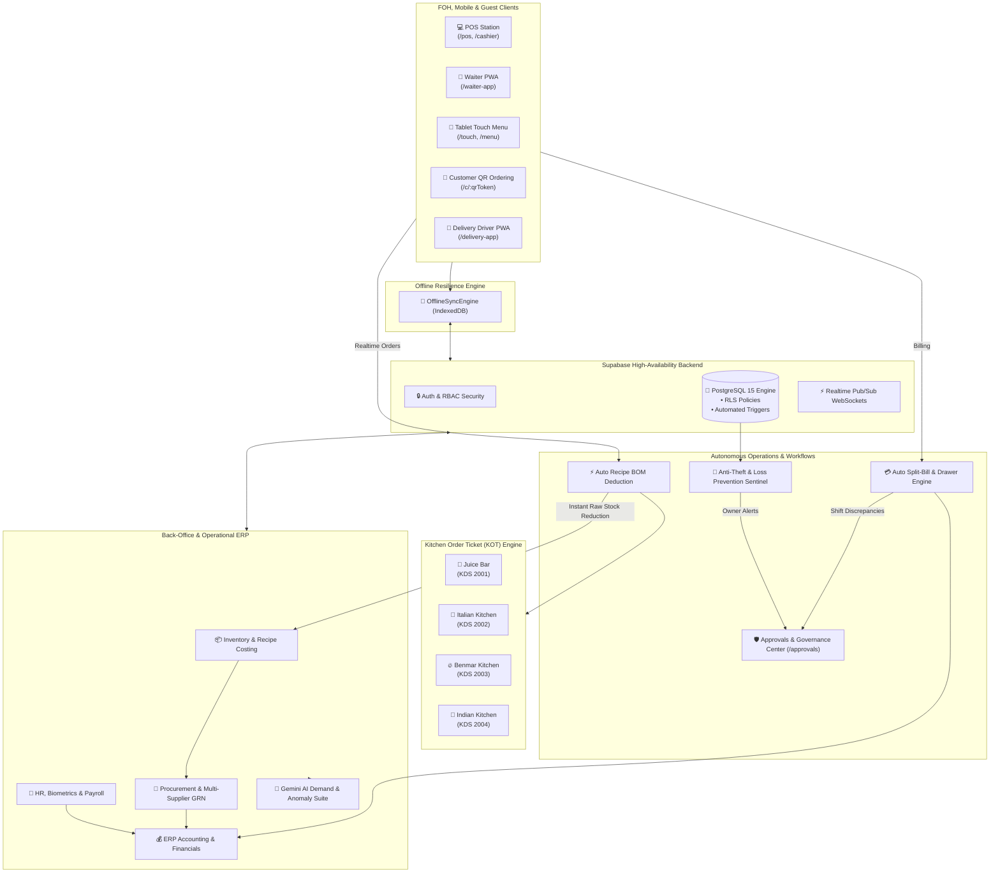

# 🌊 Seven Waves | Next-Gen Restaurant ERP & Operating System

<div align="center">


[](https://vuejs.org/)
[](https://quasar.dev/)
[](https://vitejs.dev/)
[](https://supabase.com/)
[](https://deepmind.google/technologies/gemini/)
[](https://tauri.app/)
[](https://capacitorjs.com/)
[](#)

**An ultra-modern, enterprise-grade restaurant management ecosystem engineered for high-volume restaurants, multi-kitchen hospitality resorts, cloud kitchens, and fine-dining franchises.**

[Automation Engine](#-enterprise-workflow--cashier-automation-engine) • [Live System Modules](#-system-modules--features-breakdown) • [Login Credentials](#-user-roles--login-credentials) • [Quick Start](#-quick-start-guide) • [Architecture](#-architecture--data-flow) • [Configuration](#-environment-variables)

</div>

---

## 🌟 Executive Summary

**Seven Waves Restaurant ERP** is a full-stack hospitality operating system connecting dining floor operations, multi-station kitchen preparation, supply-chain procurement, automated inventory deduction, full double-entry financial accounting, biometric human resources, and Gemini-powered artificial intelligence.

Designed to operate seamlessly on **Desktop (Tauri)**, **Web (PWA)**, and **Tablets/Mobile (Capacitor)**, with an enterprise **Offline Sync Engine** providing uninterrupted local service during network dropouts.

---

## 🔐 User Roles & Login Credentials

Every department in the ERP is guarded with granular **Role-Based Access Control (RBAC)**. Use the credentials below to test or evaluate specific functional areas:

| Department / Role              | User / Station Name     | Email / Identifier       | User Code / PIN | Password             | Target Entry URL     |
| :----------------------------- | :---------------------- | :----------------------- | :-------------: | :------------------- | :------------------- |
| **👑 System Administrator**    | Master Admin            | `admin@sevenwaves.lk`    |    _(None)_     | `Admin@123456`       | `/dashboard`         |
| **💳 Cashier / POS**           | Main Terminal Cashier   | `test@gmail.com`         |     `1010`      | `Test@123`           | `/pos` or `/cashier` |
| **🏃 Waiter / Steward**        | Service Waiter          | `dinushaud12@gmail.com`  |     `2007`      | `123456`             | `/waiter-app`        |
| **🍳 Kitchen Display (KDS 1)** | Juice Bar Station       | `juicebar@sevenwaves.lk` |     `2001`      | `Juice@123456`       | `/kitchen`           |
| **🍳 Kitchen Display (KDS 2)** | Italian & Pizza Station | `italian@sevenwaves.lk`  |     `2002`      | `Italian@123456`     | `/kitchen`           |
| **🍳 Kitchen Display (KDS 3)** | Benmar Hot Kitchen      | `benmar@sevenwaves.lk`   |     `2003`      | `Benmar@123456`      | `/kitchen`           |
| **🍳 Kitchen Display (KDS 4)** | Indian / Curry Station  | `indian@sevenwaves.lk`   |     `2004`      | `Indian@123456`      | `/kitchen`           |
| **📱 Guest / Customer**        | Public Dining Menu / QR | _(Public Session)_       |    _(None)_     | _(No Auth Required)_ | `/touch` or `/menu`  |

> 💡 **Quick PIN Login**: Front-of-house staff (Cashiers, Waiters, Kitchen Screens) can swiftly authenticate on touchscreens simply by punching in their **4-digit User Code** without entering a full email address.

---

## 🤖 Enterprise Workflow & Cashier Automation Engine

The Seven Waves system incorporates an advanced **Autonomous Business Logic & Operations Engine**. This layer eliminates manual delays, human error, and fraudulent activity across dining floor checkouts and administrative governance.

```
┌─────────────────────────────────────────────────────────────────────────────────┐
│                    SEVEN WAVES AUTONOMOUS OPERATIONS ENGINE                     │
├────────────────────────────────┬────────────────────────────────────────────────┤
│      CASHIER AUTOMATION        │          GOVERNANCE WORKFLOWS                  │
├────────────────────────────────┼────────────────────────────────────────────────┤
│ • Automated Order-to-Bill Flow │ • Unified Governance Approvals Inbox           │
│ • Instant Split-Bill Engine    │ • Multi-Tier Purchase Order Thresholds         │
│ • Realtime Recipe BOM Trigger  │ • Voucher Maker-Checker Segregation            │
│ • Blind Cash Shift Audit       │ • Locked Document Amendment Workflow           │
│ • WhatsApp & Paperless Invoices│ • Kitchen Wastage Authorization Pipeline       │
│ • Hardware Auto-Kick & Thermal │ • Anti-Theft AI Sentinel & WhatsApp Alerts     │
└────────────────────────────────┴────────────────────────────────────────────────┘
```

---

### I. Autonomous Cashier & Point-of-Sale (POS) Engine

#### 1. Instant Automated Order-to-Bill Pipeline

- **Zero-Touch Bill Consolidation**: Orders placed via Waiter PWAs, Contactless Table QRs, Tablet Touch Menus, or Online Delivery automatically funnel into the Cashier desk in real time without manual re-entry.
- **Auto-Calculated Surcharges & Taxes**:
  - Automatic configurable **10% Service Charge** allocation.
  - Automated **VAT** and **SSCL (Social Security Contribution Levy)** tax breakdown.
  - Dynamic rounding algorithm handling small currency unit change seamlessly.

#### 2. Advanced Split-Bill Calculation Engine

- **One-Touch Equal Split**: Divides total payable sum across _N_ dining guests with fractional cents balanced automatically.
- **Item-Level Selective Split**: Guests pay only for the exact dishes they consumed; remaining items stay on the active table ticket.
- **Multi-Tender Mixed Settlement**: A single transaction can automatically accept multiple tenders (e.g., _Rs. 5,000 Cash + Rs. 8,500 Visa Card + Rs. 1,000 Loyalty Reward Points_).

#### 3. Real-Time Recipe BOM Stock Deduction on Order Firing

- **Event-Driven Database Triggers**: The exact millisecond an order is placed or confirmed at the cashier desk, database triggers (`trg_order_items_kot_deduction`) immediately calculate the Bill of Materials (BOM) for each dish.
- **Live Ingredient Depletion**: Raw proteins, vegetables, dairy, and spices are deducted from the physical stock ledger in real time—giving restaurant managers 100% accurate up-to-the-minute stock balances.

#### 4. Blind Cash Drawer Reconciliation & Discrepancy Escalation

- **Tamper-Proof Blind Shift Closing**:
  - Cashiers enter physical cash counts (e.g., count of Rs. 5000, 1000, 500 notes) into the system **without seeing expected sales totals**.
  - The system compares actual drawer count against system receipts.
  - If a variance exceeds the safety threshold (e.g., variance > LKR 1,000 or < -LKR 1,000), the system **automatically flags an audit incident**, prevents quiet closure, and routes the shift directly to the Manager Approvals Center.

#### 5. Hardware & Paperless Invoicing Automation

- **ESC/POS Pulse Signal**: Automatically sends a 24V drawer-kick pulse to the cash drawer upon cash bill settlement.
- **Silent Thermal Ticket Dispatch**: Sends formatted receipt print jobs directly to 80mm/58mm thermal printers over LAN/USB.
- **Paperless Invoice Auto-Dispatch**: Direct automated customer dispatch via WhatsApp or SMS instantly upon payment confirmation.

#### 6. Automated Loyalty & Customer Points Accrual

- When a customer phone number is attached to a sale, points are computed and credited to their digital membership tier automatically based on active earning rules.

---

### II. Unified Enterprise Governance & Approvals Workflow Engine (`/approvals`)

The system features a **Unified Approvals & Governance Center (`ApprovalsCenterPage.vue`)** enforcing strict compliance across 7 specialized departments:

#### 1. Procurement Purchase Order (PO) Approval Workflow

- **Threshold-Based Routing**: Purchase orders exceeding designated financial limits automatically switch to `pending_approval` status.
- **Authorized Sign-off**: Storekeepers draft POs; Procurement Directors or General Managers approve them with a single click before documents are dispatched to suppliers.

#### 2. Finance Voucher Maker-Checker Segregation

- **Accounting Dual-Control**: Staff accountants enter Payment Vouchers (PV) or Receipt Vouchers (RV).
- **Ledger Commitment Gate**: Vouchers remain in `draft / pending` state and **cannot affect the general ledger or cashbook balances** until verified and authorized by a Finance Manager.

#### 3. Document Amendment & Tamper-Proof Unlock Workflow (`amendmentService.ts`)

- **Permanent Ledger Immutability**: Once a Goods Received Note (GRN), Supplier AP Invoice, or Customer Sale is posted, it is **cryptographically locked**.
- **Formal Request for Unlock**: If an error was made on an invoice, staff must submit a formal **Amendment Request** stating the exact reason.
- **Audit Trail**: Only authorized executives can approve the unlock. All previous values, editor identity, and modification timestamps are logged into immutable audit tables.

#### 4. Kitchen & Store Wastage Approval Pipeline

- **High-Cost Spoilage Oversight**: Whenever high-value proteins or wines spoil or burn in the kitchen, chefs log a wastage document.
- **Stock Ledger Impact**: The wastage document requires supervisory approval before stock write-off entries hit the Profit & Loss statement.

#### 5. POS Shift Variance Review Pipeline

- **High Over/Short Flagging**: Shifts with significant cash variances are routed into the governance inbox for manager interview and sign-off before cashier release.

#### 6. HR Leave, Shift Change & Salary Advance Approvals

- **Paperless Employee Requests**: Staff submit leave requests and salary advances via their mobile interface; managers receive actionable push notifications to approve or decline with feedback notes.

---

### III. Autonomous AI Sentinel & Incident Automation (`20260905_ai_enterprise_suite.sql`)

The ERP features 24/7 background AI sentinels monitoring operational transactions:

#### 1. Autonomous Anti-Theft & Loss Prevention Sentinel (`fn_audit_security_anomalies`)

- **Real-Time Suspicious Late-Void Audit**: Scans for orders voided or cancelled **10+ minutes after being sent to the kitchen** (a prime indicator of cashier pocketing cash after food has been prepared).
- **Abnormal Discount Monitoring**: Detects single discounts exceeding 20% or LKR 2,000 applied without supervisory notes.
- **Confidential Owner WhatsApp Broadcast**: Formats and automatically prepares executive WhatsApp security briefing directly to the restaurant owner's personal device (+94717462205) with risk ratings (`SECURE`, `WARNING`, `CRITICAL_RISK`).

#### 2. Morning Kitchen Demand & Prep Plan Generator (`fn_generate_kitchen_demand_forecast`)

- **30-Day Day-of-Week Velocity Engine**: Evaluates recent historical sales velocity for matching calendar days.
- **Autonomous Chef Briefing**: Automatically constructs projected guest covers, target portion estimates for top-selling signature items, and mis-en-place prep deadlines.
- **WhatsApp Formatted Daily Brief**: Creates a ready-to-dispatch morning WhatsApp plan for the Head Chef detailing defrosting targets and workstation setup tasks.

#### 3. Table-Side Negative Feedback Rescue Agent (`fn_submit_and_escalate_feedback`)

- **Real-Time Sentiment Triage**: When a diner leaves a 1-star or 2-star rating on their digital menu, the system immediately flags `is_negative_alert = TRUE`.
- **Instant Floor Escalation**: Alerts the floor manager's mobile PWA while the guest is **still seated at the table**, providing an immediate opportunity for service recovery before negative reviews reach Google Maps or social media.

---

## 🏗️ Architecture & Data Flow



---

## ⚡ System Modules & Features Breakdown

---

### 1. 🍽️ Point of Sale (POS) & Cashier Module

#### A. Dining Modes & Floor Management

- **Multi-Format Dining**: Seamlessly toggle between **Dine-In**, **Quick Takeaway**, **Room Delivery**, and **Third-Party Logistics**.
- **Live Visual Floor Plan**: Interactive real-time table layout indicating occupancy, occupied timers, active bill amounts, and reserved slots.
- **Dynamic Table Operations**: Instant table transfers, table merging (joining bills for large gatherings), and table splitting without interrupting ongoing orders.
- **Guest Seating & Seat-Wise Ordering**: Assign order items to specific seats (Seat 1, Seat 2, etc.) for streamlined split billing.

#### B. Order Taking & Customizations

- **Touch-Optimized Product Grid**: Fast category filtering, real-time search, item image thumbnails, and barcode scanner integration.
- **Deep Modifiers & Variations**: Support for sizing (Small, Regular, Large), cooking preferences (Rare, Medium, Well-Done), and combo side selections.
- **Allergen & Dietary Indicators**: Badges for Vegetarian, Vegan, Halal, Seafood, Nut-Free, and adjustable spice ratings directly visible to the cashier.
- **Kitchen Special Requests**: Free-text cooking notes per line item transmitted directly to kitchen displays.
- **Manager Authorized Overrides**: Gated approval prompts for price adjustments, high-tier promotional discounts, and line-item voiding with required reason logging.

#### C. Cashier Settlement & Billing (`/cashier`)

- **Flexible Split Billing**: Split bills equally among _N_ diners, split by exact item selections, or accept fractional split payments across multiple methods.
- **Multi-Tender Payment Processing**: Accept Cash, Credit/Debit Cards, QR Digital Wallets, Customer Credit / House Accounts, and Loyalty Points in a single bill.
- **Dynamic Surcharges & Taxes**: Automated calculation of 10% Service Charge, VAT, SSCL, and discretionary tips.
- **Receipt Generation & Dispatch**: Silent thermal receipt printing (80mm & 58mm ESC/POS), PDF invoice generation, and paperless WhatsApp/Email dispatch.

#### D. POS Shift Lifecycle & Drawer Control (`/finance/pos-shifts`)

- **Opening Float Registration**: Cashier counts and logs starting denominations before running transactions.
- **Mid-Shift Drawer Operations**: Secure cash drops (safe drops) to lower front-desk exposure, plus recorded petty cash expense payouts.
- **Blind End-of-Shift Reconciliation**: Cashiers count and enter physical currency without seeing expected system totals, completely eliminating theft and manipulation.
- **Comprehensive Z-Report**: Automated discrepancy calculation (Cash Over / Cash Short), total tender breakdowns, and supervisor sign-off lock.

---

### 2. 👨‍🍳 Smart Multi-Station Kitchen Display System (KDS)

#### A. Intelligent Multi-Kitchen Ticket Routing

- **Station-Based KOT Segregation**: When an order contains mixed dishes, the engine automatically splits and routes items to their respective specialized kitchen stations:
  - 🍹 **Juice Bar KDS (`Code 2001`)**: Beverages, mocktails, fresh juices, and desserts.
  - 🍕 **Italian Kitchen KDS (`Code 2002`)**: Pizzas, pastas, calzones, and oven bakes.
  - 🔥 **Benmar Hot Kitchen KDS (`Code 2003`)**: Fried rice, noodles, grilled meats, and seafood mains.
  - 🍛 **Indian Kitchen KDS (`Code 2004`)**: Curries, tandoor naans, biryanis, and traditional clay-oven dishes.

#### B. Preparation Timers & Visual Urgency Cues

- **Elapsed Time Tracking**: Every ticket features a running stopwatch displaying live preparation duration.
- **3-Tier Color Progression**:
  - 🟢 **Green (Normal)**: Order within target preparation SLA.
  - 🟡 **Yellow (Warning)**: Order approaching maximum threshold.
  - 🔴 **Red (Critical Delay)**: Overdue order pulsing with high-visibility alerts.
- **Audible Station Chimes**: Configurable acoustic alerts when new tickets arrive or when an order hits the urgent state.

#### C. Order Lifecycle & Bump Bar Controls

- **Status Progression Pipeline**: Single-touch transition: `Pending` ➔ `Cooking` ➔ `Ready for Pickup` ➔ `Served`.
- **Item-Level Bumping**: Chefs can strike off individual dishes as they leave the stove while keeping the rest of the ticket active.
- **Accidental Dismissal Recall**: Restore bumped tickets instantly from the completed history reel within seconds.

#### D. Waiter Paging & Service Coordination

- **Automated Steward Notifications**: The moment a kitchen marks an order as "Ready", an instant vibration and sound alert is dispatched directly to the assigned waiter's mobile PWA.

---

### 3. 📱 Mobile PWAs & Dedicated Field Portals

#### A. 🏃 Waiter Handheld Mobile PWA (`/waiter-app`)

- **Smartphone & Compact Tablet Optimized**: Ultra-fast touch interface designed for stewards walking the dining floor.
- **Tableside Digital Ordering**: Take orders directly at the table with modifier selections and push tickets instantly to the kitchen without walking back to the counter.
- **Floor Status at a Glance**: View live table status (Free, Active, Ready Food, Awaiting Bill).
- **Ready Alert Inbox**: Dedicated tab alerting the steward the exact moment dishes are placed on the kitchen pass.
- **Waiter Shift Performance**: Track personal sales volume, active tables served, and accumulated tips/commissions in real time.

#### B. 👔 Manager Floor Supervisor PWA (`/manager-app`)

- **Live Floor Monitoring**: Real-time overview of active dining tables, occupancy turnover rates, and average dining times.
- **Kitchen Bottleneck Heatmap**: Monitor live preparation delays across all 4 KDS stations remotely from anywhere on the floor.
- **Remote Authorization Gateway**: Authorize item voids, order cancellations, and bill discounts on stewards' devices via remote push notification without physically walking over.
- **Internal Staff Broadcasts**: Send urgent announcements and station messages to all working crew.

#### C. 🛵 Delivery Courier Dispatch PWA (`/delivery-app`)

- **Assigned Deliveries Queue**: Live list of orders dispatched for delivery with customer addresses, delivery instructions, and phone call hotlinks.
- **Interactive Navigation Mapping**: Built-in Leaflet GPS route map displaying optimal paths to customer destinations.
- **Cash-on-Delivery (COD) Reconciliation**: Log cash collected at the customer's doorstep with instant balance updates.
- **Proof of Delivery**: Digital customer signature capture and delivery completion timestamping.

---

### 4. 📖 Digital Touch Menu Book & Customer Self-Service

#### A. Interactive Luxury Tablet Menu (`/touch`)

- **Guest Table Stand Tablet App**: Built specifically for Android and iPad tablets placed on dining tables.
- **Rich Visual Catalog**: High-definition dish photography, chef stories, flavor profiles, and spice indicators.
- **Dynamic Dietary & Allergy Filters**: Filter menu items instantly by Vegetarian, Vegan, Gluten-Free, Halal, Seafood, Nut-Free, and Dairy-Free.
- **Smart Cross-Selling & Combos**: AI-suggested pairings (e.g., _"Pairs perfectly with Fresh Lime Mint Juice"_).

#### B. Contactless QR Table Ordering (`/c/:qrToken`, `/table/:sessionToken/menu`)

- **Zero-App-Install**: Diners scan a QR sticker on their table with their smartphone camera to open the full digital ordering menu.
- **Geo-Fenced Table Sessions**: Dynamic cryptographic session tokens prevent fraudulent ordering from outside the venue.
- **Live Visual Order Tracker (`/menu/track/:orderId`)**: Real-time interactive progress bar: _Order Received ➔ Kitchen Preparing ➔ Plating ➔ On its way to your Table_.

#### C. Customer CRM & Digital Loyalty Portal (`/loyalty`, `/admin/loyalty`)

- **Digital Loyalty Pass**: Customers view their accumulated points, rewards, and personalized QR code.
- **Tiered Membership Progression**: Bronze ➔ Silver ➔ Gold ➔ Platinum with tier-specific perks and discounts.
- **Flexible Earning Rules**: Configure points earned per rupee spent, promotional multiplier hours, and birthday discount vouchers.

---

### 5. 🌐 Website Orders, Table Reservations & Banquets

#### A. Direct Online Food Delivery & Takeaway (`/website-orders`)

- **Zero-Commission Direct Channel**: Receive pickup and delivery orders directly from the restaurant website without third-party aggregator commissions.
- **Real-time Order Acceptance**: Confirm orders, select estimated preparation times, and auto-fire tickets to the kitchen.

#### B. Online Table Reservation Engine (`/website-reservations`)

- **Web Guest Bookings**: Guests reserve dining tables by selecting date, time slot, party size, and seating area (indoor, outdoor, seaside).
- **Automated Confirmation Pipeline**: Automated email/SMS confirmations, status tracking (Confirmed, Arrived, No-Show), and floor plan table assignment.

#### C. Banquet & Event Hall Management (`/website-hall-bookings`)

- **Function Hall Bookings**: Reserve reception halls for weddings, corporate banquets, and private parties.
- **Event Logistics Tracking**: Manage advance deposits, package menus, stage setups, and custom catering schedules.

#### D. Customer Communications & QR Suite

- **Website Inquiries (`/website-messages`)**: Centralized inbox for catering inquiries and guest feedback.
- **Branded QR Generator (`/website-menu-qr`)**: Generate print-ready high-resolution QR codes for physical table stands, tent cards, and marketing brochures.

---

### 6. 📦 Inventory, Recipe Costing & Portion Control

#### A. Master Item Catalog (`/inventory/items`)

- **Comprehensive Cataloging**: Classify items into Raw Ingredients, Semi-Finished Preps, Finished Goods, Packaging, and Beverages.
- **Dual Unit of Measure (UOM)**: Seamlessly handle Purchase UOMs (e.g., 50kg sacks, crates, drums) and Inventory/Recipe UOMs (e.g., Grams, Milliliters, Pieces) with conversion factors.
- **Reorder Level Monitoring**: Automated stock health indicators with minimum stock and critical low-stock visual badges.

#### B. Recipe Yield & Live KOT Ingredient Deduction (BOM)

- **Bill of Materials (BOM)**: Link every sellable menu dish to exact ingredient portion weights (e.g., _1 Burger = 180g Beef Patty, 1 Brioche Bun, 20g Sauce, 15g Lettuce_).
- **Automatic KOT Realtime Deduction**: When orders are placed at POS or KDS, raw ingredients are **automatically deducted from inventory ledgers in real time via database triggers**.
- **Sub-Recipe Nesting**: Support for multi-tier batch preps (e.g., house-made tomato sauces, marinades, cake bases).

#### C. Recipe Margin Analyzer (`RecipeMarginTab.vue`)

- **Live Food Cost Percentage (FC%)**: Dynamic computation of cost per portion based on the latest raw material purchase prices.
- **Profitability Matrix**: Identifies high-margin "Stars", volume "Plowhorses", and low-margin "Puzzles" needing recipe or pricing adjustments.

#### D. Physical Stocktake & Variance Audits (`/inventory/stocktake`)

- **Digital Stocktake Sheets**: Perform periodic counts using tablets and barcode scanners.
- **Variance Computation**: Compares theoretical book stock against physical counts, highlighting discrepancies in quantity and monetary value.
- **Automated Reconciliation**: One-click variance journal posting with reason tracking (spoilage, shrinkage, theft).

#### E. Stock Adjustments & Spoilage Log (`/inventory/adjustments`)

- **Departmental Wastage Logging**: Record spoilage, kitchen prep burn, handling breakages, and expiration losses.
- **Supervisor Sign-off**: Restrict write-offs to authorized personnel with audit notes.

#### F. Multi-Warehouse & Inter-Store Transfers

- **Multi-Store Management**: Track separate inventories for Main Bulk Cold Room, Dry Store, Kitchen Sub-Store, and Bar Store.
- **Goods Issue Notes (GIN) (`/procurement/gin`)**: Track formal internal requisitions and stock transfers between physical storerooms.

---

### 7. 🚚 Procurement & Multi-Supplier Supply Chain

#### A. Multi-Supplier Catalog & Pricing Matrix (`/procurement/suppliers`)

- **Vendor Master Profiles**: Maintain business registration, VAT/Tax IDs, payment terms, and bank details.
- **Multi-Supplier Item Mapping (`supplier_item_prices`)**: Link a single raw material (e.g., _Fish_) to multiple suppliers with supplier-specific prices, minimum order quantities, and lead times.

#### B. Purchase Orders (PO) (`/procurement/purchase-orders`)

- **PO Workflow**: Create formal purchase orders with expected arrival dates and multi-line item breakdowns.
- **Vendor Communication**: Export print-ready PDFs and send automated PO emails directly to suppliers.

#### C. Goods Received Notes (GRN) (`/procurement/grn`)

- **Direct & PO-Linked Receipts**: Receive stock directly from suppliers or reconcile deliveries against outstanding POs.
- **Dynamic Daily Unit Price Entry**: Fully editable unit price column allowing storekeepers to record exact invoice prices, handling market fluctuations smoothly.
- **Automatic Stock Inwarding**: Posting a GRN updates warehouse stock levels, writes to the inventory ledger, and recomputes valuations instantly.
- **Weighted Average Costing (WAC)**: Stock values are calculated using true quantity-weighted average costs across receipts.

#### D. Accounts Payable (AP) & Invoices (`/procurement/ap-invoices`)

- **Three-Way Invoice Matching**: Reconcile Purchase Order ➔ Goods Received Note ➔ Supplier Invoice to prevent overbilling.
- **AP Aging Ledger**: Monitor outstanding vendor liabilities across 30, 60, and 90+ day credit terms.

#### E. Supplier Payments & Allocation (`/procurement/payments`)

- **Bulk Invoice Settlement**: Settle multiple pending supplier bills in a single bank transfer or cheque payout.
- **Exact Allocation Tracking**: Link payments precisely against specific invoice reference numbers for transparent reconciliation.

#### F. Purchase Returns & Debit Notes (`/procurement/returns`)

- **Return of Damaged Stock**: Process returns for spoiled or sub-standard goods with automated debit notes and ledger reversals.

---

### 8. 💰 Enterprise Financial Accounting & Banking

#### A. Chart of Accounts & General Ledger (`/finance/ledgers`, `/finance/accounts`)

- **Double-Entry Accounting Engine**: Fully compliant general ledger architecture adhering to standard accounting principles.
- **Hierarchical Account Trees**: Assets, Liabilities, Equity, Revenue, Cost of Goods Sold (COGS), and Operating Expenses.

#### B. Voucher Management System

- **Payment Vouchers (PV) (`/finance/pay-vouchers`)**: Record disbursements for vendor payables, utility bills, maintenance, and asset acquisitions.
- **Receipt Vouchers (RV) (`/finance/received-vouchers`)**: Record cash receipts, bank deposits, catering deposits, and debtor settlements.
- **Journal Vouchers (JV)**: Post non-cash adjustments, asset depreciation, and period-end accruals.
- **Voucher Approvals Workflow (`/finance/voucher-approvals`)**: Strict segregation of duties—vouchers entered by staff require managerial sign-off before committing to the general ledger.

#### C. Treasury, Cash & Banking Operations

- **Main Cashbook (`/finance/cashbook`)**: Continuous audit log of cash movements across registers, petty cash, and the company vault.
- **Petty Cash Imprest Book (`/finance/petty-cash`)**: Manage small daily operational expenses with receipt scanning and replenishment vouchers.
- **Post-Dated Cheque (PDC) Planner (`/finance/cheque-plan`)**: Track issued and received cheques with maturity alerts, bank presentation logs, and bounce handling.
- **Bank Reconciliation Engine (`/finance/bank-reconciliation`)**: Match internal bank accounts against physical bank statements to identify unpresented cheques and interest fees.

#### D. Statutory Financial Statements (`/finance/financial-statements`)

- **Balance Sheet**: Comprehensive snapshot of assets, liabilities, and owners' equity.
- **Profit & Loss (Income Statement)**: Real-time calculation of gross profit, food cost percentage (FC%), operational expenses, and net profit.
- **Trial Balance**: Complete debit/credit verification report with date range filters.
- **Sri Lankan Tax Management (`/finance/tax`)**: VAT (Value Added Tax) and SSCL (Social Security Contribution Levy) statutory summaries.

#### E. Fiscal Period Closing & Locks (`/finance/fiscal-periods`)

- **Period End Controls**: Lock completed months and financial years to permanently prevent retroactive tampering.

---

### 9. 👥 Human Resources, Biometrics & Automated Payroll

#### A. Employee Directory (`/hr/employees`)

- **Comprehensive Digital Profiles**: Personal details, statutory national IDs, designated job roles, emergency contacts, and banking details.

#### B. Biometric Time & Attendance (`/hr/attendance`)

- **Hardware Attendance Integration**: Connects with biometric fingerprint and facial recognition terminals.
- **Automated Hours Calculation**: Calculates work hours, late clock-ins, early departures, and overtime automatically.

#### C. Shift Rostering & Scheduling (`/hr/shifts`)

- **Visual Staff Rosters**: Schedule kitchen, service, and administrative shifts with conflict detection and coverage warnings.

#### D. Leave Management (`/hr/leave`)

- **Leave Tracking**: Annual, Casual, Medical, and Unpaid leave applications with balance tracking and supervisor approval.

#### E. Automated Payroll & Tax Engine (`/hr/payroll`)

- **Configurable Salary Structures**: Basic Salary, Budgetary Relief Allowance, Attendance Allowance, and Fixed Allowances.
- **Statutory Compliance**: Automated computation of **EPF (Employee 8% / Employer 12%)** and **ETF (Employer 3%)**.
- **Overtime (OT) Engine**: Auto-computes normal weekday OT and holiday double-time rates from verified biometric hours.
- **Deductions & Advances**: Process salary advance repayments, uniform deductions, and disciplinary fines.
- **PDF Payslips (`/finance/payroll/payslips`)**: One-click generation of professional payslips ready for printing or digital distribution.

#### F. Steward Sales Commission Engine (`/hr/commission`)

- **Performance-Based Pay**: Calculates sales commissions for stewards and cashiers based on verified revenue settled during their shifts.

#### G. Exit & Resignation Settlements (`/hr/resignation`)

- **End of Service Processing**: Manage notice periods, exit interviews, and final gratuity settlements.

---

### 10. 🤖 AI Enterprise Suite (Powered by Google Gemini)

#### A. Predictive Demand & Sales Forecasting (`/ai/forecasts`)

- **AI Demand Modeling**: Evaluates historical sales data, weekday trends, and holiday spikes to forecast customer footfall, projected revenue, and raw ingredient requirements for upcoming days.
- **Waste Prevention**: Eliminates over-purchasing of perishable items like seafood, dairy, and fresh produce.

#### B. AI Fraud & Anomaly Detection Center (`/ai/anomalies`)

- **Real-time Operational Auditing**: AI algorithms scan transactions to flag irregularities:
  - Suspicious bill cancellations after food preparation.
  - Unusual cash drawer opens without a corresponding sale.
  - Disproportionately high discounts applied by specific staff members.
  - Off-hour inventory adjustments and excessive wastage spikes.
- **Risk Categorization**: Categorizes findings by threat level (Low, Medium, High, Critical) with root-cause explanations and corrective actions.

#### C. Natural-Language Business Assistant (`/ai/assistant`, `/admin/ai-insights`)

- **Executive Decision Intelligence**: Ask conversational questions in plain English:
  - _"What was our food cost percentage this weekend compared to last weekend?"_
  - _"Which dishes produced the highest profit margin in the Italian section?"_
  - _"Highlight the top suppliers who increased prices this quarter."_

---

### 11. 🖨️ Hardware Hub & Peripheral Integration

#### A. Thermal Printers & KOT Dispatch (`/devices/printers`)

- **ESC/POS Standards**: Network (LAN/Ethernet), USB, and Bluetooth support for 80mm and 58mm thermal printers.
- **Multi-Printer Routing**: Independent printer mapping for cashier bill printers and dedicated KOT printers at each kitchen station.

#### B. Scanners & Biometrics (`/devices/scanners`, `/devices/biometrics`)

- **Barcode & QR Scanners**: Rapid barcode scanning for inventory counts and customer loyalty cards.
- **Biometric Terminal Integration**: Synchronizes attendance logs directly from networked biometric hardware.

#### C. Hardware Health & Diagnostics (`/devices/health`)

- **Real-Time Heartbeat**: Monitors connectivity status, paper status, and latency across all connected peripherals.

---

### 12. 🔄 Enterprise Offline Resilience Engine

#### A. OfflineSyncEngine (`src/core/offline/OfflineSyncEngine.ts`)

- **Client-Side IndexedDB Storage**: FOH staff (Cashiers, Waiters) continue placing orders and generating bills even if local internet drops.
- **Bi-Directional Replay Queue**: Automatically replays and syncs offline transactions to the Supabase cloud database upon reconnection with collision prevention.

---

### 13. 📊 Advanced Enterprise Reporting Suite (25+ Reports)

#### A. Sales & Revenue Analytics

- **Electronic Journal**: Complete transaction-level operational log.
- **Item-Wise Sales**: Quantity sold, gross revenue, and contribution margin per dish.
- **Waiter-Wise Performance**: Sales volume, tips, and average ticket size per steward.
- **Table-Wise Turnover**: Table occupancy frequency, dwell times, and revenue per seat.
- **Hourly Sales Heatmaps**: Peak operational hours for staffing optimization.
- **Category Share**: Revenue distribution across food, beverages, and retail categories.
- **Branch-Wise Sales**: Multi-outlet revenue comparison.
- **Discounts & Voids Audit**: Tracks all promotional discounts and cancelled orders with authorization details.
- **Payment Methods**: Breakdown of revenue by Cash, Card, Digital Wallet, and Credit.

#### B. Operational & Kitchen Reports

- **KOT Preparation SLA**: Cooking durations, station turnaround times, and delay analysis.
- **Order Status Tracking**: Progress flow and bottlenecks from placement to service.
- **Item Availability Log**: Track when dishes were marked 86'd out-of-stock.
- **Delivery Performance**: Average delivery turnaround time and courier performance.
- **Daily Kitchen Usage**: Daily kitchen consumption analysis.
- **Customer Dining History**: Guest visit frequency, preferences, and lifetime value.

#### C. Inventory & Procurement Reports

- **Stock on Hand**: Current physical stock balances with total valuations.
- **Inventory Ledger**: Complete In/Out/Balance movement audit trail per item.
- **Wastage & Spoilage Report**: Cost analysis of all logged waste.
- **Ingredient Consumption**: Theoretical vs. actual ingredient usage.
- **Reorder Level Alerts**: Items approaching or below minimum safety stock.
- **Stocktake Variances**: Physical count vs. book inventory discrepancies.
- **Supplier Purchases**: Total purchasing volume broken down by vendor.
- **GRN Receipts**: Detailed log of all inward goods receipts.

#### D. Financial & Administrative Reports

- **Daily Cash Summary**: Register balances, cash drops, and drawer reconciliation.
- **Expense Summary**: Operating expenses broken down by general ledger code.
- **Accounts Aging**: Accounts Payable (AP) and Accounts Receivable (AR) schedules.
- **System Audit Trail (`/audit`)**: Security logs recording user actions, logins, and master price changes.

---

## 💻 Tech Stack Overview

| Category                    | Technology                                                                                           |
| :-------------------------- | :--------------------------------------------------------------------------------------------------- |
| **Frontend Framework**      | [Vue 3 (Composition API)](https://vuejs.org/) + [TypeScript](https://www.typescriptlang.org/)        |
| **UI Component Suite**      | [Quasar Framework v2.16+](https://quasar.dev/)                                                       |
| **Build & Tooling**         | [Vite 5](https://vitejs.dev/) + [@quasar/app-vite](https://quasar.dev/quasar-cli-vite/)              |
| **State Management**        | [Pinia 3](https://pinia.vuejs.org/)                                                                  |
| **Database & Realtime**     | [Supabase](https://supabase.com/) (PostgreSQL 15, Row Level Security, Triggers, Realtime WebSockets) |
| **Desktop Runtime**         | [Tauri v2](https://tauri.app/) (Rust-backed lightweight native executable)                           |
| **Mobile Runtime**          | [Capacitor 7](https://capacitorjs.com/) (iOS & Android native wrappers)                              |
| **Artificial Intelligence** | [Google Generative AI SDK](https://www.npmjs.com/package/@google/generative-ai) (Gemini Models)      |
| **Data Visualization**      | [ApexCharts](https://apexcharts.com/) + vue3-apexcharts                                              |
| **Document Processing**     | ExcelJS, XLSX, jsPDF, html2pdf.js, QRCode                                                            |
| **Mapping Engine**          | [Leaflet](https://leafletjs.com/) for dispatch logistics                                             |
| **Error Monitoring**        | [Sentry Vue](https://sentry.io/) APM                                                                 |

---

## 🚀 Quick Start Guide

### Prerequisites

- **Node.js**: v18.16.0 or higher
- **Package Manager**: `npm` (v9+) or `yarn`
- **Quasar CLI**: `npm install -g @quasar/cli`

### 1. Clone & Install Dependencies

```bash
# Clone the repository
git clone https://github.com/dinu12141/Seven-Waves-Restaurant---ERP.git
cd "Seven-Waves-Restaurant---ERP"

# Install dependencies
npm install
```

### 2. Configure Environment Variables

Create a `.env` file in the root directory:

```env
VITE_SUPABASE_URL=https://your-project.supabase.co
VITE_SUPABASE_ANON_KEY=your-anon-key-here
VITE_GEMINI_API_KEY=your-gemini-api-key-here
VITE_APP_ENV=development
```

### 3. Start Development Server

```bash
quasar dev
```

The application will launch automatically at:
👉 **Local Web Interface**: `http://localhost:9000`

---

## 🛠️ Build & Deployment Scripts

```bash
# 1. Run local test suites
npm run test

# 2. Code Linting & Formatting
npm run lint
npm run format

# 3. Security pre-build check (Prevents service-key leaks)
npm run check:secrets

# 4. Production Web Build
npm run build:production

# 5. Build Desktop Executable (Tauri)
npm run tauri build

# 6. Synchronize Mobile Assets (Capacitor)
npx cap sync
```

---

## 📁 Project Directory Structure

```
restaurant-erp/
├── src/
│   ├── components/       # Reusable Quasar & ERP design components
│   │   ├── common/       # BaseDataGrid, ERPPageHeader, StatusChips
│   │   ├── inventory/    # Stock tabs, Recipe Margin calculation, ItemsTab
│   │   ├── pos/          # Cart, Bill split, Modifier selectors, Shift dialogs
│   │   ├── procurement/  # DocLinesEditor, DocHeader, Payment Allocation
│   │   └── touch-menu/   # Touch Menu Book components & allergen tags
│   ├── layouts/          # Responsive application layouts
│   │   ├── MainLayout.vue        # Back-office ERP desktop layout
│   │   ├── KDSLayout.vue         # Fullscreen ultra-dark kitchen display
│   │   ├── WaiterAppLayout.vue   # Mobile PWA waiter layout
│   │   ├── ManagerAppLayout.vue  # Mobile PWA floor supervisor layout
│   │   ├── DeliveryAppLayout.vue # Mobile courier dispatch layout
│   │   └── TouchMenuLayout.vue   # Customer touchscreen tablet layout
│   ├── modules/          # Domain-specific bounded contexts
│   │   ├── ai/           # Gemini forecasts, Anomaly center, AI Assistant
│   │   ├── devices/      # ESC/POS printers, Barcode scanners, Biometrics
│   │   ├── finance/      # Vouchers, Cashbook, Cheques, Statements
│   │   └── pos/          # POS order lifecycle, Kitchen order ticket routing
│   ├── pages/            # Core views & route handlers (60+ pages)
│   ├── services/         # Supabase API clients & business logic
│   ├── stores/           # Pinia stores (auth, pos, cart, devices, offline)
│   └── core/             # Offline sync engine, IndexedDB adapters, security
├── supabase/             # Database migrations, RLS policies, seed SQL
│   ├── migrations/       # Version-controlled schema migrations
│   └── procurement.sql   # Supply-chain and costing triggers
└── tauri/                # Native desktop build configuration
```

---

## 📄 License & Intellectual Property

Copyright © 2026 **Seven Waves Restaurant Management System**.  
All rights reserved. Unauthorized copying, distribution, or decompilation of this software is strictly prohibited.

Developed with ❤️ for high-performance culinary & hospitality excellence.
