# UML Diagrams
## Seven Waves Restaurant ERP
**Version:** 1.0 | **Date:** 2026-07-16 | **Author:** Analyst Agent

All diagrams use Mermaid syntax. Render at https://mermaid.live or in any Mermaid-compatible viewer.

---

## 1. Use Case Diagram — All Actors & Use Cases

```mermaid
graph TD
    %% Actors
    Admin(["👤 Admin"])
    Manager(["👤 Manager"])
    Cashier(["👤 Cashier"])
    Waiter(["👤 Waiter"])
    Kitchen(["👤 Kitchen Staff"])
    Rider(["👤 Delivery Rider"])
    HROfficer(["👤 HR Officer"])
    Finance(["👤 Finance Officer"])
    Inventory(["👤 Inventory Manager"])
    Procurement(["👤 Procurement Officer"])
    Customer(["👤 Customer"])

    %% POS Use Cases
    subgraph POS["POS Module"]
        UC_AddItem["Add Items to Cart"]
        UC_Discount["Apply Discount"]
        UC_QuickPay["Quick Pay"]
        UC_ParkOrder["Park Order"]
        UC_VoidOrder["Void Order"]
    end

    %% Kitchen Use Cases
    subgraph KDS["Kitchen Display"]
        UC_StartKOT["Start KOT"]
        UC_MarkReady["Mark KOT Ready"]
        UC_PrintKOT["Print KOT"]
    end

    %% Waiter Use Cases
    subgraph WaiterApp["Waiter App"]
        UC_AcceptOrder["Accept Order"]
        UC_MarkUnavail["Mark Item Unavailable"]
        UC_ReadyAlert["Receive Ready Alert"]
    end

    %% Online Ordering
    subgraph QR["QR / Kiosk"]
        UC_ScanQR["Scan QR Code"]
        UC_KioskOrder["Place Kiosk Order"]
        UC_TrackOrder["Track Order"]
    end

    %% Finance
    subgraph Fin["Finance"]
        UC_Voucher["Create Voucher"]
        UC_Approve["Approve Voucher"]
        UC_Reports["Generate Financial Statements"]
        UC_Payroll["Run Payroll"]
    end

    %% HR
    subgraph HR["HR Module"]
        UC_Attendance["Record Attendance"]
        UC_Leave["Apply for Leave"]
        UC_ApproveLeave["Approve Leave"]
    end

    %% Inventory
    subgraph Inv["Inventory"]
        UC_GRN["Post GRN"]
        UC_StockAdj["Adjust Stock"]
        UC_StockTake["Perform Stock Take"]
    end

    %% Delivery
    subgraph Del["Delivery"]
        UC_AssignRider["Assign Rider"]
        UC_AcceptDel["Accept Delivery"]
        UC_MarkDelivered["Mark Delivered"]
    end

    %% Admin
    subgraph Adm["Administration"]
        UC_ManageUsers["Manage Users"]
        UC_ManageBranch["Manage Branches"]
        UC_ManageRoles["Manage Roles"]
    end

    Admin --> UC_ManageUsers
    Admin --> UC_ManageBranch
    Admin --> UC_ManageRoles
    Admin --> UC_Reports

    Manager --> UC_Discount
    Manager --> UC_VoidOrder
    Manager --> UC_AssignRider
    Manager --> UC_ApproveLeave
    Manager --> UC_Reports

    Cashier --> UC_AddItem
    Cashier --> UC_Discount
    Cashier --> UC_QuickPay
    Cashier --> UC_ParkOrder
    Cashier --> UC_VoidOrder

    Waiter --> UC_AcceptOrder
    Waiter --> UC_MarkUnavail
    Waiter --> UC_ReadyAlert
    Waiter --> UC_AddItem

    Kitchen --> UC_StartKOT
    Kitchen --> UC_MarkReady
    Kitchen --> UC_PrintKOT

    Rider --> UC_AcceptDel
    Rider --> UC_MarkDelivered

    HROfficer --> UC_Attendance
    HROfficer --> UC_ApproveLeave
    HROfficer --> UC_Payroll

    Finance --> UC_Voucher
    Finance --> UC_Approve
    Finance --> UC_Reports

    Inventory --> UC_GRN
    Inventory --> UC_StockAdj
    Inventory --> UC_StockTake

    Procurement --> UC_GRN

    Customer --> UC_ScanQR
    Customer --> UC_KioskOrder
    Customer --> UC_TrackOrder
    Customer --> UC_Leave
```

---

## 2. Activity Diagram — QR Order Flow

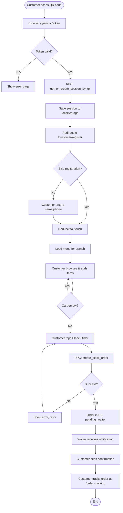

---

## 3. Activity Diagram — POS Payment Flow

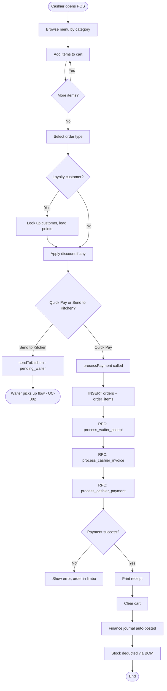

---

## 4. Sequence Diagram — QR Order Flow (End-to-End)

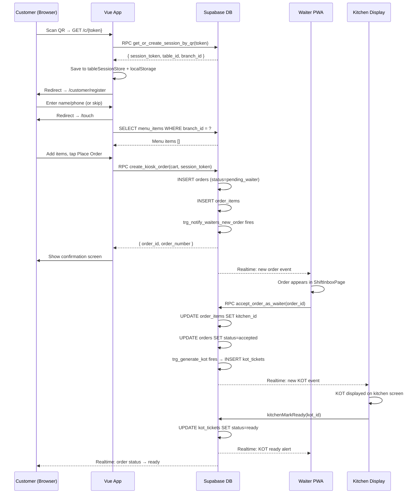

---

## 5. Sequence Diagram — POS Payment Flow

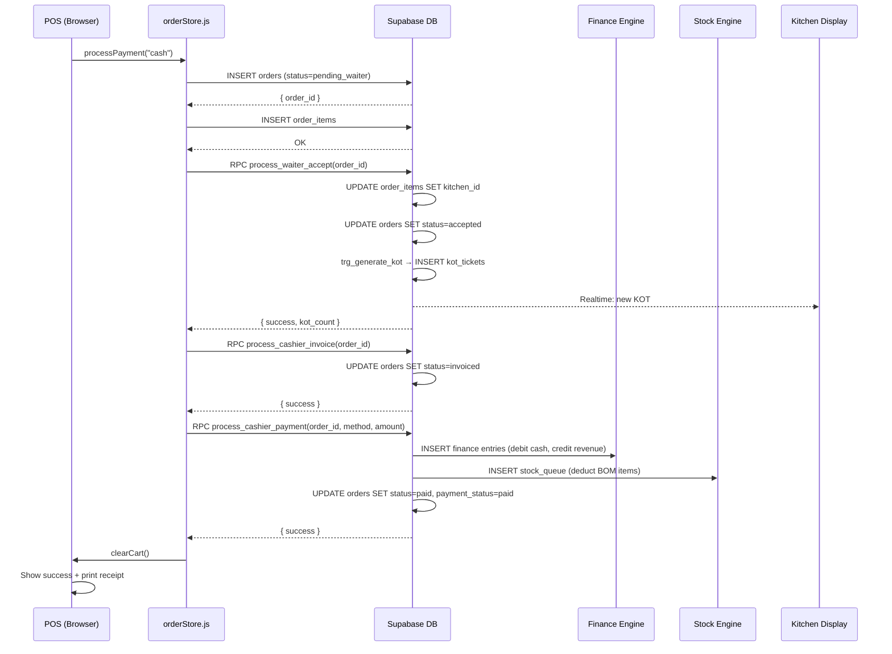

---

## 6. Sequence Diagram — Waiter Accept Order + KOT Generation

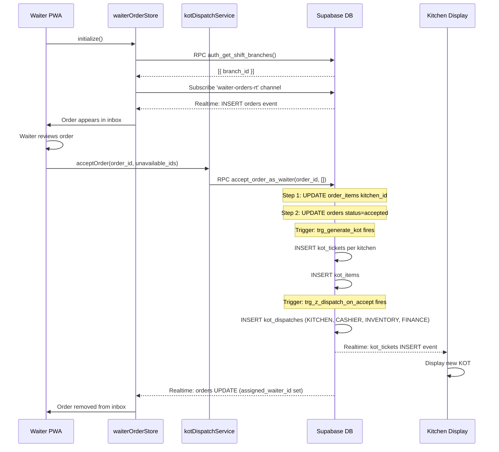

---

## 7. Sequence Diagram — Kitchen Mark Ready + Serve

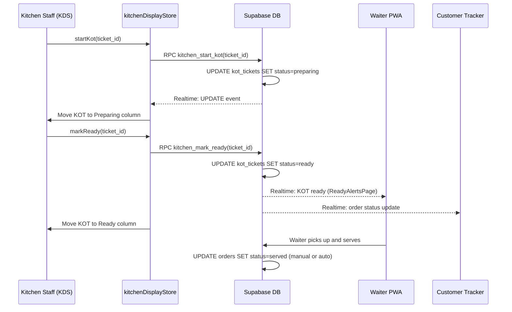

---

## 8. Sequence Diagram — Online Order + Delivery Assignment

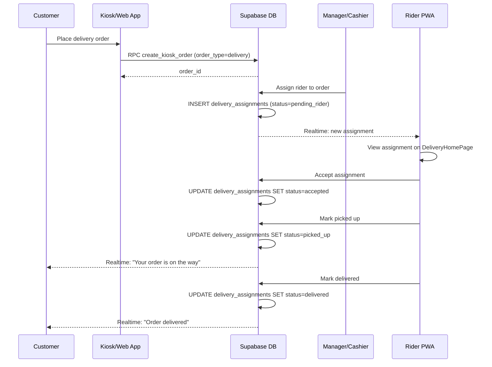

---

## 9. State Diagram — Order Lifecycle

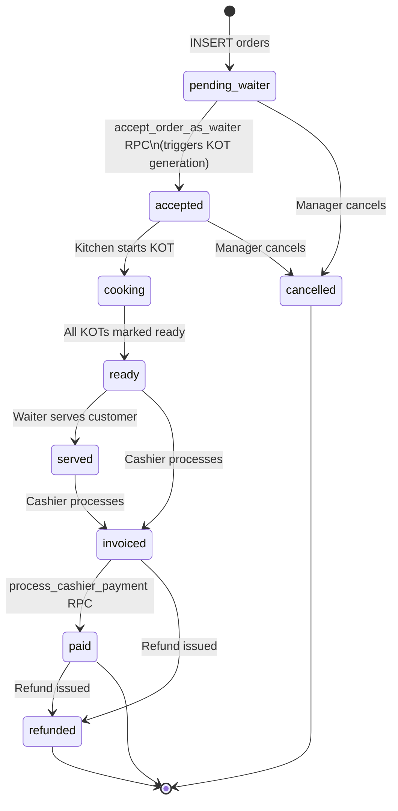

---

## 10. State Diagram — Table Lifecycle

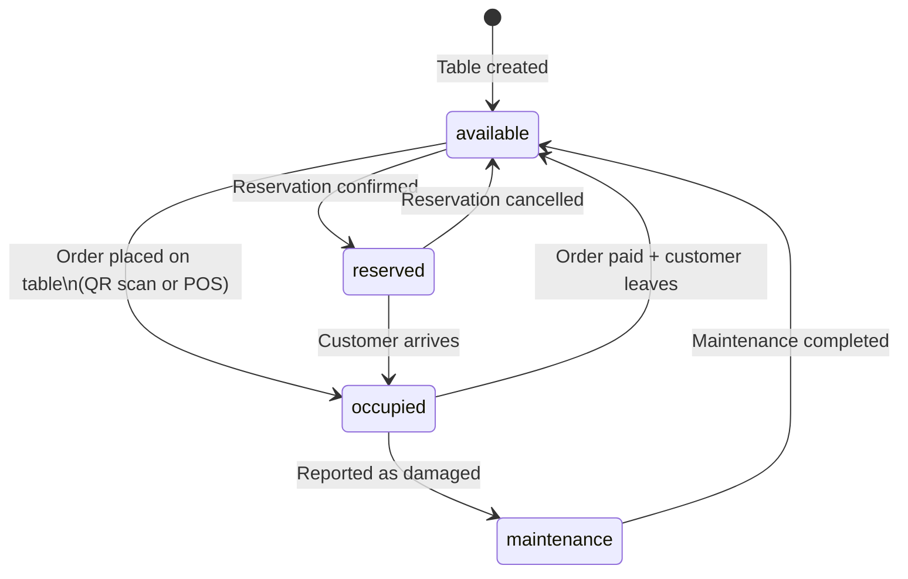

---

## 11. State Diagram — Delivery Lifecycle

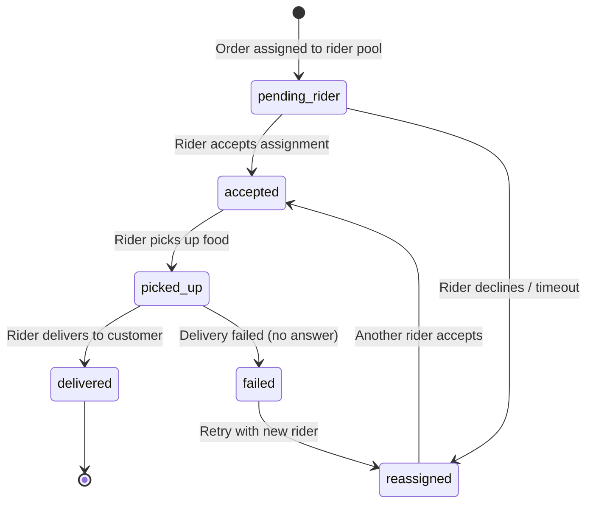

---

## 12. Data Flow Diagram — Level 0 (Context Diagram)

```mermaid
graph LR
    Customer(["Customer"]) -->|Order / QR scan| System[/"Seven Waves ERP"\]
    System -->|Order confirmation / tracking| Customer

    Staff(["Restaurant Staff"]) -->|Manage operations| System
    System -->|Orders / KOTs / Reports| Staff

    Suppliers(["Suppliers"]) -->|GRN / Invoices| System
    System -->|POs / Payments| Suppliers

    PayGateway(["Payment Gateway"]) <-->|Payment auth / confirm| System

    BiometricDev(["Biometric Devices"]) -->|Attendance data| System
    Printers(["Printers"]) <--|ESC/POS commands| System

    Supabase(["Supabase DB"]) <-->|All persistence| System
```

---

## 13. Data Flow Diagram — Level 1 (Main Processes)

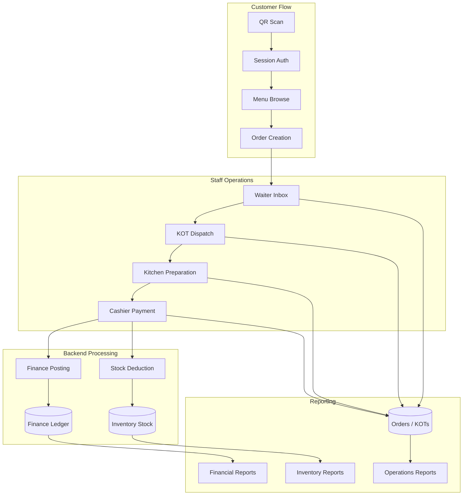

---

## 14. Data Flow Diagram — Level 2 (Order Subsystem)

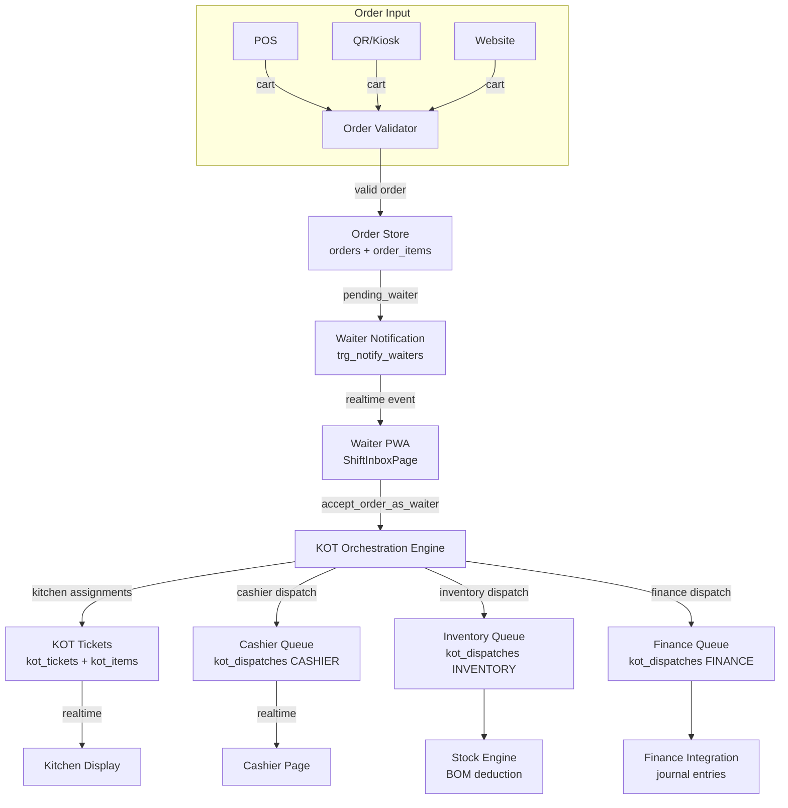

---

## 15. Data Flow Diagram — Level 2 (Finance Subsystem)

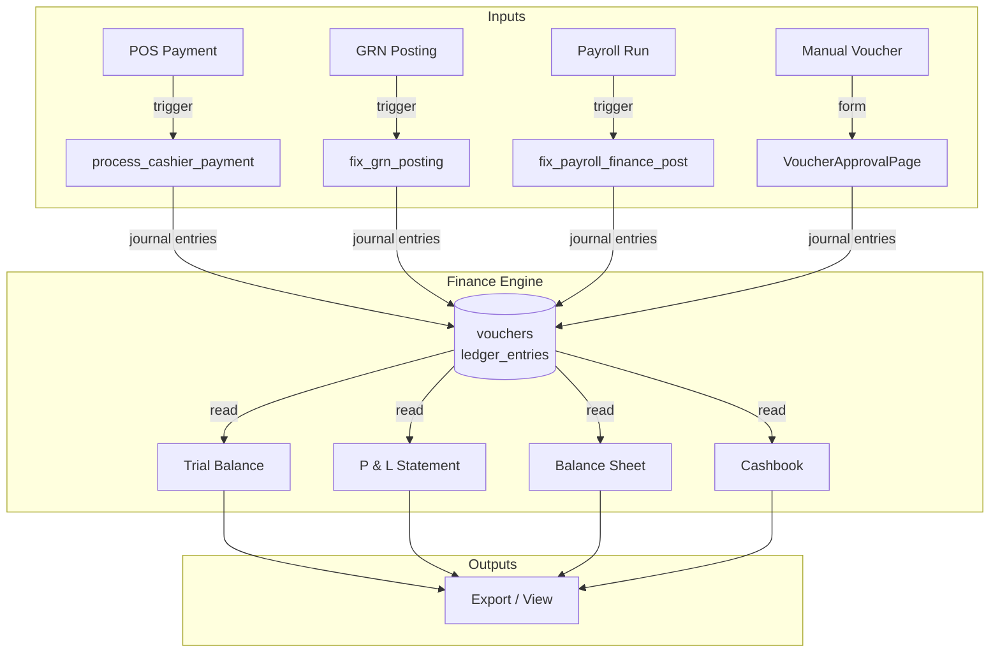

---

## 16. Business Process Flow — Main Restaurant Workflow (BPMN-style)

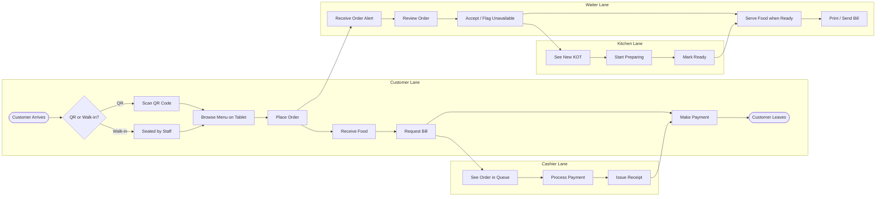

---

## 17. Component Interaction Diagram

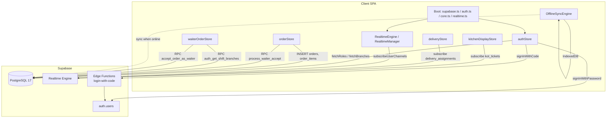
