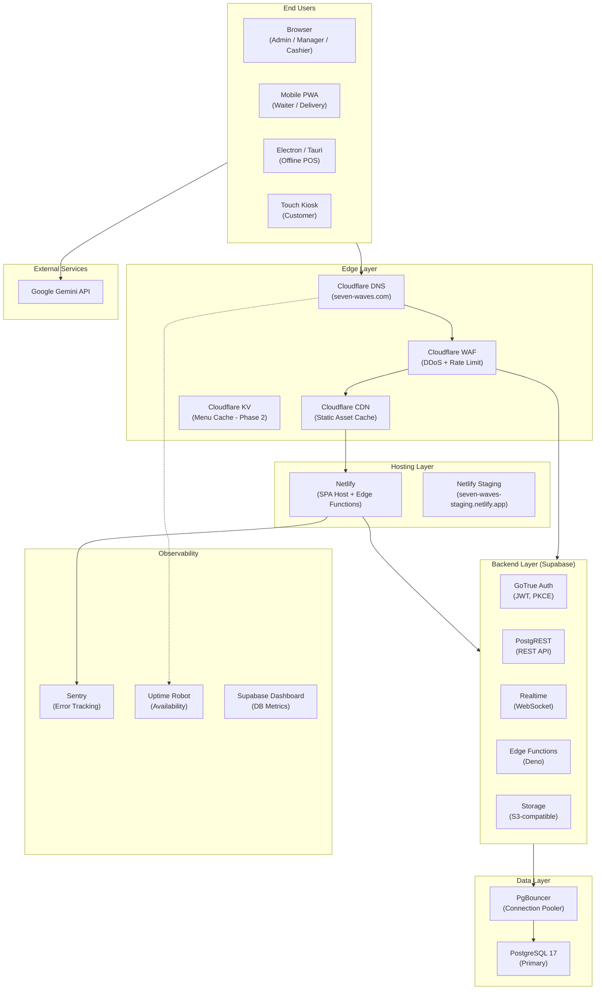
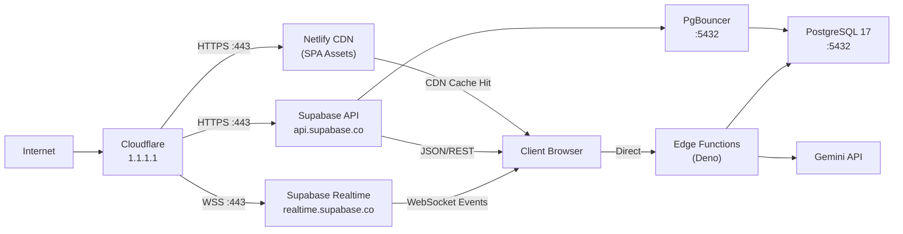
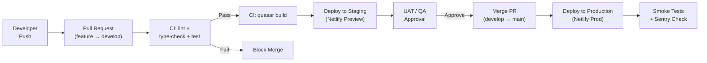

# Deployment Architecture Document
## Seven Waves Restaurant ERP
**Version:** 1.0  
**Date:** 2026-07-16  
**Author:** Architecture Team

---

## 1. Current Deployment Audit

### 1.1 Current State

| Component | Provider | Status |
|-----------|---------|--------|
| Frontend SPA | Netlify | Live at `https://seven-waves.netlify.app` |
| Database | Supabase (ap-northeast-2) | Live, project ref: `clykwuzajtwvwuavmtzs` |
| Auth | Supabase GoTrue | Live |
| Realtime | Supabase Realtime | Live |
| Storage | Supabase Storage | Live |
| Edge Functions | Supabase Edge Functions | Partial (login-with-code deployed) |
| CDN / WAF | None | **Missing** |
| CI/CD | None (manual push) | **Missing** |
| Monitoring | None | **Missing** |
| Error Tracking | None | **Missing** |
| Staging Environment | None | **Missing** |

### 1.2 Current Deployment Gaps

| Gap | Risk | Priority |
|-----|------|---------|
| No CDN in front of Netlify | Origin overload; slower global load | HIGH |
| No WAF / DDoS protection | Supabase anon key exposed to public | HIGH |
| No CI/CD pipeline | Manual deployments; no gate on lint/test | HIGH |
| No staging environment | Production is the only test bed | HIGH |
| No error monitoring | Silent failures in production | HIGH |
| No uptime monitoring | No alert on downtime | MEDIUM |
| No DB backup verification | Supabase auto-backup exists but untested | MEDIUM |
| No blue-green deployment | Each deploy is a hard cutover | LOW |
| VITE_APP_PUBLIC_URL not set | Falls back to window.location.origin | LOW |

---

## 2. Target Deployment Architecture

### 2.1 Architecture Diagram



### 2.2 Network Topology



---

## 3. Environment Strategy

### 3.1 Three-Environment Model

| Environment | URL | Branch | Purpose |
|-------------|-----|--------|---------|
| Development | `localhost:9000` | Any feature branch | Local dev with hot reload |
| Staging | `seven-waves-staging.netlify.app` | `develop` | Integration testing, UAT |
| Production | `seven-waves.netlify.app` (or custom domain) | `main` | Live traffic |

### 3.2 Environment Variables

#### Development (`.env`)
```env
VITE_SUPABASE_URL=https://clykwuzajtwvwuavmtzs.supabase.co
VITE_SUPABASE_ANON_KEY=<dev anon key>
VITE_APP_ENV=development
# VITE_APP_PUBLIC_URL intentionally commented out (window.location.origin fallback)
```

#### Staging (Netlify Environment Variables)
```env
VITE_SUPABASE_URL=https://<staging-project>.supabase.co
VITE_SUPABASE_ANON_KEY=<staging anon key>
VITE_APP_ENV=staging
VITE_APP_PUBLIC_URL=https://seven-waves-staging.netlify.app
```

#### Production (Netlify Environment Variables)
```env
VITE_SUPABASE_URL=https://clykwuzajtwvwuavmtzs.supabase.co
VITE_SUPABASE_ANON_KEY=<prod anon key>
VITE_APP_ENV=production
VITE_APP_PUBLIC_URL=https://seven-waves.netlify.app
VITE_GEMINI_API_KEY=<prod gemini key>
```

### 3.3 Supabase Environment Parity
- **Staging Supabase project**: Separate project (different ref ID) with anonymized production data snapshot
- **Production project**: `clykwuzajtwvwuavmtzs` (ap-northeast-2)
- SQL migrations applied to staging first, verified, then applied to production

---

## 4. CI/CD Pipeline

### 4.1 Recommended GitHub Actions Pipeline

```yaml
# .github/workflows/ci.yml
name: CI/CD

on:
  push:
    branches: [main, develop]
  pull_request:
    branches: [main, develop]

jobs:
  quality:
    runs-on: ubuntu-latest
    steps:
      - uses: actions/checkout@v4
      - uses: actions/setup-node@v4
        with: { node-version: '22' }
      - run: npm ci
      - run: npm run lint
      - run: npm run type-check
      - run: npm run test

  build:
    needs: quality
    runs-on: ubuntu-latest
    steps:
      - uses: actions/checkout@v4
      - uses: actions/setup-node@v4
        with: { node-version: '22' }
      - run: npm ci
      - run: npm run build
        env:
          VITE_SUPABASE_URL: ${{ secrets.VITE_SUPABASE_URL }}
          VITE_SUPABASE_ANON_KEY: ${{ secrets.VITE_SUPABASE_ANON_KEY }}
      - uses: actions/upload-artifact@v4
        with:
          name: dist-spa
          path: dist/spa

  deploy-staging:
    needs: build
    if: github.ref == 'refs/heads/develop'
    runs-on: ubuntu-latest
    steps:
      - uses: actions/download-artifact@v4
        with: { name: dist-spa, path: dist/spa }
      - uses: netlify/actions/cli@master
        with:
          args: deploy --dir=dist/spa --site=${{ secrets.NETLIFY_STAGING_SITE_ID }}
        env:
          NETLIFY_AUTH_TOKEN: ${{ secrets.NETLIFY_AUTH_TOKEN }}

  deploy-production:
    needs: build
    if: github.ref == 'refs/heads/main'
    runs-on: ubuntu-latest
    environment: production
    steps:
      - uses: actions/download-artifact@v4
        with: { name: dist-spa, path: dist/spa }
      - uses: netlify/actions/cli@master
        with:
          args: deploy --dir=dist/spa --prod --site=${{ secrets.NETLIFY_SITE_ID }}
        env:
          NETLIFY_AUTH_TOKEN: ${{ secrets.NETLIFY_AUTH_TOKEN }}
```

### 4.2 Deployment Flow



---

## 5. Blue-Green Deployment Strategy

Since Supabase + Netlify already provides instant atomic deploys, true blue-green is approximated:

### 5.1 Current (Risk Level: HIGH)
- Push to `main` → Netlify rebuilds and replaces instantly
- Any build error causes downtime

### 5.2 Target Blue-Green Approach
1. **Netlify Deploy Previews**: Every PR gets a unique preview URL — de-facto blue-green for testing
2. **Netlify Instant Rollback**: Use Netlify's "Publish deploy" to roll back to any previous build in < 30 seconds
3. **DB Schema**: Use additive migrations only (never DROP in production without prior `ALTER TABLE ... ADD COLUMN DEFAULT`)
4. **Feature Flags**: Use Supabase `system_modules` table (already exists) to gate new features before making them live

### 5.3 Rollback Procedure
```
1. Netlify Dashboard → Deploys → Click previous successful deploy → "Publish deploy"
2. If DB migration caused issues:
   a. Apply reverse migration SQL via Supabase MCP tool
   b. Verify RLS policies still intact
   c. Test critical path (login → POS → KOT)
3. Alert team via Slack/email
4. Create incident report in project docs
```

---

## 6. Monitoring & Alerting Architecture

### 6.1 Observability Stack

| Layer | Tool | What to Monitor |
|-------|------|----------------|
| Frontend Errors | Sentry (JS SDK) | Unhandled exceptions, Vue component errors |
| API Errors | Supabase Dashboard | PostgREST error rate, slow queries |
| Uptime | Uptime Robot (free) | `/auth/login` endpoint every 5 min |
| DB Performance | Supabase Dashboard | Query time, connection count, cache hit rate |
| Realtime | Supabase Dashboard | WebSocket connection count, message rate |
| Build Status | GitHub Actions | CI pass/fail rate |
| Business KPIs | Custom Supabase RPC | Orders/hour, KOT dispatch latency |

### 6.2 Key Metrics to Instrument

```
Business Metrics:
- Orders per hour per branch
- KOT dispatch latency (order accept → KDS display)
- Payment processing success rate
- Offline sync queue depth

Technical Metrics:
- API response time (PostgREST P50/P95/P99)
- WebSocket connection count
- Auth error rate (failed logins)
- IndexedDB sync queue depth
- Page load time (Largest Contentful Paint)

Infrastructure Metrics:
- Supabase DB connection count vs pool limit
- Netlify bandwidth usage
- Cloudflare cache hit rate
```

### 6.3 Alerting Rules

| Condition | Alert Channel | Severity |
|-----------|--------------|---------|
| Uptime < 99% | Email + SMS | CRITICAL |
| Sentry error rate > 10/min | Email | HIGH |
| DB connection pool > 80% | Email | HIGH |
| KOT dispatch latency > 30s | Dashboard | MEDIUM |
| Sync queue depth > 100 items | Dashboard | MEDIUM |
| Build failed on main | Slack | HIGH |

---

## 7. Disaster Recovery & Backup Strategy

### 7.1 Current Backup State
- **Supabase Pro**: Daily automated backups (7-day retention on free, 30-day on Pro)
- **Point-in-time recovery**: Available on Supabase Pro (up to 7 days)
- **No DR drill**: No documented recovery procedure or test

### 7.2 Recovery Time Objectives

| Scenario | RTO Target | RPO Target |
|----------|-----------|-----------|
| Frontend deploy failure | 5 min | 0 (Netlify rollback) |
| Supabase outage | 30 min | 1 hour (last backup) |
| Accidental data deletion | 1 hour | 1 hour |
| Full DB corruption | 4 hours | 24 hours |
| Complete region failure | 24 hours | 24 hours |

### 7.3 Backup Strategy

```
Daily (automated by Supabase):
├── Full DB dump → Supabase Storage (ap-northeast-2)
└── Retention: 30 days

Weekly (manual via MCP tool):
├── Export critical tables to S3/Google Drive:
│   ├── orders, payments, kot_tickets
│   ├── finance (journals, vouchers, accounts)
│   ├── hr (employees, payroll_runs)
│   └── inventory (stock_levels, grn)
└── Retention: 1 year

Monthly:
└── Full SQL dump to external cloud (separate AWS account)

DR Drill (quarterly):
├── Restore staging DB from production backup
├── Run full smoke test suite
└── Document restoration time
```

### 7.4 DR Runbook (High Level)
```
1. Incident detected (uptime alert or user report)
2. Assess: frontend issue or DB issue?
   a. Frontend → Netlify rollback (5 min)
   b. DB → Contact Supabase support + activate read replica if available
3. Communicate: post status to customers/branches (status page or WhatsApp group)
4. Restore from backup if needed:
   a. Create new Supabase project in same region
   b. Restore via pg_restore from latest backup
   c. Update VITE_SUPABASE_URL in Netlify env vars
   d. Trigger rebuild
5. Verify: run smoke tests (login, POS order, KOT)
6. Post-mortem: root cause analysis within 48 hours
```

---

## 8. Security Hardening Checklist

- [x] PKCE auth flow (no implicit)
- [x] RLS enabled on all business tables (`erp_security_lockdown.sql`)
- [x] anon role write access revoked (`CRITICAL_fix_revoke_anon_functions.sql`)
- [x] Rate limiting on login (client + DB)
- [x] Input sanitization (XSS)
- [x] Auth cache purge on logout
- [x] inactivity timeout (30 min)
- [ ] WAF in front of Supabase (Cloudflare) — **PENDING**
- [ ] CSP headers on Netlify — **PENDING**
- [ ] HSTS headers — **PENDING**
- [ ] Supabase anon key restriction to Netlify origin only — **PENDING**
- [ ] Database audit log for admin operations — **PARTIALLY DONE** (`login_audit_logs` exists)
- [ ] Penetration test — **PENDING**
- [ ] Secrets rotation schedule — **PENDING**

---

## 9. Electron / Tauri Desktop Deployment

### 9.1 Build Process
```bash
# Electron
npm run build                    # Build SPA
npx electron-builder             # Package for Windows/macOS

# Tauri
npm run build
npx tauri build                  # Requires Rust toolchain
```

### 9.2 Auto-Update Strategy
- Electron: Use `electron-updater` with update server (can host on Netlify)
- Tauri: Built-in updater plugin
- Update channel: `prod` for stable releases, `beta` for staging

### 9.3 Offline Database (Desktop)
- Electron/Tauri: Full IndexedDB available (WebView2/WebKitGTK)
- SQLite (via better-sqlite3) as Phase 2 option for larger offline datasets
- Sync on reconnect via `OfflineSyncEngine`

---

## 10. Mobile PWA Deployment

### 10.1 Service Worker
- Workbox 7 configured for: precaching SPA shell, runtime caching for API responses
- Cache strategy: `StaleWhileRevalidate` for menu data, `NetworkFirst` for orders

### 10.2 PWA Manifest
- Three separate manifests: waiter, manager, delivery
- Each PWA is a separate "app" installable from the browser
- Deep link support for QR scan → kiosk flow

### 10.3 iOS Considerations
- Add to Home Screen required (no PWA push notifications on iOS < 16.4)
- `detectSessionInUrl: false` in Tauri; `true` for web (handles PKCE redirect)
