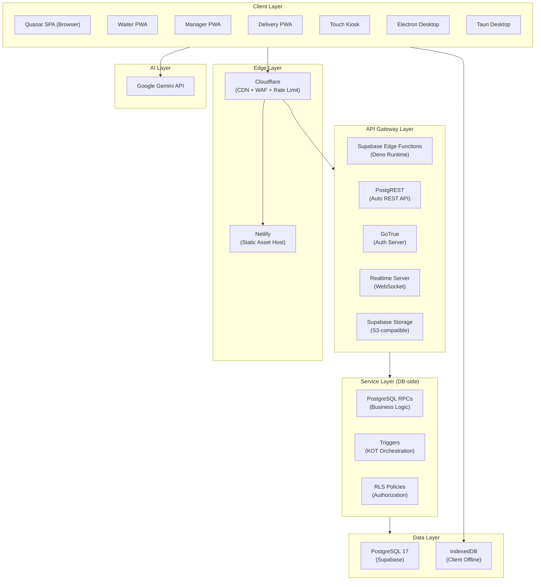
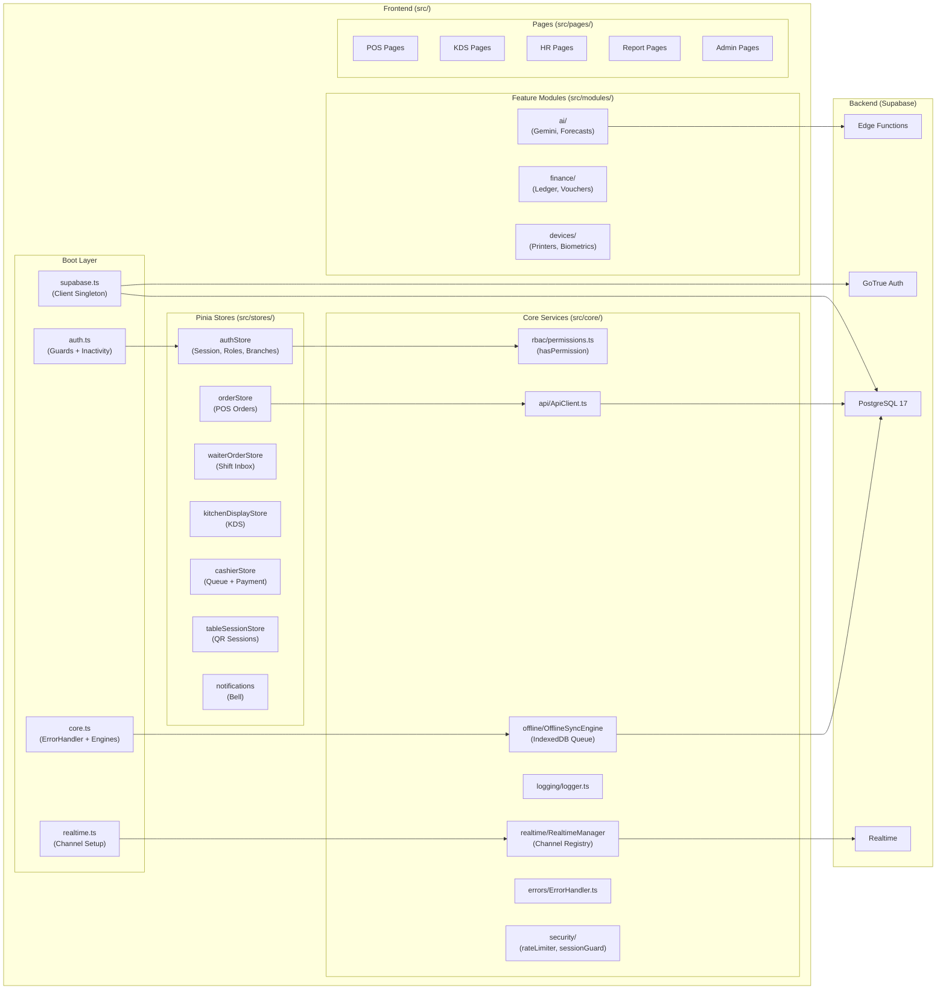
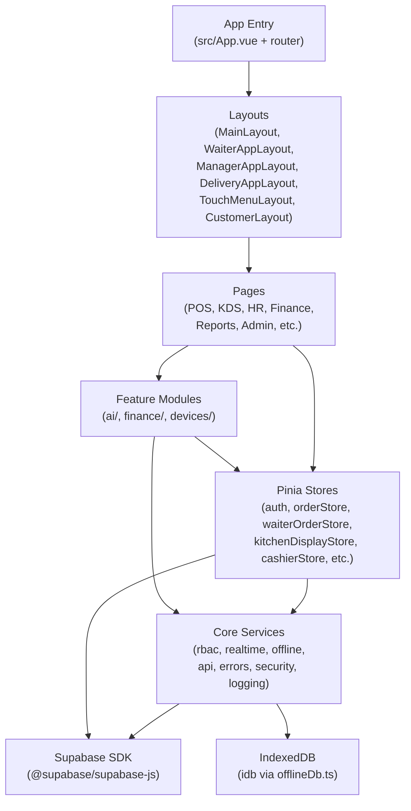
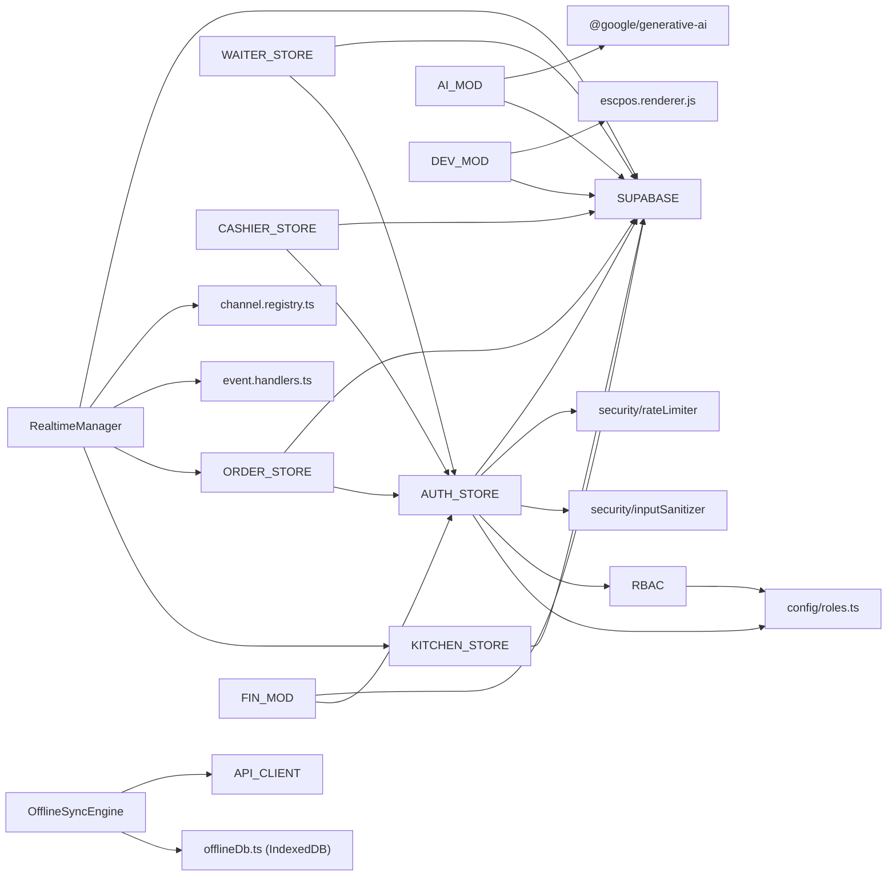
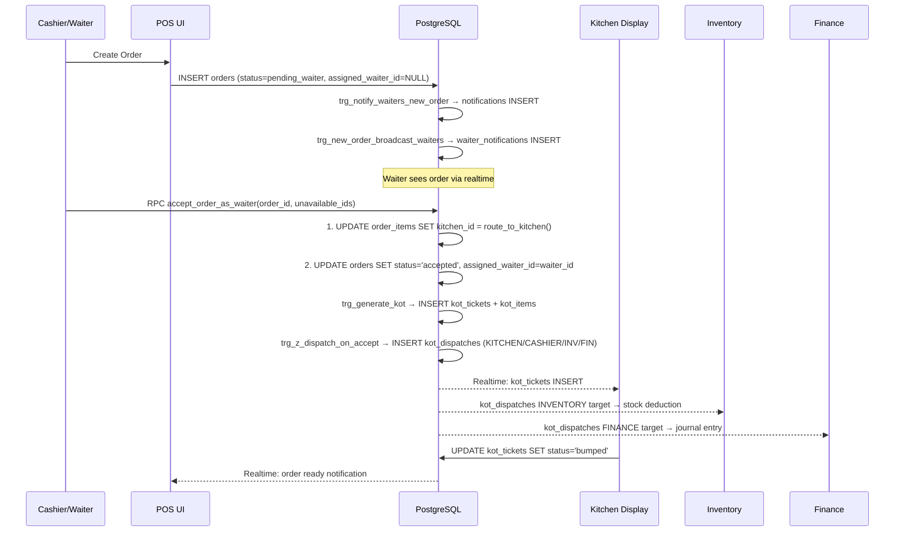

# System Architecture Document
## Seven Waves Restaurant ERP
**Version:** 1.0  
**Date:** 2026-07-16  
**Author:** Architecture Team

---

## 1. Current Architecture Audit

### 1.1 Overview
Seven Waves ERP is a **client-heavy SPA** that communicates directly with Supabase via the JS SDK. There is no traditional application server between the client and the database. All business logic runs in one of three places:
- Vue 3 / Pinia stores (client-side)
- PostgreSQL stored procedures / RPCs (database-side)
- Supabase Edge Functions (Deno runtime, used sparingly)

### 1.2 Current Architecture Strengths
- **Zero-backend simplicity**: Supabase handles auth, realtime, storage, and API — no Express/NestJS server to maintain
- **PKCE auth flow**: Modern, secure OAuth flow implemented correctly (`src/boot/supabase.ts:22`)
- **RBAC dual enforcement**: Permissions enforced both at Vue Router layer (`src/boot/auth.ts`) AND PostgreSQL RLS
- **Declarative realtime registry**: `CHANNEL_REGISTRY` in `src/core/realtime/channel.registry.ts` — all channels declared in one place
- **Offline-first engine**: `OfflineSyncEngine` with IndexedDB queue, dead-letter, retry (`src/core/offline/OfflineSyncEngine.ts`)
- **Auth cache**: 24-hour localStorage cache eliminates 3 DB calls on every page refresh (`src/stores/auth.ts:88-139`)
- **Exponential backoff** on WebSocket reconnect (`src/boot/supabase.ts:17-19`)

### 1.3 Current Architecture Weaknesses & Anti-Patterns

#### ARCH-ISSUE-01: Dual Realtime Systems (HIGH)
**Location:** `CLAUDE.md` — "Two parallel realtime systems coexist"  
**Problem:** `RealtimeManager` (infrastructure layer) and store-level ad-hoc subscriptions both run concurrently. Waiter and kitchen stores subscribe directly AND via the registry. This causes:
- Duplicate event processing risk
- Double WebSocket channel creation
- Unclear ownership of reconnection logic  
**Fix:** Consolidate all subscriptions into `RealtimeManager`; remove store-level ad-hoc subscriptions.

#### ARCH-ISSUE-02: No API Gateway (HIGH)
**Problem:** Client exposes Supabase anon key and connects directly to PostgREST. There is no WAF, no rate limiting at network edge, no request logging aggregation.  
**Fix:** Add Cloudflare WAF + rate limiting in front of Supabase, or use Supabase Edge Function as a thin gateway.

#### ARCH-ISSUE-03: Auth Cache Security Gap (HIGH)
**Location:** `src/stores/auth.ts:104-119`  
**Problem:** Roles cached in localStorage for 24 hours. If an admin revokes a user's role, the user retains full access until cache expires or they hit a privileged route that forces revalidation.  
**Fix:** Reduce cache TTL to 5 minutes for roles, or add a server-push invalidation via Realtime to the `user_roles` table.

#### ARCH-ISSUE-04: No Migration Runner (HIGH)
**Problem:** 90+ SQL files in `supabase/` are applied manually via MCP tool with no version tracking. There is no audit of which files have been applied to which environment.  
**Fix:** Adopt `supabase migrations` or a custom migration ledger table (`applied_migrations`) to track applied SQL.

#### ARCH-ISSUE-05: No Caching Layer (MEDIUM)
**Problem:** Menu data, reference data (branches, kitchens, roles), and frequently-read tables all hit Supabase PostgREST on every request. No Redis, no CDN cache headers.  
**Fix:** Add a caching layer: Cloudflare Cache Rules for menu/reference endpoints, or Supabase `Cache-Control` headers via Edge Functions.

#### ARCH-ISSUE-06: No Message Queue (MEDIUM)
**Problem:** KOT orchestration runs entirely via synchronous PostgreSQL triggers. Under high volume (e.g. 200 concurrent orders), trigger chains become a bottleneck and can cause lock contention.  
**Fix:** Consider Supabase Edge Functions + `pg_net` (HTTP from DB) to offload dispatch, or a PgBouncer + worker pool pattern.

#### ARCH-ISSUE-07: `company_id` Inconsistency (MEDIUM)
**Problem:** Some tables (`companies`, `branches`, `kitchens`) have `company_id` directly. Others (e.g. `orders`, `kot_tickets`) only have `branch_id` and rely on joins for company-level isolation. RLS on these tables only filters by `branch_id`, not `company_id`.  
**Fix:** Add `company_id` to all operational tables with a FK + index; update RLS policies.

#### ARCH-ISSUE-08: Duplicate Auth Methods (LOW)
**Location:** `src/stores/auth.ts:240-258` (`_backgroundFetchUserData`) vs `:543-562` (`_backgroundRefreshUserData`)  
**Problem:** Two nearly identical methods exist. `_backgroundFetchUserData` calls 4 fetches including `_fetchProfile`; `_backgroundRefreshUserData` calls 3 (no profile). Confusing naming and duplication.  
**Fix:** Consolidate into one `_refreshSession(includeProfile: boolean)` method.

#### ARCH-ISSUE-09: `@ts-ignore` in Route Guards (LOW)
**Location:** `src/boot/auth.ts:155, 171, 185`  
**Problem:** TypeScript type checks suppressed in security-critical route guard code. Type errors here could mask permission check bugs.  
**Fix:** Properly type `route.meta` using Vue Router's `RouteMeta` interface extension.

#### ARCH-ISSUE-10: Dead Code in Codebase (LOW)
**Location:** `src/pages/hr/EmployeesPage.old.vue`  
**Problem:** `.old.vue` file committed to main branch. Should be removed.  
**Fix:** Delete the file; git history preserves it.

#### ARCH-ISSUE-11: Branch Switching Not Implemented (MEDIUM)
**Location:** `src/stores/auth.ts:685-692`  
**Problem:** `currentBranch` getter returns only the home branch or first branch. Staff with multiple branch assignments cannot switch branch within the app — there is no branch-switching UI or store action.  
**Fix:** Add `switchBranch(branchId)` action and branch selector UI for multi-branch users.

#### ARCH-ISSUE-12: Offline RPC Registration (MEDIUM)
**Location:** `src/core/offline/OfflineSyncEngine.ts:139`  
**Problem:** Offline sync routes to `offline_sync_{module}_{action}` RPCs. If these RPCs don't exist in the DB, sync items fail silently. No validation that the RPC exists before enqueuing.  
**Fix:** Maintain a registry of supported offline RPCs; validate at enqueue time.

---

## 2. Target Architecture

### 2.1 Layered Architecture Overview



### 2.2 Current vs Target Comparison

| Concern | Current | Target |
|---------|---------|--------|
| CDN / WAF | None | Cloudflare |
| Rate Limiting | Client-side only | Cloudflare + DB |
| API Gateway | None (direct PostgREST) | Cloudflare + Edge Functions for sensitive ops |
| Caching | None | Cloudflare Cache + Pinia store TTL |
| Message Queue | None (triggers only) | pg_net + Edge Function worker (Phase 3) |
| Migration Tracking | None | Applied migrations ledger table |
| Realtime | Dual system | Single RealtimeManager |
| Branch Switching | Not implemented | Branch selector UI + switchBranch action |
| Auth Cache TTL | 24h (too long) | 5min for roles, 24h for profile |

---

## 3. Component Diagram



---

## 4. Package / Module Dependency Diagram



---

## 5. Module Dependency Diagram (Detailed)



---

## 6. Order Flow Sequence Diagram



---

## 7. Technology Stack

### 7.1 Current Stack

| Layer | Technology | Version | Justification |
|-------|-----------|---------|--------------|
| UI Framework | Vue 3 | ^3.5.22 | Composition API, TypeScript, excellent DX |
| UI Component | Quasar | ^2.16.0 | Material Design, cross-platform (web/PWA/Electron/Tauri) |
| State Management | Pinia | ^3.0.1 | Vue 3 native, TypeScript-first, devtools |
| Routing | Vue Router | ^5.0.0 | Official, meta-based guards |
| Backend | Supabase | cloud | Auth + DB + Realtime + Storage in one |
| Database | PostgreSQL 17 | managed | JSONB, RLS, triggers, stored procedures |
| Desktop | Electron | ^41.0.2 | Windows/macOS packaging |
| Desktop (alt) | Tauri | ^2.10.1 | Rust-based, smaller binary |
| Build | Vite + @quasar/app-vite | ^2.1.0 | Fast HMR, tree-shaking |
| AI | Google Gemini | ^0.24.1 | Multimodal, restaurant domain forecasting |
| Charts | ApexCharts | ^5.7.0 | Rich chart types, realtime support |
| PDF | jsPDF + pdfkit | latest | Client + server-side PDF generation |
| Excel | ExcelJS | ^4.4.0 | Full xlsx support |
| i18n | vue-i18n | ^11.0.0 | Official Vue i18n solution |
| Testing | Vitest | ^4.1.6 | Vite-native, fast |
| Linting | ESLint 9 + Prettier | latest | Modern flat config |

### 7.2 Recommended Stack Additions

| Need | Recommendation | Reason |
|------|---------------|--------|
| CDN + WAF | Cloudflare Free/Pro | DDoS, rate limiting, caching |
| Migration tracking | Custom `applied_migrations` table | Audit which SQL files are live |
| Error monitoring | Sentry (free tier) | Production error tracking |
| CI/CD | GitHub Actions | Automated lint, type-check, test, deploy |
| E2E Testing | Playwright | Critical path testing (POS flow) |
| API monitoring | Supabase Dashboard + Uptime Robot | SLA verification |

---

## 8. Scalability Plan

### 8.1 Current Bottlenecks
1. **PostgreSQL triggers for KOT orchestration**: Synchronous, blocking. Under 100+ concurrent orders, lock contention risk.
2. **No connection pooling config**: Supabase uses PgBouncer by default; ensure pool mode = `transaction` for PostgREST.
3. **No CDN for menu images/assets**: All assets served from Netlify/Supabase Storage; no edge caching.

### 8.2 Horizontal Scaling Strategy

```
Phase 1 (0–50 branches):
  Supabase Pro → enough for ~200 concurrent connections
  Netlify CDN → static assets
  No changes needed

Phase 2 (50–200 branches):
  Supabase + PgBouncer (transaction mode, pool size 50–100)
  Cloudflare in front of Netlify (CDN + WAF)
  Supabase read replicas for reports (when available)
  Cache menu data in Cloudflare KV

Phase 3 (200+ branches):
  Consider Supabase self-hosted on Kubernetes (control over PG config)
  Message queue (Inngest or pg_net workers) for KOT dispatch
  Redis (Upstash) for session state and rate limiting
  Dedicated read DB for reporting queries
```

### 8.3 Caching Strategy

| Data Type | Cache Location | TTL |
|-----------|---------------|-----|
| Menu items | Pinia store + localStorage | 15 min |
| Branch/kitchen config | Pinia store | 60 min |
| Reports | Client-side memoization | 5 min |
| Auth roles | localStorage | 5 min (reduce from 24h) |
| Static assets | Cloudflare CDN | 1 year (hashed filenames) |
| Menu images | Supabase Storage + Cloudflare | 7 days |

---

## 9. Multi-Tenancy Design

### 9.1 Current Model
- **Single Supabase project** for all companies
- Tenant isolation via `company_id` → `branch_id` chain
- RLS filters by `branch_id` (user's branches from `user_branches`)
- Some tables lack `company_id` directly (orders, kot_tickets)

### 9.2 Issues
- Cross-company data leakage risk if RLS is misconfigured on a table without `company_id`
- No schema-level isolation between companies

### 9.3 Recommended Improvements

```sql
-- Add company_id to all operational tables (migration):
ALTER TABLE orders ADD COLUMN company_id UUID REFERENCES companies(id);
ALTER TABLE kot_tickets ADD COLUMN company_id UUID REFERENCES companies(id);
-- ... repeat for inventory, delivery_orders, etc.

-- Update RLS to always include company_id check:
CREATE POLICY "company_isolation" ON orders
  USING (company_id IN (SELECT b.company_id FROM auth_branch_ids() ab JOIN branches b ON b.id = ab));
```

---

## 10. Offline-First Architecture

### 10.1 Current Implementation

```
Client (Browser / Electron)
├── Network Online
│   └── Direct Supabase calls (PostgREST / Realtime)
├── Network Offline
│   └── OfflineSyncEngine.enqueue()
│       └── IndexedDB (offlineDb.ts) → sync_queue store
│           ├── Allowed: pos, kitchen, waiter, hr, delivery
│           └── Blocked: finance, procurement
└── On Reconnect
    └── OfflineSyncEngine.syncAll()
        └── Route each item to offline_sync_{module}_{action} RPC
            └── Dead-letter after 5 attempts
```

### 10.2 Gaps in Current Implementation
1. **Missing offline RPCs**: `offline_sync_pos_create_order`, `offline_sync_waiter_accept_order`, etc. are not defined in `supabase/*.sql`. The engine will always fail without these.
2. **No conflict resolution**: If an item is modified online while queued offline, the sync RPC has no merge strategy.
3. **No UI for sync status**: The `offlineSyncStore` exists but no persistent UI banner shows pending sync count.

### 10.3 Recommended Offline RPCs to Create
```sql
-- Minimum required for POS offline support:
CREATE OR REPLACE FUNCTION offline_sync_pos_create_order(payload JSONB)
RETURNS JSONB LANGUAGE plpgsql SECURITY DEFINER AS $$...$$;

CREATE OR REPLACE FUNCTION offline_sync_waiter_accept_order(payload JSONB)
RETURNS JSONB LANGUAGE plpgsql SECURITY DEFINER AS $$...$$;

CREATE OR REPLACE FUNCTION offline_sync_pos_void_order(payload JSONB)
RETURNS JSONB LANGUAGE plpgsql SECURITY DEFINER AS $$...$$;
```
