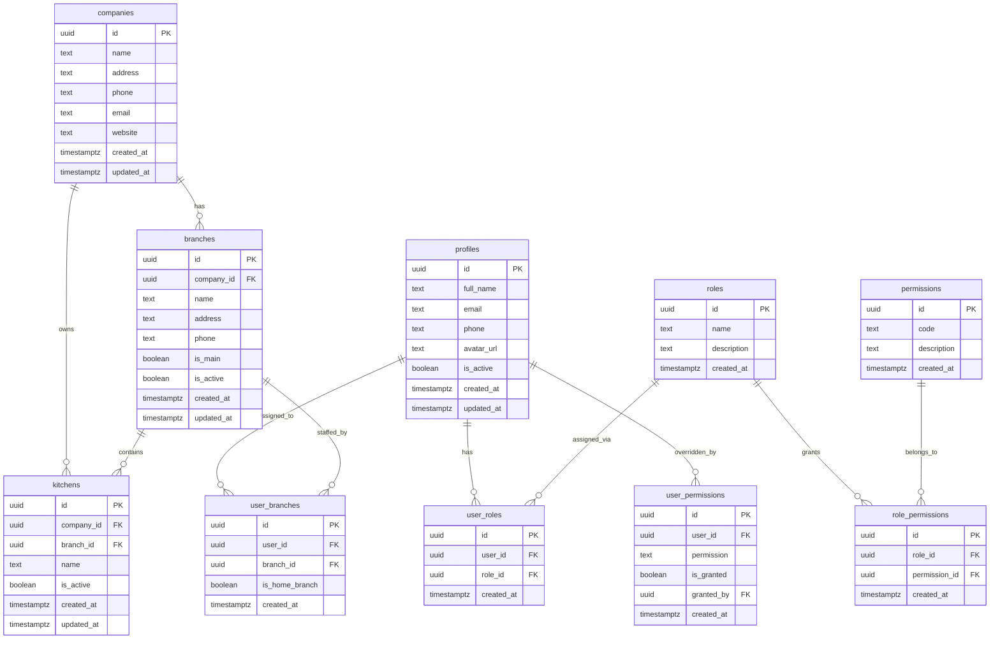
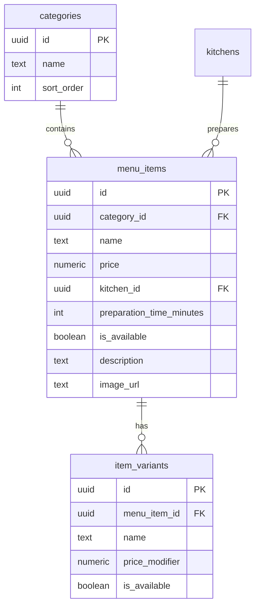
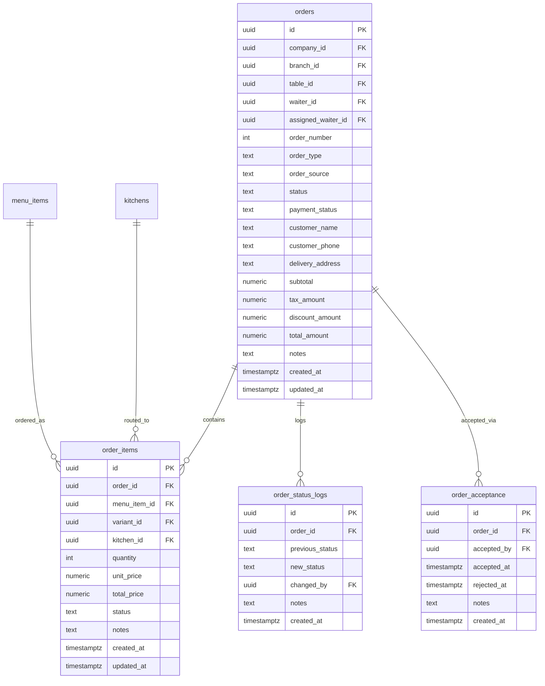
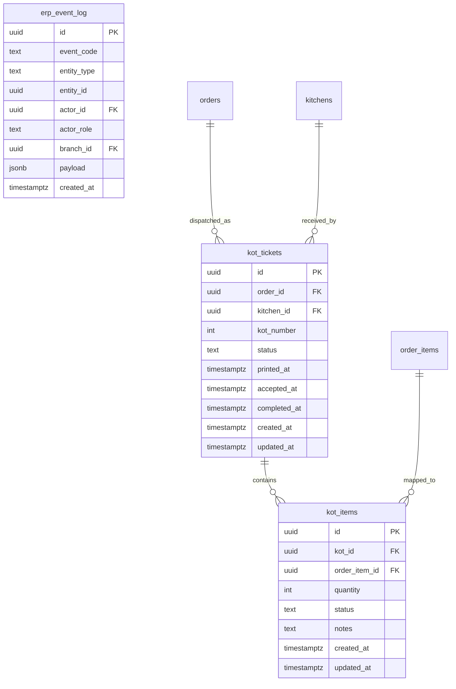
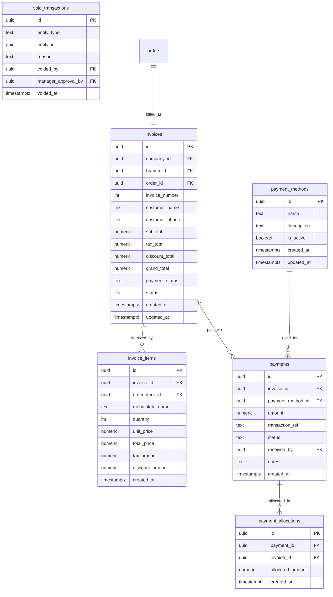
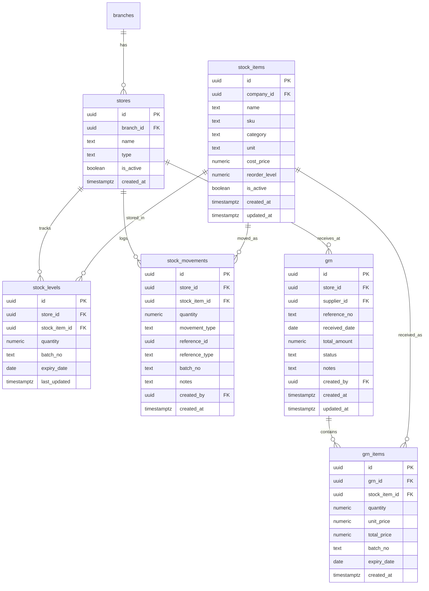
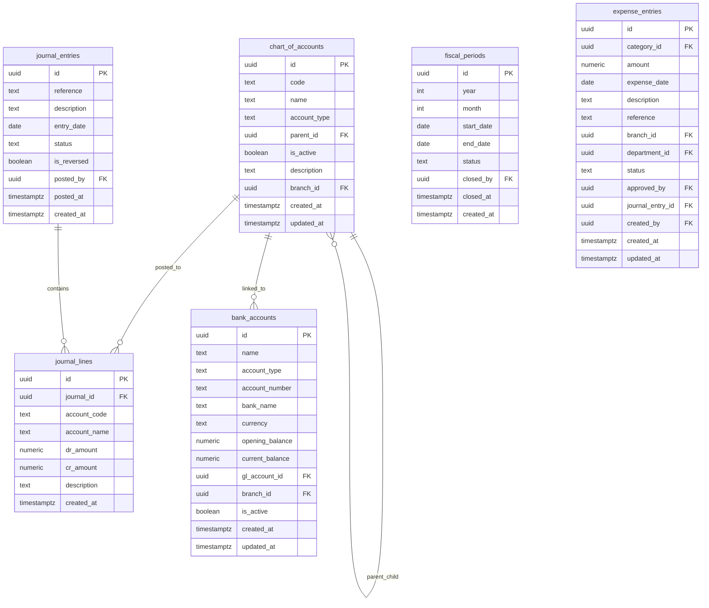
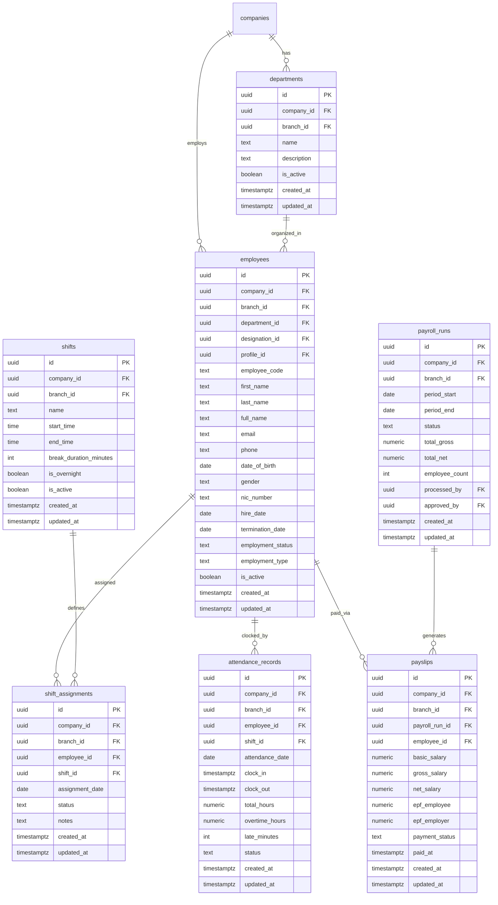
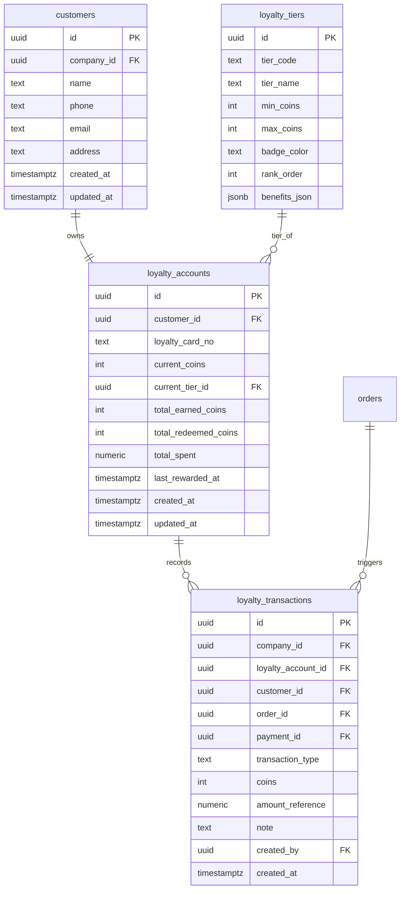

# ER Diagram — Seven Waves Restaurant ERP

> PostgreSQL 17 · Supabase · Multi-company, Multi-branch

---

## Domain Overview

| Domain | Tables |
|--------|--------|
| Auth / Org | companies, branches, kitchens, profiles, roles, permissions, role_permissions, user_roles, user_branches, user_permissions |
| Menu | categories, menu_items, item_variants |
| Orders | orders, order_items, order_status_logs, order_acceptance |
| KOT | kot_tickets, kot_items, erp_event_log |
| Billing | payment_methods, invoices, invoice_items, payments, payment_allocations, void_transactions |
| Inventory | stores, stock_items, stock_levels, stock_movements, grn, grn_items, stock_transfers, stock_transfer_items |
| Inventory (Advanced) | items, uom, warehouses, stock_on_hand, inventory_ledger, inventory_documents, inventory_document_lines |
| Procurement | suppliers, supplier_contacts, supplier_item_prices, purchase_orders, purchase_order_lines, goods_receipts, goods_receipt_lines, ap_invoices, ap_invoice_lines, supplier_payments, supplier_payment_allocations, purchase_returns, purchase_return_lines, ap_ledger, ap_balance_snapshot, payment_terms, procurement_doc_sequences |
| Finance | chart_of_accounts, fiscal_periods, bank_accounts, cash_transactions, customer_receivables, expense_categories, expense_entries, tax_codes, tax_transactions, finance_documents, payroll_cycles, payroll_records, payroll_line_items, finance_audit_logs, journal_entries, journal_lines |
| HR | departments, designations, employees, salary_structures, shifts, shift_assignments, attendance_logs, attendance_records, leave_types, leave_requests, employee_overtime, payroll_runs, payslips, employee_loans |
| CRM / Loyalty | customers, loyalty_tiers, loyalty_rules, loyalty_accounts, loyalty_transactions |
| Restaurant Ops | restaurant_tables, notifications, waiter_notifications |
| Security | audit_logs, qr_rate_limits |
| Delivery | delivery_assignments |

---

## Auth & Organization Domain

---

## Menu Domain

---

## Order Domain

---

## KOT Domain

---

## Billing Domain

---

## Inventory Domain

---

## Procurement Domain

```mermaid
erDiagram
    suppliers {
        uuid id PK
        uuid company_id FK
        text name
        text contact_person
        text phone
        text email
        text address
        uuid payment_term_id FK
        numeric credit_limit
        numeric balance
        boolean is_active
        timestamptz created_at
        timestamptz updated_at
    }

    purchase_orders {
        uuid id PK
        uuid company_id FK
        uuid branch_id FK
        text doc_number
        date doc_date
        date expected_date
        uuid supplier_id FK
        uuid payment_term_id FK
        text status
        numeric subtotal
        numeric tax_amount
        numeric total_amount
        uuid created_by FK
        uuid approved_by FK
        timestamptz created_at
        timestamptz updated_at
    }

    purchase_order_lines {
        uuid id PK
        uuid po_id FK
        int line_number
        uuid item_id FK
        uuid uom_id FK
        numeric quantity
        numeric unit_price
        numeric line_total
        numeric received_qty
        numeric invoiced_qty
        numeric returned_qty
        numeric open_qty
        timestamptz created_at
    }

    goods_receipts {
        uuid id PK
        uuid company_id FK
        uuid branch_id FK
        text doc_number
        date doc_date
        uuid po_id FK
        uuid supplier_id FK
        uuid warehouse_id FK
        text status
        numeric total_amount
        uuid created_by FK
        uuid posted_by FK
        timestamptz posted_at
        timestamptz created_at
        timestamptz updated_at
    }

    ap_invoices {
        uuid id PK
        uuid company_id FK
        uuid branch_id FK
        text doc_number
        text supplier_inv_no
        date doc_date
        date due_date
        uuid supplier_id FK
        uuid grn_id FK
        uuid po_id FK
        text status
        numeric total_amount
        numeric paid_amount
        numeric balance_due
        timestamptz created_at
        timestamptz updated_at
    }

    ap_ledger {
        uuid id PK
        uuid company_id FK
        uuid branch_id FK
        uuid supplier_id FK
        text entry_type
        uuid doc_id
        text doc_number
        date doc_date
        date due_date
        numeric debit
        numeric credit
        text description
        uuid posted_by FK
        timestamptz posted_at
    }

    suppliers ||--o{ purchase_orders : "receives"
    purchase_orders ||--o{ purchase_order_lines : "contains"
    purchase_orders ||--o{ goods_receipts : "fulfilled_by"
    goods_receipts ||--o{ ap_invoices : "invoiced_as"
    ap_invoices ||--o{ ap_ledger : "posts_to"
    suppliers ||--o{ ap_ledger : "ledgered_for"
```

---

## Finance Domain

---

## HR Domain

---

## CRM / Loyalty Domain

---

## Missing Tables (Gap Analysis)

The following tables are referenced in the codebase or needed for full ERP functionality but are **not yet in any .sql file**:

| Missing Table | Referenced In | Purpose |
|--------------|---------------|---------|
| `reservations` | N/A | Table reservation management |
| `table_qr_codes` | `TablesManagementPage.vue` | QR token → table mapping |
| `customer_sessions` | `fix_kiosk_session.sql` (RPCs only) | Kiosk/QR session tokens |
| `notifications` | `notifications.sql` | System notification queue |
| `waiter_notifications` | CLAUDE.md | Waiter-specific alert inbox |
| `delivery_assignments` | `delivery_assignments_migration.sql` | Rider ↔ order assignment |
| `service_charges` | `apply_service_charge.sql` | Per-order service charge config |
| `tax_configurations` | Finance module | Branch-level tax rate setup |
| `printer_assignments` | `printers.sql` | Printer ↔ kitchen/branch mapping |
| `biometric_devices` | `biometric_integration.sql` | Device registry for attendance |
| `order_status_events` | `kot_orchestration_v2.sql` | Backward-compat event mirror |
| `kot_dispatches` | CLAUDE.md | KOT dispatch tracking per target |
| `items` | `procurement.sql` | Unified item master (procurement) |
| `uom` | `procurement.sql` | Unit of measure master |
| `warehouses` | `procurement.sql` | Warehouse/location master |
| `stock_on_hand` | `inventory_module.sql` | Current stock by warehouse |
| `inventory_ledger` | `inventory_module.sql` | Immutable inventory journal |
| `inventory_documents` | `erp_security_lockdown.sql` | Generic inventory documents |
| `recipe_items` | `erp_security_lockdown.sql` | BOM line items for recipes |
| `loyalty_rules` | `customer_loyalty_system.sql` | Coin earning rule definitions |
