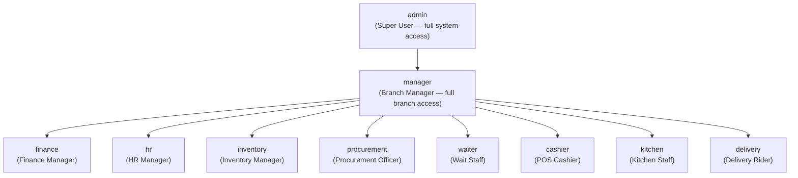

# RBAC Design — Seven Waves Restaurant ERP

> Role-Based Access Control with branch-level and shift-level scoping

---

## 1. Role Hierarchy



> Note: This is a conceptual hierarchy for access scope, not inheritance. Each role has independent permissions; admin/manager override via explicit RLS policies.

---

## 2. Permission Matrix

### Legend: ✓ Full · R Read · — None · RPC Via secure RPC only

| Module | Resource | admin | manager | finance | hr | inventory | procurement | waiter | cashier | kitchen | delivery |
|--------|----------|-------|---------|---------|----|-----------| ------------|--------|---------|---------|---------|
| **Dashboard** | analytics | ✓ | R | R | R | R | — | — | — | — | — |
| **POS** | orders.create | ✓ | ✓ | — | — | — | — | ✓ | ✓ | — | — |
| **POS** | orders.read | ✓ | ✓ | R | — | — | — | R | R | R | R |
| **POS** | orders.void | ✓ | ✓ | — | — | — | — | — | RPC | — | — |
| **POS** | payments.create | ✓ | ✓ | — | — | — | — | — | RPC | — | — |
| **POS** | payments.refund | ✓ | ✓ | — | — | — | — | — | — | — | — |
| **KDS** | kot_tickets.read | ✓ | ✓ | — | — | — | — | R | — | R | — |
| **KDS** | kot_tickets.update | ✓ | ✓ | — | — | — | — | — | — | ✓ | — |
| **KOT** | kot_items.update | ✓ | ✓ | — | — | — | — | — | — | ✓ | — |
| **Tables** | restaurant_tables.read | ✓ | ✓ | — | — | — | — | ✓ | ✓ | — | — |
| **Tables** | restaurant_tables.manage | ✓ | ✓ | — | — | — | — | — | — | — | — |
| **Menu** | menu_items.read | ✓ | ✓ | — | — | — | — | ✓ | ✓ | ✓ | ✓ |
| **Menu** | menu_items.manage | ✓ | ✓ | — | — | — | — | — | — | — | — |
| **Inventory** | stock_levels.read | ✓ | R | — | — | ✓ | — | — | — | R | — |
| **Inventory** | stock_levels.adjust | ✓ | ✓ | — | — | ✓ | — | — | — | — | — |
| **Inventory** | grn.create | ✓ | ✓ | — | — | ✓ | ✓ | — | — | — | — |
| **Inventory** | grn.approve | ✓ | ✓ | — | — | ✓ | — | — | — | — | — |
| **Procurement** | purchase_orders.create | ✓ | ✓ | — | — | — | ✓ | — | — | — | — |
| **Procurement** | purchase_orders.approve | ✓ | ✓ | R | — | — | — | — | — | — | — |
| **Procurement** | ap_invoices.post | ✓ | ✓ | ✓ | — | — | — | — | — | — | — |
| **Procurement** | supplier_payments.post | ✓ | — | ✓ | — | — | — | — | — | — | — |
| **Finance** | journal_entries.create | ✓ | — | ✓ | — | — | — | — | — | — | — |
| **Finance** | journal_entries.post | ✓ | — | ✓ | — | — | — | — | — | — | — |
| **Finance** | chart_of_accounts.manage | ✓ | — | ✓ | — | — | — | — | — | — | — |
| **Finance** | reports.view | ✓ | ✓ | ✓ | R | R | R | — | — | — | — |
| **HR** | employees.read | ✓ | R | — | ✓ | — | — | — | — | — | — |
| **HR** | employees.manage | ✓ | — | — | ✓ | — | — | — | — | — | — |
| **HR** | payroll.run | ✓ | — | ✓ | ✓ | — | — | — | — | — | — |
| **HR** | leave.approve | ✓ | ✓ | — | ✓ | — | — | — | — | — | — |
| **HR** | attendance.manage | ✓ | — | — | ✓ | — | — | — | — | — | — |
| **CRM** | customers.read | ✓ | ✓ | — | — | — | — | R | R | — | — |
| **CRM** | loyalty.adjust | ✓ | ✓ | — | — | — | — | — | — | — | — |
| **Delivery** | delivery_orders.manage | ✓ | ✓ | — | — | — | — | — | — | — | ✓ |
| **Settings** | company.manage | ✓ | — | — | — | — | — | — | — | — | — |
| **Settings** | branch.manage | ✓ | ✓ | — | — | — | — | — | — | — | — |
| **Settings** | users.manage | ✓ | — | — | ✓ | — | — | — | — | — | — |
| **Audit** | audit_logs.read | ✓ | — | — | — | — | — | — | — | — | — |

---

## 3. Complete Permission Code List

Format: `{module}.{resource}.{action}`

### POS Module

```
pos.order.create
pos.order.read
pos.order.update
pos.order.void
pos.order.cancel
pos.order.assign_waiter
pos.payment.create
pos.payment.read
pos.payment.refund
pos.invoice.create
pos.invoice.read
pos.invoice.void
pos.discount.apply
pos.shift.open
pos.shift.close
pos.shift.read
```

### Kitchen Module

```
kitchen.kot.read
kitchen.kot.accept
kitchen.kot.start
kitchen.kot.ready
kitchen.kot.cancel
kitchen.order_items.update_status
kitchen.menu.toggle_availability
```

### Menu Module

```
menu.category.create
menu.category.read
menu.category.update
menu.category.delete
menu.item.create
menu.item.read
menu.item.update
menu.item.delete
menu.item.toggle_availability
menu.variant.create
menu.variant.update
menu.variant.delete
menu.pricing.update
```

### Table Management

```
tables.table.create
tables.table.read
tables.table.update
tables.table.delete
tables.table.assign
tables.table.release
tables.reservation.create
tables.reservation.read
tables.reservation.update
tables.reservation.cancel
tables.qr.generate
tables.qr.regenerate
```

### Inventory Module

```
inventory.stock_item.create
inventory.stock_item.read
inventory.stock_item.update
inventory.stock_item.delete
inventory.stock_level.read
inventory.stock_level.adjust
inventory.grn.create
inventory.grn.read
inventory.grn.verify
inventory.grn.cancel
inventory.transfer.create
inventory.transfer.read
inventory.transfer.approve
inventory.transfer.complete
inventory.movement.read
inventory.alert.read
inventory.wastage.record
```

### Procurement Module

```
procurement.supplier.create
procurement.supplier.read
procurement.supplier.update
procurement.supplier.delete
procurement.purchase_order.create
procurement.purchase_order.read
procurement.purchase_order.approve
procurement.purchase_order.cancel
procurement.goods_receipt.create
procurement.goods_receipt.read
procurement.goods_receipt.post
procurement.goods_receipt.cancel
procurement.ap_invoice.create
procurement.ap_invoice.read
procurement.ap_invoice.post
procurement.ap_invoice.cancel
procurement.supplier_payment.create
procurement.supplier_payment.read
procurement.supplier_payment.post
procurement.supplier_payment.cancel
procurement.purchase_return.create
procurement.purchase_return.post
```

### Finance Module

```
finance.chart_of_accounts.read
finance.chart_of_accounts.manage
finance.journal.create
finance.journal.read
finance.journal.post
finance.journal.reverse
finance.bank_account.read
finance.bank_account.manage
finance.cash_transaction.create
finance.cash_transaction.read
finance.expense.create
finance.expense.read
finance.expense.approve
finance.tax.read
finance.tax.manage
finance.report.trial_balance
finance.report.income_statement
finance.report.balance_sheet
finance.report.cash_flow
finance.report.receivable_aging
finance.report.payable_aging
finance.payroll.create
finance.payroll.post
finance.payroll.read
finance.period.close
```

### HR Module

```
hr.employee.create
hr.employee.read
hr.employee.update
hr.employee.terminate
hr.department.manage
hr.designation.manage
hr.shift.create
hr.shift.read
hr.shift.assign
hr.attendance.read
hr.attendance.manage
hr.attendance.approve
hr.leave.request
hr.leave.read
hr.leave.approve
hr.leave.reject
hr.overtime.create
hr.overtime.approve
hr.payroll.run
hr.payroll.read
hr.payroll.approve
hr.payslip.read
hr.salary_structure.create
hr.salary_structure.read
hr.loan.create
hr.loan.approve
```

### CRM Module

```
crm.customer.create
crm.customer.read
crm.customer.update
crm.loyalty.read
crm.loyalty.adjust
crm.loyalty.rules.manage
crm.tier.manage
```

### Delivery Module

```
delivery.order.view
delivery.order.accept
delivery.order.pickup
delivery.order.deliver
delivery.order.fail
delivery.assignment.create
delivery.assignment.reassign
delivery.tracking.view
```

### Admin / System Module

```
admin.company.manage
admin.branch.create
admin.branch.update
admin.branch.delete
admin.user.create
admin.user.read
admin.user.update
admin.user.deactivate
admin.role.assign
admin.permission.grant
admin.audit.read
admin.settings.manage
admin.device.manage
admin.printer.manage
admin.backup.create
```

### Reports Module

```
report.sales.view
report.revenue.view
report.inventory_valuation.view
report.cogs.view
report.employee_summary.view
report.payroll_summary.view
report.customer_analytics.view
report.delivery_performance.view
report.kitchen_performance.view
report.ai_forecast.view
```

---

## 4. Role-Permission Default Assignments

### admin

All permissions (`*`)

### manager

```
pos.order.*, pos.payment.read, pos.invoice.read, pos.discount.apply, pos.shift.*
kitchen.kot.*, kitchen.menu.toggle_availability
menu.*.read, menu.item.toggle_availability, menu.pricing.update
tables.*
inventory.*
procurement.supplier.read, procurement.purchase_order.*, procurement.goods_receipt.*
finance.*.read, finance.expense.approve
hr.employee.read, hr.shift.*, hr.attendance.*, hr.leave.approve
crm.customer.read, crm.loyalty.read
delivery.*
report.*
```

### finance

```
finance.*
procurement.purchase_order.read, procurement.ap_invoice.*, procurement.supplier_payment.*
report.sales.view, report.revenue.view, report.cogs.view, report.payroll_summary.view
```

### hr

```
hr.*
report.employee_summary.view, report.payroll_summary.view
```

### inventory

```
inventory.*
procurement.purchase_order.read, procurement.goods_receipt.*
report.inventory_valuation.view, report.cogs.view
```

### procurement

```
procurement.*
inventory.grn.*, inventory.stock_item.read
```

### waiter

```
pos.order.create, pos.order.read, pos.order.update
tables.table.read, tables.table.assign
menu.*.read
kitchen.kot.read
crm.customer.read
```

### cashier

```
pos.order.read, pos.payment.create, pos.invoice.create, pos.invoice.read, pos.discount.apply
pos.shift.open, pos.shift.close
crm.customer.read, crm.customer.create, crm.loyalty.read
report.sales.view
```

### kitchen

```
kitchen.kot.*, kitchen.order_items.update_status, kitchen.menu.toggle_availability
menu.item.read
inventory.stock_level.read, inventory.alert.read
```

### delivery

```
delivery.*
pos.order.read (delivery orders only — via RLS)
crm.customer.read (phone/address only)
```

---

## 5. Branch-Level Access Control

Branch scoping is enforced at two layers:

1. **`user_branches` table**: User assigned to specific branches — `auth_branch_ids()` returns their IDs
2. **RLS policies**: Every branch-scoped policy includes `branch_id = ANY(auth_branch_ids())`

### Multi-Branch User Example

A `manager` assigned to branches A and B:
- Can read all orders in branches A and B
- Cannot read orders in branch C
- `auth_branch_ids()` returns `[A, B]`

### Branch Assignment Rules

| Role | Branch Scope |
|------|-------------|
| `admin` | All branches (RLS bypass via `is_admin()`) |
| `manager` | Explicitly assigned branches only |
| `waiter` | Assigned branches + **shift-gated** |
| `cashier` | Assigned branches only |
| `kitchen` | Assigned branch kitchens (`auth_kitchen_ids()`) |
| `delivery` | All branches for delivery orders |
| `finance` | Assigned branches only |
| `hr` | Assigned branches only |
| `inventory` | Assigned branches only |

---

## 6. Shift-Based Access Control

Waiters are further gated by active shifts via `auth_is_on_shift(branch_id)`:

```
auth_is_on_shift(branch_id) flow:
  1. admin/manager → always TRUE
  2. Check shift_assignments WHERE employee.profile_id = auth.uid()
       AND assignment_date = TODAY
       AND branch_id = given branch
       AND status = 'scheduled'
       AND current_time BETWEEN (shift.start_time - 30min) AND (shift.end_time + 30min)
  3. Returns TRUE if found, FALSE otherwise
  4. On any error → fail closed (returns FALSE)
```

**Shift buffer**: ±30 minutes — waiters can start logging in 30 min before shift.

**Overnight shifts**: Handled via `is_overnight` flag on `shifts` table — wraps around midnight.

---

## 7. Super-Admin Override Mechanism

`is_admin()` returns `auth_has_role('admin')` which bypasses all branch/shift restrictions. The `admin` role is:
- Set only via Supabase dashboard or direct DB insert
- Never grantable by the application UI (only admins can manage roles)
- Checked first in every RLS policy (short-circuit evaluation)

---

## 8. Permission Inheritance Rules

1. **No inheritance** — roles are flat, not hierarchical in the DB
2. **OR semantics** — multiple roles accumulate permissions (PostgreSQL ORs all applicable policies)
3. **Per-user overrides** — `user_permissions` table allows granting or revoking specific permissions per user, checked via `auth_has_permission()`
4. **Deny wins** — if `user_permissions.is_granted = false` for a permission, it should deny even if the role grants it (current code: `COALESCE(v_result, false)` — only checks explicit grants, not denials)

**Bug**: `auth_has_permission()` only returns `true` for explicit grants. It does not implement deny. A user with a role that grants `pos.order.void` cannot be denied at the user level without removing the role entirely.

**Fix**: 
```sql
CREATE OR REPLACE FUNCTION public.auth_has_permission(p_permission TEXT)
RETURNS BOOLEAN LANGUAGE plpgsql SECURITY DEFINER SET search_path = public AS $$
DECLARE v_result BOOLEAN;
BEGIN
  SELECT is_granted INTO v_result
  FROM user_permissions
  WHERE user_id = auth.uid() AND permission = p_permission
  LIMIT 1;
  -- NULL = no override, use role default; FALSE = explicit deny
  RETURN v_result; -- caller must handle NULL (use role default)
END;
$$;
```

---

## 9. Missing Permission Checks in Frontend

The frontend RBAC system (`src/core/rbac/permissions.ts`) checks `hasPermission(roles, permKey, userPerms)`. The following are referenced in the codebase but not yet enforced server-side via RLS:

| Permission Code | Used In | Server-Side RLS? |
|----------------|---------|-----------------|
| `pos.order.void` | POS void flow | No — any cashier can call void RPC |
| `pos.discount.apply` | POS discount | No — discount applied client-side |
| `finance.journal.post` | Finance module | Partial — authenticated only |
| `admin.user.manage` | User management | No — admin only via is_admin() ✓ |
| `report.sales.view` | Reports | No server-side policy |
| `hr.payroll.run` | Payroll | Partial — hr role only |
