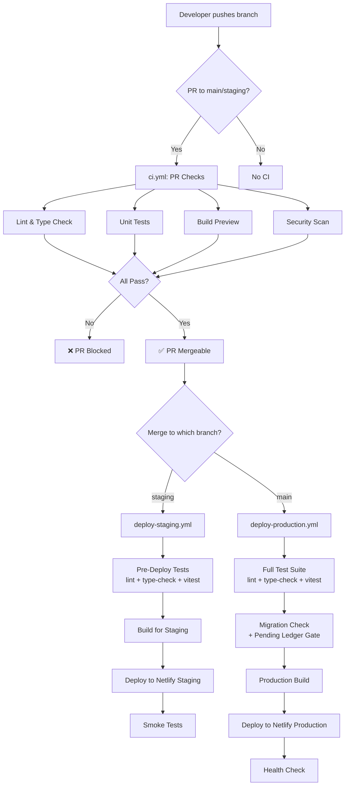
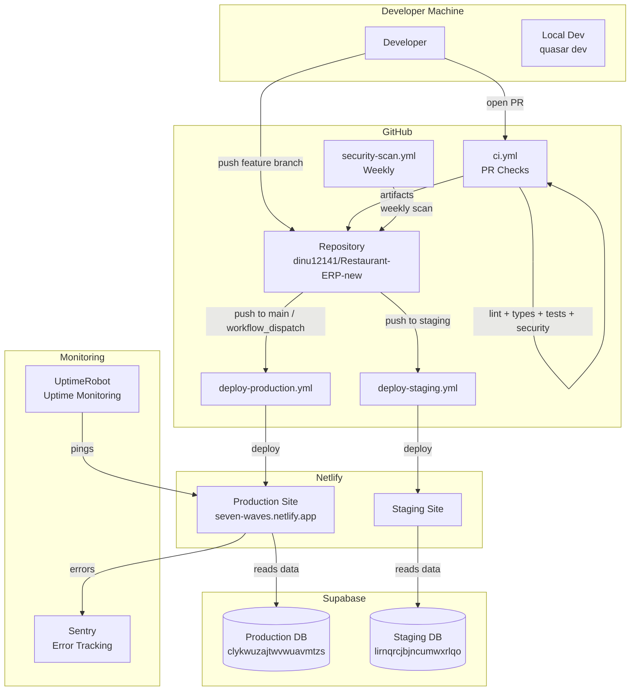

# Seven Waves Restaurant ERP — CI/CD Pipeline Design

> **Document type:** DevOps Reference  
> **Status:** Current — reflects pipelines as of 2026-07-16  
> **Author:** CICD Agent  
> **Applies to:** GitHub repository `dinu12141/Restaurant-ERP-new`, Netlify deployment  

---

## Table of Contents

1. [Pipeline Overview](#1-pipeline-overview)
2. [Current CI/CD Audit](#2-current-cicd-audit)
3. [Branch Strategy](#3-branch-strategy)
4. [PR / Feature Branch Pipeline](#4-pr--feature-branch-pipeline)
5. [Staging Deploy Pipeline](#5-staging-deploy-pipeline)
6. [Production Deploy Pipeline](#6-production-deploy-pipeline)
7. [Hotfix Pipeline](#7-hotfix-pipeline)
8. [Database Migration CI/CD Strategy](#8-database-migration-cicd-strategy)
9. [Environment Variables & Secrets Management](#9-environment-variables--secrets-management)
10. [Build Optimization Configuration](#10-build-optimization-configuration)
11. [Netlify Configuration Reference](#11-netlify-configuration-reference)
12. [Monitoring Integration](#12-monitoring-integration)
13. [Complete Working GitHub Actions YAML](#13-complete-working-github-actions-yaml)
14. [Rollback Runbook](#14-rollback-runbook)
15. [Incident Response](#15-incident-response)
16. [Security Gates in CI/CD](#16-security-gates-in-cicd)
17. [Performance Budgets](#17-performance-budgets)
18. [Required GitHub Secrets](#18-required-github-secrets)

---

## 1. Pipeline Overview

### 1.1 Philosophy

Seven Waves ERP is a **restaurant point-of-sale system**. Downtime directly impacts revenue. The pipeline is designed around three principles:

1. **Fast feedback** — PR checks must complete in under 5 minutes. Developers should know within minutes if their code is broken, not after a slow deploy.
2. **Safe deployments** — Every production deploy passes through quality gates (lint, type-check, tests, security scan, build verification, migration check) before reaching Netlify.
3. **Zero-downtime** — Netlify's atomic deploy model (swap deploy slots) plus SPA architecture means deploys never interrupt active users.

### 1.2 Pipeline Stages Diagram



### 1.3 Environment Map

| Branch | Pipeline | Environment | Netlify Site |
|--------|----------|-------------|--------------|
| `feature/*`, `fix/*` | ci.yml (PR checks only) | Preview | Build artifact only |
| `staging` | deploy-staging.yml | Staging | Separate Netlify site (`STAGING_NETLIFY_SITE_ID`) |
| `main` | deploy-production.yml | Production | Production Netlify site (`PRODUCTION_NETLIFY_SITE_ID`) |

---

## 2. Current CI/CD Audit

### 2.1 Existing Workflows (as of 2026-07-16)

Three GitHub Actions workflows exist in `.github/workflows/`:

| File | Trigger | Purpose | Status |
|------|---------|---------|--------|
| `ci.yml` | PR to `main` or `staging` | Quality gates | ✅ Active |
| `deploy-staging.yml` | Push to `staging` | Staging deployment | ✅ Active |
| `deploy-production.yml` | Push to `main` + `workflow_dispatch` | Production deployment | ✅ Active |

### 2.2 Audit Findings — Pre-Fix State

The following issues were found and corrected during the 2026-07-16 CICD hardening session:

#### Finding CI-01: Staging Missing Lint + Type-Check (HIGH — FIXED)

**File:** `.github/workflows/deploy-staging.yml`  
**Issue:** The pre-deploy test job only ran `npx vitest run`. ESLint and TypeScript errors could reach staging undetected.

```yaml
# BEFORE (broken):
- run: npm ci
- run: npx vitest run --reporter=verbose

# AFTER (fixed):
- run: npm ci
- name: ESLint
  run: npm run lint
- name: TypeScript Check
  run: npm run type-check
- name: Unit Tests
  run: npx vitest run --reporter=verbose
```

**Impact:** A single `@ts-ignore` or ESLint disable that accidentally became a real type error would have passed staging deployment.

#### Finding CI-02: Security Scan Non-Fatal (MEDIUM — FIXED)

**File:** `.github/workflows/ci.yml`  
**Issue:** `npm audit --omit=dev --audit-level=high || true` — the `|| true` silently passed even when high-severity vulnerabilities were found.

```yaml
# BEFORE (broken):
run: npm audit --omit=dev --audit-level=high || true

# AFTER (fixed):
run: npm audit --omit=dev --audit-level=high
```

**Impact:** A HIGH-severity npm dependency vulnerability (e.g., RCE in a dev tool, prototype pollution in a production dep) would have been silently ignored in every PR.

#### Finding CI-03: No Manual Production Deploy Trigger (LOW — FIXED)

**File:** `.github/workflows/deploy-production.yml`  
**Issue:** Production deploys were only triggered by `push` to `main`. No way to manually re-trigger without pushing a dummy commit.

```yaml
# ADDED:
workflow_dispatch:
  inputs:
    reason:
      description: 'Reason for manual deploy'
      required: true
      default: 'Manual production deployment'
```

**Impact:** Operational — if a deploy failed mid-way at Netlify but code was correct, there was no way to retry without polluting git history.

#### Finding CI-04: Invalid Secrets Grep Regex (LOW — FIXED)

**File:** `.github/workflows/ci.yml`  
**Issue:** The secrets scan used `grep -v "comment\|//\|*\|test"` where `\|*\|` is an invalid POSIX regex — `*` is not valid as a quantifier without a preceding atom. This could cause `grep` to fail silently or behave unexpectedly.

```bash
# BEFORE (broken regex):
grep -rn "service_role" src/ ... | grep -v "comment\|//\|*\|test"

# AFTER (correct regex, line-by-line exclusion):
grep -rn "service_role" src/ ... | grep -v "^\s*//" | grep -v "^\s*\*"
```

#### Finding CI-05: No Hardcoded JWT/Key Detection (MEDIUM — FIXED)

**File:** `.github/workflows/ci.yml`  
**Issue:** The secrets scan only checked for the string `"service_role"` but not for actual hardcoded JWT tokens (which start with `eyJhbGciOiJIUzI1NiIsInR5cCI6IkpXVCJ9.`).

```bash
# ADDED:
if grep -rn "eyJhbGciOiJIUzI1NiIsInR5cCI6IkpXVCJ9\." src/ ...; then
  echo "❌ Hardcoded JWT token found in source code!"
  exit 1
fi
```

#### Finding CI-06: No Pending Migrations Gate (CRITICAL — FIXED)

**File:** `.github/workflows/deploy-production.yml`  
**Issue:** The migration-check job only detected *new* SQL files added in the current commit. It did not check whether critical SQL files listed in `supabase/applied_migrations_ledger.sql` PENDING section had been applied to the database.

**Added:** A `Check Pending Migrations Ledger` step that:
1. Parses `supabase/applied_migrations_ledger.sql` for the `PENDING MIGRATIONS` section
2. Extracts filenames listed there as comments (`-- filename.sql`)
3. Checks if those files exist in the repo
4. Hard-fails the production deploy if any file matching `security|rls|fix|lockdown|hardening` is pending

**Impact:** Without this gate, `supabase/fix_missing_rls_policies.sql` (a critical security fix covering 3 CRITICAL + 4 HIGH vulnerabilities) could have been silently skipped while the app was deployed to production.

#### Finding CI-07: .env Tracking Check Missing (MEDIUM — FIXED)

**File:** `.github/workflows/ci.yml`  
**Issue:** No CI check verified that `.env` files were not staged/tracked by git.

**Added:**
```bash
TRACKED=$(git ls-files .env .env.local .env.production .env.staging 2>/dev/null || true)
if [ -n "$TRACKED" ]; then
  echo "❌ .env file(s) are tracked by git: $TRACKED"
  exit 1
fi
```

**Note:** Historical `.env` files in git history (commits `e55a0c1`, `d70d105`, `d24c943`, `71f6daa`) cannot be removed by CI. See [Section 14.4 — Credential Rotation](#144-credential-rotation-runbook) for the manual cleanup procedure.

#### Finding CI-08: No Gitleaks Secret Scanning (MEDIUM — FIXED)

**File:** `.github/workflows/ci.yml`  
**Issue:** No automated secret scanning on PR commits. An accidental commit containing a Stripe key, Supabase service key, or API token would not be caught before merge.

**Added:** `gitleaks/gitleaks-action@v2` which automatically scans only the PR's new commits (diff mode, not full history scan).

### 2.3 Items Not Yet Fixed (Backlog)

| ID | Issue | Severity | Owner | Status |
|----|-------|----------|-------|--------|
| CI-09 | No Sentry source map upload step in production deploy | MEDIUM | DevOps | PENDING — requires `@sentry/vue` install |
| CI-10 | Electron build not validated in CI | LOW | CICD | PENDING |
| CI-11 | No Playwright E2E test job | MEDIUM | QA | PENDING |
| CI-12 | No k6 performance baseline job | LOW | Perf | PENDING |
| CI-13 | Git history contains live credentials (4 commits) | CRITICAL | Repo owner | **MANUAL ACTION REQUIRED** |
| CI-14 | No CodeQL SAST scanning | MEDIUM | CICD | PENDING |
| CI-15 | `format:check` step missing from CI (Prettier) | LOW | CICD | PENDING |

---

## 3. Branch Strategy

### 3.1 Branch Model

```
main (production)
  └── staging (staging environment)
       ├── feature/pos-split-bill
       ├── feature/online-payment-gateway
       ├── fix/waiter-shift-realtime
       └── hotfix/payment-void-bug       ← merges to main AND staging
```

### 3.2 Branch Naming Conventions

| Branch prefix | Purpose | Deploys to |
|---------------|---------|-----------|
| `feature/*` | New features | PR checks only |
| `fix/*` | Bug fixes | PR checks only |
| `hotfix/*` | Emergency production fixes | Fast-tracked to main + staging |
| `refactor/*` | Code cleanup, no feature change | PR checks only |
| `docs/*` | Documentation only | No CI (docs changes in paths-ignore) |
| `staging` | Integration branch for staging deploy | Staging environment |
| `main` | Production-ready code | Production environment |

### 3.3 Protected Branch Rules (Recommended GitHub Settings)

```yaml
# main branch:
required_status_checks:
  strict: true
  contexts:
    - "Lint & Type Check"
    - "Unit Tests"
    - "Build Preview"
    - "Security Scan"
required_pull_request_reviews:
  required_approving_review_count: 1
  dismiss_stale_reviews: true
enforce_admins: false  # allow admins to hotfix
allow_force_pushes: false
allow_deletions: false
```

---

## 4. PR / Feature Branch Pipeline

**File:** `.github/workflows/ci.yml`  
**Trigger:** `pull_request` to `main` or `staging`

### 4.1 Concurrency

```yaml
concurrency:
  group: ci-${{ github.head_ref }}
  cancel-in-progress: true
```

If a developer pushes two commits in quick succession, the first CI run is cancelled when the second starts. This avoids wasting runner minutes.

### 4.2 Job: Lint & Type Check

```yaml
lint-and-typecheck:
  name: Lint & Type Check
  runs-on: ubuntu-latest
  steps:
    - uses: actions/checkout@v4
    - uses: actions/setup-node@v4
      with:
        node-version: 22
        cache: npm
    - run: npm ci
    - name: ESLint
      run: npm run lint
    - name: TypeScript Check
      run: npm run type-check
```

**What it checks:**
- `npm run lint` → `eslint -c ./eslint.config.js "./src*/**/*.{js,cjs,mjs,vue}"` — covers `src/`, `src-electron/`, `src-pwa/`
- `npm run type-check` → `vue-tsc --noEmit --skipLibCheck` — full TypeScript + Vue template type checking

**Failure cases:**
- Any ESLint error (warnings are allowed per current config)
- Any TypeScript error in `.ts`, `.vue` templates
- `@ts-ignore` that masks a real error

### 4.3 Job: Unit Tests

```yaml
test:
  name: Unit Tests
  runs-on: ubuntu-latest
  steps:
    - uses: actions/checkout@v4
    - uses: actions/setup-node@v4
      with:
        node-version: 22
        cache: npm
    - run: npm ci
    - name: Run Vitest
      run: npx vitest run --reporter=verbose
```

**What it tests:**
- `src/core/__tests__/permissions.test.ts` — RBAC permission logic (hasPermission, hasModuleAccess)
- `src/core/__tests__/security-rls.test.ts` — RLS policy structural validation (38 tests)
- `src/modules/finance/__tests__/` — Finance module tests
- `src/modules/devices/__tests__/devices.test.ts` — Hardware IPC, payment terminal, label printer (25 tests)

**Environment:** `vitest.config.ts` provides `VITE_QR_SECRET: 'test-secret-for-vitest'` so QR service tests don't fail on missing env.

**Coverage:** Not yet collected in CI (see [CI-09](#23-items-not-yet-fixed-backlog)). Target: 80% for core/, 60% for stores/.

### 4.4 Job: Build Preview

```yaml
build:
  name: Build Preview
  runs-on: ubuntu-latest
  needs: [lint-and-typecheck, test]
  steps:
    - uses: actions/checkout@v4
    - uses: actions/setup-node@v4
      with:
        node-version: 22
        cache: npm
    - run: npm ci
    - name: Build SPA
      env:
        VITE_APP_ENV: preview
        VITE_APP_VERSION: ${{ github.sha }}
        VITE_SUPABASE_URL: ${{ secrets.STAGING_SUPABASE_URL }}
        VITE_SUPABASE_ANON_KEY: ${{ secrets.STAGING_SUPABASE_ANON_KEY }}
        VITE_GOOGLE_MAPS_KEY: ${{ secrets.GOOGLE_MAPS_KEY }}
        VITE_ENABLE_PWA: 'true'
        VITE_ENABLE_REALTIME: 'true'
        VITE_ENABLE_OFFLINE: 'true'
      run: npx quasar build
    - name: Verify Build Output
      run: |
        test -f dist/spa/index.html || (echo "❌ Build output missing" && exit 1)
        echo "✅ Build output verified"
        du -sh dist/spa/
    - uses: actions/upload-artifact@v4
      with:
        name: spa-build-${{ github.sha }}
        path: dist/spa/
        retention-days: 3
```

**Notes:**
- Build only runs after lint + test pass (`needs: [lint-and-typecheck, test]`)
- Uses staging Supabase credentials (NOT production) for PR builds
- Artifact retained 3 days (enough for PR review)
- Expected build time: 2–4 minutes

### 4.5 Job: Security Scan

```yaml
security-scan:
  name: Security Scan
  runs-on: ubuntu-latest
  steps:
    - uses: actions/checkout@v4
      with:
        fetch-depth: 0
    - uses: actions/setup-node@v4
      with:
        node-version: 22
        cache: npm
    - run: npm ci

    - name: Audit Dependencies
      run: npm audit --omit=dev --audit-level=high

    - name: Check .env Not Tracked by Git
      run: |
        TRACKED=$(git ls-files .env .env.local .env.production .env.staging 2>/dev/null || true)
        if [ -n "$TRACKED" ]; then
          echo "❌ .env file(s) are tracked by git: $TRACKED"
          exit 1
        fi
        echo "✅ No .env files tracked"

    - name: Check for Exposed Secrets in Source
      run: |
        if grep -rn "service_role" src/ --include="*.ts" --include="*.js" --include="*.vue" \
          | grep -v "^\s*//" | grep -v "^\s*\*"; then
          echo "❌ service_role key reference found in source code!"
          exit 1
        fi
        if grep -rn "eyJhbGciOiJIUzI1NiIsInR5cCI6IkpXVCJ9\." src/ \
          --include="*.ts" --include="*.js" --include="*.vue" 2>/dev/null; then
          echo "❌ Hardcoded JWT token found in source code!"
          exit 1
        fi
        echo "✅ No exposed secrets found in source"

    - name: Gitleaks — Scan PR Commits for Secrets
      uses: gitleaks/gitleaks-action@v2
      env:
        GITHUB_TOKEN: ${{ secrets.GITHUB_TOKEN }}
        GITLEAKS_LICENSE: ${{ secrets.GITLEAKS_LICENSE }}
```

**What the security scan covers:**

| Check | Tool | What It Catches |
|-------|------|-----------------|
| Dependency vulnerabilities | `npm audit` | Known CVEs in production dependencies |
| `.env` file tracking | `git ls-files` | Accidentally staged env files |
| Hardcoded `service_role` strings | `grep` | Supabase admin key exposure |
| Hardcoded JWT tokens | `grep` | Any base64-encoded JWT in source |
| Secret patterns in commits | `gitleaks` | API keys, connection strings, tokens in new commits |

**Gitleaks note:** The community edition is free for all repos. `GITLEAKS_LICENSE` secret is optional (suppresses a one-line warning in logs). Configure at: `Settings → Secrets → GITLEAKS_LICENSE`.

---

## 5. Staging Deploy Pipeline

**File:** `.github/workflows/deploy-staging.yml`  
**Trigger:** Push to `staging` branch

### 5.1 Job: Pre-Deploy Tests

```yaml
test:
  name: Pre-Deploy Tests
  runs-on: ubuntu-latest
  steps:
    - uses: actions/checkout@v4
    - uses: actions/setup-node@v4
      with:
        node-version: 22
        cache: npm
    - run: npm ci
    - name: ESLint
      run: npm run lint
    - name: TypeScript Check
      run: npm run type-check
    - name: Unit Tests
      run: npx vitest run --reporter=verbose
```

**Why lint + type-check are repeated here:** The staging deploy can be triggered by a direct push to `staging` (e.g., hotfix merges, cherry-picks). Without these checks, a TypeScript error introduced outside of a formal PR could bypass quality gates.

### 5.2 Job: Environment Isolation Check

```yaml
- name: Verify Environment Isolation
  env:
    STAGING_URL: ${{ secrets.STAGING_SUPABASE_URL }}
    PROD_URL: ${{ secrets.PRODUCTION_SUPABASE_URL }}
  run: |
    if [ "$STAGING_URL" = "$PROD_URL" ]; then
      echo "❌ FATAL: STAGING_SUPABASE_URL equals PRODUCTION_SUPABASE_URL!"
      exit 1
    fi
    if echo "$STAGING_URL" | grep -q "lirnqrcjbjncumwxrlqo"; then
      echo "✅ Staging URL points to staging project"
    fi
```

This guard prevents the worst possible accident: deploying staging code that points to the **production Supabase database**. Both Supabase project URLs are checked and must be different.

### 5.3 Job: Staging Build

```yaml
env:
  VITE_APP_ENV: staging
  VITE_APP_VERSION: ${{ github.sha }}
  VITE_SUPABASE_URL: ${{ secrets.STAGING_SUPABASE_URL }}
  VITE_SUPABASE_ANON_KEY: ${{ secrets.STAGING_SUPABASE_ANON_KEY }}
  VITE_GOOGLE_MAPS_KEY: ${{ secrets.GOOGLE_MAPS_KEY }}
  VITE_APP_PUBLIC_URL: ${{ secrets.STAGING_PUBLIC_URL }}
  VITE_SENTRY_DSN: ${{ secrets.STAGING_SENTRY_DSN }}
  VITE_ENABLE_PWA: 'true'
  VITE_ENABLE_REALTIME: 'true'
  VITE_ENABLE_OFFLINE: 'true'
run: npx quasar build
```

**Note:** `VITE_SENTRY_DSN` is provided for staging so errors in staging are captured in a separate Sentry environment. This requires creating a "Staging" environment in Sentry with its own DSN.

### 5.4 Job: Deploy to Netlify Staging

```yaml
- uses: nwtgck/actions-netlify@v3
  with:
    publish-dir: dist/spa
    production-deploy: true
    github-token: ${{ secrets.GITHUB_TOKEN }}
    deploy-message: "Staging deploy — ${{ github.sha }}"
  env:
    NETLIFY_AUTH_TOKEN: ${{ secrets.NETLIFY_AUTH_TOKEN }}
    NETLIFY_SITE_ID: ${{ secrets.STAGING_NETLIFY_SITE_ID }}
```

**Note:** `production-deploy: true` here refers to the Netlify concept of a "production deploy" (as opposed to a "deploy preview"). The staging Netlify site has its own dedicated `SITE_ID` — this does NOT deploy to the production Netlify site.

### 5.5 Job: Staging Smoke Tests

```yaml
smoke-test:
  name: Staging Smoke Tests
  runs-on: ubuntu-latest
  needs: [deploy]
  steps:
    - name: Wait for Deploy Propagation
      run: sleep 30
    - name: Health Check
      env:
        STAGING_URL: ${{ secrets.STAGING_PUBLIC_URL }}
      run: |
        STATUS=$(curl -s -o /dev/null -w "%{http_code}" "$STAGING_URL")
        if [ "$STATUS" != "200" ]; then
          echo "❌ App returned HTTP $STATUS"
          exit 1
        fi
        echo "✅ App loads (HTTP 200)"

        BODY=$(curl -s "$STAGING_URL")
        if echo "$BODY" | grep -q "Seven Waves"; then
          echo "✅ App title found"
        else
          echo "⚠️ App title not found in response"
        fi

        HEADERS=$(curl -sI "$STAGING_URL")
        for HEADER in "x-content-type-options" "x-frame-options" "referrer-policy"; do
          if echo "$HEADERS" | grep -qi "$HEADER"; then
            echo "✅ Header: $HEADER"
          else
            echo "⚠️ Missing header: $HEADER"
          fi
        done
```

**Note on SPA body check:** The index.html has `<title>Seven Waves ERP</title>` in static HTML, so `grep -q "Seven Waves"` does work on the raw Netlify response (the SPA shell is static HTML — only the Vue app content is JS-rendered). This is not a false check.

---

## 6. Production Deploy Pipeline

**File:** `.github/workflows/deploy-production.yml`  
**Triggers:** Push to `main` OR `workflow_dispatch` (manual)

### 6.1 Concurrency (Non-Cancellable)

```yaml
concurrency:
  group: deploy-production
  cancel-in-progress: false  # Never cancel a production deploy in progress
```

Unlike CI which cancels stale runs, production deploys are **never** auto-cancelled. If two production deploys are triggered simultaneously (e.g., a push races with a manual dispatch), the second waits for the first to complete.

### 6.2 Manual Deploy Trigger

```yaml
workflow_dispatch:
  inputs:
    reason:
      description: 'Reason for manual deploy'
      required: true
      default: 'Manual production deployment'
```

Use cases for manual production deploys:
- Re-deploying after a Netlify outage
- Forced re-deploy after rotating Supabase credentials (same code, new env vars)
- Re-triggering a deploy that failed at the Netlify API step (not a code issue)

The `reason` field is logged in the GitHub Step Summary for audit purposes.

### 6.3 Job: Full Test Suite

```yaml
test:
  name: Full Test Suite
  steps:
    - run: npm run lint
    - run: npm run type-check
    - run: npx vitest run --reporter=verbose
```

Same as staging + PR, but on production this is the **last line of defense** before the code goes live. Failures here stop the entire deploy pipeline.

### 6.4 Job: Migration Validation

```yaml
migration-check:
  name: Migration Validation
  steps:
    - name: Check for New Migrations
      # Detects newly added .sql files in supabase/migrations/

    - name: Validate SQL Syntax
      # Only runs if new migrations detected:
      # - No DROP TABLE without IF EXISTS
      # - No TRUNCATE (use DELETE WHERE instead)

    - name: Check Pending Migrations Ledger
      # CRITICAL: Parses supabase/applied_migrations_ledger.sql
      # Fails if any security-critical SQL file is listed in PENDING section
      # but has not been applied to the database
```

**Pending Migrations Gate — How It Works:**

```
supabase/applied_migrations_ledger.sql contains:

-- =====================================================
-- PENDING MIGRATIONS — NOT YET APPLIED TO SUPABASE
-- =====================================================

-- !! CRITICAL SECURITY FIX — Apply immediately !!
-- fix_missing_rls_policies.sql     ← CI scans for this
```

The script:
1. Reads lines after `PENDING MIGRATIONS` header
2. Matches `-- somefile.sql` pattern
3. Checks if `supabase/somefile.sql` or `supabase/migrations/somefile.sql` exists in the repo
4. If filename matches `security|rls|fix|lockdown|hardening` → CRITICAL counter increments
5. If `CRITICAL > 0` → `exit 1` → production deploy blocked

**To unblock production after applying a pending migration:**
1. Apply the SQL via Supabase Dashboard → SQL Editor
2. Add the ledger INSERT (shown in the PENDING comment) to `applied_migrations_ledger.sql`
3. Remove the `-- filename.sql` line from the PENDING section
4. Commit and push → CI gate will pass

### 6.5 Job: Production Build

```yaml
build:
  name: Production Build
  needs: [test, migration-check]
  steps:
    - name: Verify Environment Isolation
      # Checks PRODUCTION_SUPABASE_URL ≠ STAGING_SUPABASE_URL
      # Verifies production URL contains expected project ref

    - name: Build Production SPA
      env:
        VITE_APP_ENV: production
        VITE_APP_VERSION: ${{ github.sha }}
        VITE_SUPABASE_URL: ${{ secrets.PRODUCTION_SUPABASE_URL }}
        VITE_SUPABASE_ANON_KEY: ${{ secrets.PRODUCTION_SUPABASE_ANON_KEY }}
        VITE_GOOGLE_MAPS_KEY: ${{ secrets.GOOGLE_MAPS_KEY }}
        VITE_APP_PUBLIC_URL: ${{ secrets.PRODUCTION_PUBLIC_URL }}
        VITE_SENTRY_DSN: ${{ secrets.PRODUCTION_SENTRY_DSN }}
        VITE_ENABLE_PWA: 'true'
        VITE_ENABLE_REALTIME: 'true'
        VITE_ENABLE_OFFLINE: 'true'
      run: npx quasar build

    - name: Verify Build
      run: |
        test -f dist/spa/index.html
        BUNDLE_SIZE=$(du -sk dist/spa/ | cut -f1)
        echo "📦 Bundle size: ${BUNDLE_SIZE}KB"
        if [ "$BUNDLE_SIZE" -gt 10240 ]; then
          echo "⚠️ Bundle size exceeds 10MB — consider code splitting"
        fi

    - uses: actions/upload-artifact@v4
      with:
        name: production-build-${{ github.sha }}
        path: dist/spa/
        retention-days: 30  # Keep production builds for 30 days (audit trail)
```

### 6.6 Job: Deploy to Production

```yaml
deploy:
  name: Deploy to Production
  needs: [build]
  environment: production  # Requires GitHub environment approval if configured
  steps:
    - uses: actions/download-artifact@v4
      with:
        name: production-build-${{ github.sha }}
        path: dist/spa/
    - uses: nwtgck/actions-netlify@v3
      with:
        publish-dir: dist/spa
        production-deploy: true
        github-token: ${{ secrets.GITHUB_TOKEN }}
        deploy-message: "Production v${{ github.sha }}"
      env:
        NETLIFY_AUTH_TOKEN: ${{ secrets.NETLIFY_AUTH_TOKEN }}
        NETLIFY_SITE_ID: ${{ secrets.PRODUCTION_NETLIFY_SITE_ID }}
    - name: Record Deployment
      run: |
        echo "## 🚀 Production Deployment" >> $GITHUB_STEP_SUMMARY
        echo "- **Commit:** ${{ github.sha }}" >> $GITHUB_STEP_SUMMARY
        echo "- **Time:** $(date -u +%Y-%m-%dT%H:%M:%SZ)" >> $GITHUB_STEP_SUMMARY
        echo "- **Deployer:** ${{ github.actor }}" >> $GITHUB_STEP_SUMMARY
        echo "- **Trigger:** ${{ github.event_name }}..." >> $GITHUB_STEP_SUMMARY
```

**Note:** The `environment: production` tag in GitHub Actions can be configured to require a human approval before the deploy job runs. This creates a manual gate in the GitHub UI:

```
GitHub UI: Environments → production → Required reviewers → [add Tech Lead]
```

With this configured, no code merges to `main` without a human approving the production deploy.

### 6.7 Job: Production Health Check

```yaml
health-check:
  name: Production Health Check
  needs: [deploy]
  steps:
    - name: Wait for Deploy Propagation
      run: sleep 45
    - name: Run Health Checks
      # Checks: HTTP 200, security headers (HSTS, X-Frame-Options, etc.),
      # service worker accessible, immutable cache on assets
```

**Health check endpoints:**
1. `$PROD_URL` → must return HTTP 200
2. `$PROD_URL/sw.js` → service worker (PWA health)
3. Security headers: `x-content-type-options`, `x-frame-options`, `referrer-policy`, `strict-transport-security`
4. Asset caching: `max-age=31536000` on `/assets/*` files

**On failure:** The `Notify on Failure` step writes to `$GITHUB_STEP_SUMMARY`. The team should also configure Slack/Discord notifications here (see [Section 12.3](#123-deployment-notifications)).

---

## 7. Hotfix Pipeline

Hotfixes bypass the normal `feature → staging → main` path to address production emergencies.

### 7.1 Hotfix Procedure

```bash
# 1. Branch from main (not staging)
git checkout main
git pull origin main
git checkout -b hotfix/payment-void-bug

# 2. Apply the fix
# ... edit files ...

# 3. Push — CI runs (lint + type-check + tests must pass)
git push origin hotfix/payment-void-bug

# 4. PR directly to main (skip staging for true emergencies)
# CI checks run automatically

# 5. After merge, immediately merge back to staging
git checkout staging
git pull origin staging
git merge main
git push origin staging
```

### 7.2 Hotfix CI Rules

Hotfix PRs to `main` still trigger the full `ci.yml`. The only relaxation is:
- A single approver suffices (vs normal 1+ reviewers)
- Can skip QA sign-off on staging (since no staging deploy happened)

**Never skip:**
- TypeScript check
- Unit tests
- Security scan

### 7.3 Emergency Deploy (Hotfix Without PR)

For true P0 incidents (e.g., auth is completely broken, payments failing):

```bash
# Push directly to main (bypasses PR requirement if admin override is set)
git checkout main
git cherry-pick <hotfix-commit>
git push origin main
# → deploy-production.yml triggers automatically
```

After the emergency, create a retroactive PR documenting the change.

---

## 8. Database Migration CI/CD Strategy

### 8.1 Current State

The Seven Waves ERP uses a **manual migration model**:
- All SQL files live in `supabase/migrations/` (timestamped) and `supabase/` (named)
- Applied via Supabase Dashboard → SQL Editor or MCP `execute_sql` tool
- `supabase/applied_migrations_ledger.sql` tracks what has been applied

As of 2026-07-16, there are 25 migration files in `supabase/migrations/` ranging from 2026-03-14 to 2026-05-18.

### 8.2 Migration File Naming Convention (Target)

```
supabase/migrations/
  YYYYMMDDHHMMSS_description.sql        # timestamped (Supabase CLI format)
  20260716130000_add_company_id_menus.sql
  20260716140000_fix_rls_profiles.sql
```

For `supabase/` root (legacy one-off fixes):
```
supabase/
  fix_missing_rls_policies.sql    # security fixes
  offline_sync_rpcs.sql           # new RPC groups
  schema.sql                      # base schema (applied once)
```

### 8.3 CI Migration Validation (Current)

The `migration-check` job in `deploy-production.yml` validates:

```yaml
- name: Check for New Migrations
  run: |
    CHANGED=$(git diff --name-only HEAD~1 HEAD -- 'supabase/migrations/' 2>/dev/null || echo "")
    # → detects newly added .sql files

- name: Validate SQL Syntax
  if: has_migrations == 'true'
  run: |
    for f in <changed sql files>; do
      # Fail if: DROP TABLE without IF EXISTS
      # Fail if: TRUNCATE (use DELETE WHERE instead)
    done

- name: Check Pending Migrations Ledger
  run: |
    # Parse supabase/applied_migrations_ledger.sql PENDING section
    # Block deploy if security-critical SQL files are pending
```

### 8.4 Target: Supabase CLI Integration (Future)

When the team adopts the Supabase CLI locally:

```yaml
# Future migration step in deploy-staging.yml:
- name: Apply Migrations to Staging
  env:
    SUPABASE_ACCESS_TOKEN: ${{ secrets.SUPABASE_ACCESS_TOKEN }}
    SUPABASE_PROJECT_REF: lirnqrcjbjncumwxrlqo   # staging project
  run: |
    npx supabase link --project-ref $SUPABASE_PROJECT_REF
    npx supabase db push --include-all
```

**Note:** Production migrations must NEVER be auto-applied from CI. Always manual → staging first, verify, then manually apply to production.

### 8.5 Migration Safety Rules

| Rule | Reason |
|------|--------|
| Never `DROP TABLE` without `IF EXISTS` | Prevents accidental data loss if run twice |
| Never `TRUNCATE` in migrations | `DELETE WHERE` is safer; can be filtered by date |
| Always `ON CONFLICT DO NOTHING` on seed inserts | Idempotent migrations |
| Always test rollback SQL | If forward migration breaks prod, rollback must be ready |
| Take backup BEFORE applying to production | Non-negotiable for schema changes |
| Apply to staging first, verify 24h+ | Catch silent data issues before they hit prod |

### 8.6 Rollback SQL (Template)

Every migration file should end with:

```sql
-- ═══════════════════════════════════════════════════════
-- ROLLBACK (apply if this migration needs to be reverted)
-- ═══════════════════════════════════════════════════════
/*
BEGIN;
  -- Undo each change in reverse order
  DROP TABLE IF EXISTS public.new_table;
  ALTER TABLE public.existing_table DROP COLUMN IF EXISTS new_column;
  -- Re-create dropped indexes/constraints
COMMIT;
*/
```

---

## 9. Environment Variables & Secrets Management

### 9.1 Variable Inventory

| Variable | Dev (`.env`) | CI/Staging | CI/Production | Notes |
|----------|-------------|------------|---------------|-------|
| `VITE_SUPABASE_URL` | `.env` | GitHub Secret | GitHub Secret | Safe to expose (with RLS) |
| `VITE_SUPABASE_ANON_KEY` | `.env` | GitHub Secret | GitHub Secret | Public key, safe in SPA |
| `VITE_APP_ENV` | `.env` | `staging` | `production` | Set inline in workflow |
| `VITE_APP_VERSION` | `.env` | `${{ github.sha }}` | `${{ github.sha }}` | Set inline |
| `VITE_APP_PUBLIC_URL` | Not set | GitHub Secret | GitHub Secret | Set for custom domains only |
| `VITE_SENTRY_DSN` | Optional | `STAGING_SENTRY_DSN` | `PRODUCTION_SENTRY_DSN` | Per-environment |
| `VITE_GOOGLE_MAPS_KEY` | `.env` | `GOOGLE_MAPS_KEY` | `GOOGLE_MAPS_KEY` | Same key for all |
| `VITE_ENABLE_PWA` | `.env` | `'true'` | `'true'` | Inline |
| `VITE_ENABLE_REALTIME` | `.env` | `'true'` | `'true'` | Inline |
| `VITE_ENABLE_OFFLINE` | `.env` | `'true'` | `'true'` | Inline |
| `SUPABASE_SERVICE_ROLE_KEY` | `.env.local` ONLY | Edge Functions only | Edge Functions only | **NEVER in Vite build** |
| `NETLIFY_AUTH_TOKEN` | N/A | GitHub Secret | GitHub Secret | Netlify deploy token |
| `NETLIFY_SITE_ID` | N/A | `STAGING_NETLIFY_SITE_ID` | `PRODUCTION_NETLIFY_SITE_ID` | Separate sites |

### 9.2 Why the Supabase Anon Key Is Safe in the SPA

A common question: "Isn't it insecure to expose the Supabase URL and anon key in the built JavaScript?"

**No.** The Supabase anon key is designed to be public:
- It is a JWT with `role: anon` — minimum trust level
- All database access through the anon key is controlled by **Row Level Security (RLS) policies**
- Without a valid `auth.users` session, the anon key can only access tables with explicit `anon` grants
- The anon key cannot call `supabase_admin` functions or access the management API

What MUST remain secret:
- `SUPABASE_SERVICE_ROLE_KEY` — bypasses all RLS, grants full database access. Must only be used in:
  - Supabase Edge Functions (server-side)
  - Supabase Dashboard (admin operations)
  - **NEVER included in `VITE_*` variables** (they get bundled into client JS)

### 9.3 GitHub Secrets Setup Procedure

Navigate to: `GitHub → Repository → Settings → Secrets and variables → Actions`

**Required secrets (create these before CI will work):**

```
Production:
  PRODUCTION_SUPABASE_URL          = https://clykwuzajtwvwuavmtzs.supabase.co
  PRODUCTION_SUPABASE_ANON_KEY     = eyJ...  (from Supabase Dashboard → Project Settings → API)
  PRODUCTION_PUBLIC_URL            = https://seven-waves.netlify.app
  PRODUCTION_NETLIFY_SITE_ID       = [from Netlify site settings]
  PRODUCTION_SENTRY_DSN            = https://xxx@xxx.ingest.sentry.io/xxx

Staging:
  STAGING_SUPABASE_URL             = https://lirnqrcjbjncumwxrlqo.supabase.co
  STAGING_SUPABASE_ANON_KEY        = eyJ...  (staging project API key)
  STAGING_PUBLIC_URL               = https://staging-seven-waves.netlify.app
  STAGING_NETLIFY_SITE_ID          = [from Netlify staging site settings]
  STAGING_SENTRY_DSN               = https://xxx@xxx.ingest.sentry.io/xxx (separate Sentry project)

Shared:
  NETLIFY_AUTH_TOKEN               = [from Netlify → User settings → Personal access tokens]
  GOOGLE_MAPS_KEY                  = [from Google Cloud Console → APIs → Maps JavaScript API]
  GITLEAKS_LICENSE                 = [optional — suppresses Gitleaks warning]
```

### 9.4 Secret Rotation Procedure

**Rotate Supabase Anon Key (e.g., after credential exposure):**
1. Go to Supabase Dashboard → Project Settings → API → Reset anon key
2. Copy the new anon key
3. Update `PRODUCTION_SUPABASE_ANON_KEY` and `STAGING_SUPABASE_ANON_KEY` in GitHub Secrets
4. Trigger a manual production deploy: Actions → CD — Deploy Production → Run workflow
5. Verify the app works (users may need to log in again if the old key was embedded in their PWA cache)

**Rotate Netlify Auth Token:**
1. Netlify → User Settings → Personal Access Tokens → Create new token
2. Update `NETLIFY_AUTH_TOKEN` in GitHub Secrets
3. Delete the old token in Netlify

**Annual rotation schedule:**
- Q1: Rotate `NETLIFY_AUTH_TOKEN`
- Q2: Review `GOOGLE_MAPS_KEY` (check for billing anomalies)
- Q3: Rotate Supabase service role key (not in CI, but in Edge Function env)
- Q4: Full audit of all secrets, remove unused ones

### 9.5 .gitignore Verification

The following are in `.gitignore` and must never be committed:

```gitignore
.env
.env.*
!.env.example
.env.local*
.claude/settings.json  # Contains Supabase MCP access token
```

**Historical incident:** Commits `e55a0c1`, `d70d105`, `d24c943`, `71f6daa` contain `.env` with live credentials in git history. See [Section 14.4](#144-credential-rotation-runbook) for cleanup procedure.

---

## 10. Build Optimization Configuration

### 10.1 Quasar Build Configuration

**File:** `quasar.config.js`

The build uses Vite's `manualChunks` to split the vendor bundle:

```javascript
manualChunks(id) {
  if (id.includes('node_modules')) {
    if (id.includes('@supabase'))   return 'vendor-supabase'
    if (id.includes('vue') || id.includes('pinia') || id.includes('vue-router'))
                                    return 'vendor-vue'
    if (id.includes('quasar'))      return 'vendor-quasar'
    if (id.includes('chart') || id.includes('apexcharts'))
                                    return 'vendor-charts'
    if (id.includes('jspdf') || id.includes('pdfmake') || id.includes('html2canvas'))
                                    return 'vendor-pdf'     // LAZY loaded
    if (id.includes('xlsx') || id.includes('exceljs'))
                                    return 'vendor-excel'   // LAZY loaded
    // @google/generative-ai: NOT listed here — let Vite handle it
    // as a natural lazy chunk (only loaded on /ai/* routes)
  }
}
```

### 10.2 Bundle Size Analysis (Post-Optimization)

After the 2026-07-16 DevOps + Perf optimization session:

| Chunk | Size (gzipped) | Load Strategy | Notes |
|-------|---------------|---------------|-------|
| `vendor-vue` | ~139KB | Eager (modulepreload) | Vue 3, Pinia, vue-router |
| `vendor-quasar` | ~19KB | Eager (modulepreload) | Quasar framework core |
| `vendor-supabase` | ~35KB | Eager (modulepreload) | Supabase JS client |
| `vendor-charts` | ~132KB | Was eager → now lazy | ApexCharts (DashboardChart uses defineAsyncComponent) |
| `vendor-pdf` | ~155KB | Lazy | jsPDF, html2canvas — loaded on print pages only |
| `vendor-excel` | ~384KB | Lazy | xlsx, exceljs — loaded on export pages only |
| `mod-ai` | ~173KB | Lazy | @google/generative-ai — loaded only on /ai/* routes |
| `index` | ~3KB | Eager | App entry point |

**Total initial JS sent to browser:** ~193KB gzipped (vue + quasar + supabase + entry). All other chunks load on-demand.

**Before optimization (for reference):**
- `vendor` catch-all: 655KB gzipped
- PDF and Excel eager-loaded for every user including kitchen staff

### 10.3 PWA Workbox Configuration

**Added by Perf agent in `quasar.config.js`:**

```javascript
extendGenerateSWOptions(cfg) {
  cfg.skipWaiting = true        // New SW takes control immediately
  cfg.clientsClaim = true       // Controls all open tabs
  cfg.cleanupOutdatedCaches = true  // Removes old cache versions

  cfg.runtimeCaching = [
    // JS/CSS: Fresh on deploy, instant on subsequent loads
    {
      urlPattern: /\.(?:js|css)$/,
      handler: 'StaleWhileRevalidate',
      options: { cacheName: 'static-resources', expiration: { maxAgeSeconds: 604800 } }
    },
    // Images: Cache aggressively
    {
      urlPattern: /\.(?:png|jpg|jpeg|svg|gif|webp|ico)$/,
      handler: 'CacheFirst',
      options: { cacheName: 'images', expiration: { maxAgeSeconds: 2592000 } }
    },
    // Supabase REST API: Network first with cache fallback for offline
    {
      urlPattern: /https:\/\/.*\.supabase\.co\/rest\//,
      handler: 'NetworkFirst',
      options: {
        cacheName: 'supabase-api',
        networkTimeoutSeconds: 5,
        expiration: { maxAgeSeconds: 300 }
      }
    }
  ]
}
```

### 10.4 Build Targets

```javascript
target: {
  browser: ['es2022', 'firefox115', 'chrome115', 'safari14'],
  node: 'node20',
},
```

**Browser support:** Targets modern browsers only (no IE11 support). This avoids polyfills and reduces bundle size. Restaurant ERP users are expected to use Chrome/Chromium-based browsers on POS terminals.

### 10.5 Expected Build Times

| Step | Expected Duration |
|------|------------------|
| `npm ci` (cached) | 15–30s |
| `npm run lint` | 20–40s |
| `npm run type-check` | 30–60s |
| `npx vitest run` | 30–60s |
| `npx quasar build` | 2–4min |
| **Total CI run** | **~5–7 minutes** |

---

## 11. Netlify Configuration Reference

**File:** `netlify.toml`

### 11.1 Build Configuration

```toml
[build]
  command = "npx quasar build"
  publish = "dist/spa"

[build.environment]
  NODE_VERSION = "22"
  NPM_FLAGS = "--legacy-peer-deps"
```

**Notes:**
- `NODE_VERSION = "22"` — matches the Node.js version used in GitHub Actions
- `NPM_FLAGS = "--legacy-peer-deps"` — needed because some Quasar plugins have not yet updated their peer dependency declarations for the current Vue 3 minor version
- The build command is the same for CI and Netlify — single source of truth

### 11.2 SPA Fallback Redirect

```toml
[[redirects]]
  from = "/*"
  to = "/index.html"
  status = 200
```

All routes (e.g., `/dashboard`, `/pos`, `/waiter-app`) return `index.html`. The Vue Router handles client-side routing. Status 200 (not 301) ensures the browser sees the SPA entry point, not a redirect.

### 11.3 Security Headers

All headers are served on all pages (`for = "/*"`):

| Header | Value | Purpose |
|--------|-------|---------|
| `X-Content-Type-Options` | `nosniff` | Prevents MIME type sniffing — blocks scripts served with wrong content-type |
| `X-Frame-Options` | `DENY` | Prevents clickjacking by blocking all iframes |
| `Referrer-Policy` | `strict-origin-when-cross-origin` | Limits referrer data sent to external sites |
| `Strict-Transport-Security` | `max-age=31536000; includeSubDomains; preload` | Forces HTTPS for 1 year, submits to HSTS preload list |
| `Permissions-Policy` | `camera=(), microphone=(), geolocation=(self), payment=(), usb=()` | Disables unused browser APIs; enables payment + USB (for hardware) |
| `Content-Security-Policy` | (see below) | Controls which resources can be loaded |
| `Cross-Origin-Opener-Policy` | `same-origin` | Prevents cross-origin window references |
| `Cross-Origin-Resource-Policy` | `same-origin` | Prevents cross-origin resource embedding |

**CSP Breakdown:**

```
default-src 'self'
  → Blocks everything not explicitly allowed

script-src 'self' 'unsafe-inline' https://maps.googleapis.com https://*.sentry.io
  → Allows Google Maps SDK and Sentry error reporting
  → 'unsafe-inline' needed for Quasar's inline event handlers (Quasar limitation)
  → Future: add nonces to remove 'unsafe-inline'

style-src 'self' 'unsafe-inline' https://fonts.googleapis.com
  → Allows Google Fonts CSS and inline styles (Quasar requirement)

font-src 'self' https://fonts.gstatic.com data:
  → Inter font from Google Fonts CDN

img-src 'self' data: blob: https://*.supabase.co https://maps.googleapis.com ...
  → Supabase Storage images, Google Maps tiles, data URIs for QR codes

connect-src 'self' https://*.supabase.co wss://*.supabase.co ...
  → Supabase REST + Realtime WebSocket connections
  → Sentry error reporting
  → Google Gemini AI API

worker-src 'self'
  → Service worker for PWA

manifest-src 'self'
  → PWA manifest.json

frame-ancestors 'none'
  → Redundant with X-Frame-Options DENY (defense in depth)

upgrade-insecure-requests
  → Upgrades HTTP sub-requests to HTTPS
```

**CSP Gap:** `'unsafe-inline'` in `script-src` is required by Quasar's current build output. A future hardening step is to implement CSP nonces in the SPA entry point and remove `'unsafe-inline'`.

### 11.4 Cache Configuration

```toml
# SPA entry — must always revalidate
[[headers]]
  for = "/index.html"
  [headers.values]
    Cache-Control = "no-cache, no-store, must-revalidate"

# Hashed assets — cache forever (hash changes on rebuild)
[[headers]]
  for = "/assets/*"
  [headers.values]
    Cache-Control = "public, max-age=31536000, immutable"

# Service worker — must always revalidate (PWA requirement)
[[headers]]
  for = "/sw.js"
  [headers.values]
    Cache-Control = "no-cache, no-store, must-revalidate"

# Manifest — short cache (changed rarely)
[[headers]]
  for = "/manifest.json"
  [headers.values]
    Cache-Control = "public, max-age=3600"
```

**Cache strategy explained:**
- `index.html` with `no-cache` ensures users always get the latest app entry point
- `/assets/*` uses `immutable` because Vite hashes asset filenames (e.g., `vendor-vue-Cx7z3kEL.js`) — if the content changes, the filename changes, so `immutable` is safe
- `sw.js` must not be cached because the browser polls it to detect PWA updates

---

## 12. Monitoring Integration

### 12.1 Error Monitoring (Sentry) — Pending Setup

**Status:** `VITE_SENTRY_DSN` is plumbed through the build pipeline (both staging and production) but `@sentry/vue` is not yet installed.

**Setup steps (P0-9 — pending):**
```bash
npm install @sentry/vue
```

Then in `src/boot/sentry.ts`:
```typescript
import * as Sentry from '@sentry/vue'
import { App } from 'vue'
import { Router } from 'vue-router'

export default ({ app, router }: { app: App; router: Router }) => {
  if (!import.meta.env.VITE_SENTRY_DSN) return

  Sentry.init({
    app,
    dsn: import.meta.env.VITE_SENTRY_DSN,
    environment: import.meta.env.VITE_APP_ENV || 'development',
    release: import.meta.env.VITE_APP_VERSION,
    integrations: [
      Sentry.browserTracingIntegration({ router }),
      Sentry.replayIntegration(),
    ],
    tracesSampleRate: 0.1,    // 10% of transactions
    replaysSessionSampleRate: 0.05,
    replaysOnErrorSampleRate: 1.0,
  })
}
```

**Source map upload (future CI step in deploy-production.yml):**
```yaml
- name: Upload Source Maps to Sentry
  env:
    SENTRY_AUTH_TOKEN: ${{ secrets.SENTRY_AUTH_TOKEN }}
    SENTRY_ORG: seven-waves
    SENTRY_PROJECT: restaurant-erp
  run: |
    npx @sentry/cli releases new ${{ github.sha }}
    npx @sentry/cli releases files ${{ github.sha }} upload-sourcemaps dist/spa --url-prefix '~/'
    npx @sentry/cli releases finalize ${{ github.sha }}
    npx @sentry/cli releases deploys ${{ github.sha }} new -e production
```

**Alert rules (configure in Sentry):**
- Error rate > 1% of sessions in 5 minutes → Slack alert
- New issue type first seen → immediate email notification
- P0 errors (payment failures, auth failures) → PagerDuty/on-call

### 12.2 Uptime Monitoring — Pending Setup (P0-10)

**Tool:** UptimeRobot (free tier — 50 monitors, 5-minute interval)

**Monitors to create:**

| Monitor Name | URL | Expected | Alert |
|-------------|-----|---------|-------|
| ERP App — Prod | `https://seven-waves.netlify.app` | HTTP 200 | SMS + Email |
| ERP Auth — Prod | `https://seven-waves.netlify.app/auth/login` | HTTP 200 | Email |
| Supabase API | `https://clykwuzajtwvwuavmtzs.supabase.co/rest/v1/` | HTTP 200 | Email |
| PWA Manifest | `https://seven-waves.netlify.app/manifest.json` | HTTP 200 | Email |
| Service Worker | `https://seven-waves.netlify.app/sw.js` | HTTP 200 | Email |

**Alert contacts:**
1. Tech Lead (SMS + Email)
2. Dev team (Email only)
3. Status page update (if using UptimeRobot status pages)

### 12.3 Deployment Notifications

**Add this step to deploy-production.yml `deploy` job on failure:**

```yaml
- name: Notify Deployment Failure
  if: failure()
  uses: slackapi/slack-github-action@v1
  with:
    channel-id: '#deployments'
    payload: |
      {
        "text": "❌ Production deployment FAILED",
        "blocks": [{
          "type": "section",
          "text": {
            "type": "mrkdwn",
            "text": "*❌ Production Deploy Failed*\nCommit: ${{ github.sha }}\nActor: ${{ github.actor }}\nSee: ${{ github.server_url }}/${{ github.repository }}/actions/runs/${{ github.run_id }}"
          }
        }]
      }
  env:
    SLACK_BOT_TOKEN: ${{ secrets.SLACK_BOT_TOKEN }}
```

---

## 13. Complete Working GitHub Actions YAML

### 13.1 Weekly Security Audit Workflow

**File:** `.github/workflows/security-scan.yml`

```yaml
name: Weekly Security Audit

on:
  schedule:
    - cron: '0 9 * * 1'  # Every Monday at 9 AM UTC
  workflow_dispatch:

jobs:
  full-security-scan:
    name: Full Security Audit
    runs-on: ubuntu-latest
    steps:
      - uses: actions/checkout@v4
        with:
          fetch-depth: 0

      - uses: actions/setup-node@v4
        with:
          node-version: 22
          cache: npm

      - run: npm ci

      - name: Full Dependency Audit
        run: npm audit --audit-level=moderate || true  # Report all, warn on moderate

      - name: Check for Outdated Packages
        run: |
          echo "## Outdated Dependencies" >> $GITHUB_STEP_SUMMARY
          npm outdated --json 2>/dev/null | node -e "
            const data = JSON.parse(require('fs').readFileSync('/dev/stdin', 'utf8'));
            const pkgs = Object.entries(data).filter(([, v]) => v.current !== v.latest);
            if (pkgs.length > 0) {
              console.log('| Package | Current | Latest |');
              console.log('|---------|---------|--------|');
              pkgs.forEach(([n, v]) => console.log(\`| \${n} | \${v.current} | \${v.latest} |\`));
            }
          " >> $GITHUB_STEP_SUMMARY 2>/dev/null || echo "All packages up to date"

      - name: Full Gitleaks Scan (All History)
        uses: gitleaks/gitleaks-action@v2
        env:
          GITHUB_TOKEN: ${{ secrets.GITHUB_TOKEN }}
          GITLEAKS_LICENSE: ${{ secrets.GITLEAKS_LICENSE }}

      - name: Check RLS Coverage Report
        run: |
          echo "## Database RLS Status" >> $GITHUB_STEP_SUMMARY
          echo "Manual check required: verify supabase/fix_missing_rls_policies.sql is applied" >> $GITHUB_STEP_SUMMARY
          echo "Run verification query in Supabase Dashboard:" >> $GITHUB_STEP_SUMMARY
          echo "\`SELECT schemaname, tablename, rowsecurity FROM pg_tables WHERE schemaname='public' AND rowsecurity=false;\`" >> $GITHUB_STEP_SUMMARY

      - name: NPM Licenses Check
        run: npx license-checker --production --onlyAllow 'MIT;ISC;BSD-2-Clause;BSD-3-Clause;Apache-2.0;CC0-1.0;CC-BY-3.0;CC-BY-4.0;Python-2.0;BlueOak-1.0.0;0BSD;Unlicense' --excludePrivatePackages || true
```

### 13.2 Performance Baseline Workflow

**File:** `.github/workflows/performance-test.yml`

```yaml
name: Weekly Performance Baseline

on:
  schedule:
    - cron: '0 8 * * 2'  # Every Tuesday at 8 AM UTC
  workflow_dispatch:

jobs:
  bundle-analysis:
    name: Bundle Size Analysis
    runs-on: ubuntu-latest
    steps:
      - uses: actions/checkout@v4
      - uses: actions/setup-node@v4
        with:
          node-version: 22
          cache: npm
      - run: npm ci

      - name: Build with Stats
        env:
          VITE_APP_ENV: production
          VITE_SUPABASE_URL: ${{ secrets.STAGING_SUPABASE_URL }}
          VITE_SUPABASE_ANON_KEY: ${{ secrets.STAGING_SUPABASE_ANON_KEY }}
        run: npx quasar build

      - name: Bundle Size Report
        run: |
          echo "## Bundle Size Report" >> $GITHUB_STEP_SUMMARY
          echo "| File | Size (KB) |" >> $GITHUB_STEP_SUMMARY
          echo "|------|-----------|" >> $GITHUB_STEP_SUMMARY
          find dist/spa/assets -name "*.js" -exec du -k {} \; \
            | sort -rn \
            | head -15 \
            | awk '{print "| " $2 " | " $1 " |"}' >> $GITHUB_STEP_SUMMARY
          echo "" >> $GITHUB_STEP_SUMMARY
          echo "**Total:** $(du -sh dist/spa/ | cut -f1)" >> $GITHUB_STEP_SUMMARY

      - name: Gzip Analysis
        run: |
          echo "## Gzip Sizes (most impactful)" >> $GITHUB_STEP_SUMMARY
          echo "| File | Gzip KB |" >> $GITHUB_STEP_SUMMARY
          echo "|------|---------|" >> $GITHUB_STEP_SUMMARY
          find dist/spa/assets -name "*.js" | while read f; do
            size=$(gzip -c "$f" | wc -c)
            kb=$((size / 1024))
            echo "$kb $f"
          done | sort -rn | head -10 | awk '{print "| " $2 " | " $1 " |"}' >> $GITHUB_STEP_SUMMARY

  lighthouse:
    name: Lighthouse Score
    runs-on: ubuntu-latest
    steps:
      - uses: actions/checkout@v4
      - name: Run Lighthouse CI
        uses: treosh/lighthouse-ci-action@v11
        with:
          urls: |
            ${{ secrets.STAGING_PUBLIC_URL }}
          uploadArtifacts: true
          temporaryPublicStorage: true
          budgetPath: '.github/lighthouse-budget.json'
```

**Create `.github/lighthouse-budget.json`:**
```json
[
  {
    "path": "/*",
    "timings": [
      { "metric": "interactive", "budget": 5000 },
      { "metric": "first-contentful-paint", "budget": 2000 },
      { "metric": "speed-index", "budget": 3000 }
    ],
    "resourceSizes": [
      { "resourceType": "script", "budget": 500 },
      { "resourceType": "total", "budget": 1200 }
    ]
  }
]
```

### 13.3 Electron Build Validation (Future)

**File:** `.github/workflows/electron-build.yml`

```yaml
name: Electron Build Validation

on:
  push:
    paths:
      - 'src-electron/**'
      - 'electron-main.cjs'
  pull_request:
    paths:
      - 'src-electron/**'
      - 'electron-main.cjs'

jobs:
  validate-electron-main:
    name: Validate Electron Main Process
    runs-on: ubuntu-latest
    steps:
      - uses: actions/checkout@v4
      - uses: actions/setup-node@v4
        with:
          node-version: 22
          cache: npm
      - run: npm ci
      - name: Lint Electron Main
        run: npx eslint src-electron/electron-main.js src-electron/electron-preload.js
      - name: Verify No-Sandbox Not Re-Added
        run: |
          if grep -n "no-sandbox" src-electron/electron-main.js | grep -v "//"; then
            echo "❌ --no-sandbox flag re-added without comment explanation"
            echo "   This disables the Chromium renderer sandbox."
            echo "   If needed for specific hardware, document the specific issue."
            exit 1
          fi
          echo "✅ Electron security: no-sandbox flag not present"
      - name: Verify Context Isolation
        run: |
          if grep -q "contextIsolation: false" src-electron/electron-main.js; then
            echo "❌ contextIsolation is disabled — security risk!"
            exit 1
          fi
          echo "✅ contextIsolation: true"
      - name: Verify nodeIntegration Disabled
        run: |
          if grep -q "nodeIntegration: true" src-electron/electron-main.js; then
            echo "❌ nodeIntegration is enabled — critical security risk!"
            exit 1
          fi
          echo "✅ nodeIntegration: false (default)"
```

---

## 14. Rollback Runbook

### 14.1 Application Rollback (< 5 minutes)

Netlify maintains a full history of all deploys. Rolling back is a single command:

```bash
# Option 1: Netlify CLI
netlify rollback --site-id $PRODUCTION_NETLIFY_SITE_ID

# Option 2: Netlify Dashboard
# Site → Deploys → Click any previous deploy → "Publish deploy"

# Option 3: GitHub Actions manual dispatch with previous SHA
# Run workflow_dispatch with the commit SHA of the last known-good deploy
```

**Verification after rollback:**
```bash
# Run health check script
./scripts/health-check.sh https://seven-waves.netlify.app
```

### 14.2 Database Rollback

For database changes that break production:

```sql
-- Step 1: Identify what changed (check applied_migrations_ledger.sql)
SELECT filename, applied_at FROM applied_migrations ORDER BY applied_at DESC LIMIT 5;

-- Step 2: Run the rollback SQL from the migration file's ROLLBACK section
-- (Every migration file should include a commented ROLLBACK block)

-- Step 3: After DB rollback, also rollback the app to the previous version
-- (Netlify rollback as above)

-- Step 4: Remove from migration ledger
DELETE FROM applied_migrations WHERE filename = 'the-problematic-migration.sql';
```

**Warning:** Schema rollbacks (removing columns, dropping tables) can cause data loss. Always:
1. Backup before applying the original migration
2. Verify the rollback SQL in staging first
3. Test with a read-only query before executing destructive rollback

### 14.3 Partial Rollback (Revert a Feature)

When a specific feature is broken but the rest of the deploy is fine:

```bash
# Identify the bad commit
git log --oneline main | head -10

# Create a revert commit
git revert <bad-commit-sha> --no-edit
git push origin main
# → Triggers deploy-production.yml automatically
```

This is safer than `git reset` because it creates a new commit (no force-push needed) and maintains a clear audit trail.

### 14.4 Credential Rotation Runbook

**CRITICAL: Execute immediately if credentials are exposed**

**Background:** Commits `e55a0c1`, `d70d105`, `d24c943`, `71f6daa` contain `.env` with live Supabase credentials. Even after the commit history is cleaned, assume the credentials may be compromised.

```bash
# Step 1: IMMEDIATELY rotate all credentials

# Supabase anon key:
# → Supabase Dashboard → Project Settings → API → Reset anon key
# → Update PRODUCTION_SUPABASE_ANON_KEY in GitHub Secrets
# → Update STAGING_SUPABASE_ANON_KEY in GitHub Secrets

# Supabase service role key (if it was in .env):
# → Supabase Dashboard → Project Settings → API → Reset service role key
# → Update any Edge Function environment variables
# → Update any backend services that use it

# Google API key (if exposed):
# → Google Cloud Console → Credentials → Delete old key → Create new key
# → Update GOOGLE_MAPS_KEY in GitHub Secrets

# Step 2: Clean git history (do on a fresh clone)
git clone https://github.com/dinu12141/Restaurant-ERP-new.git clean-repo
cd clean-repo

# Install BFG Repo Cleaner
# Download from: https://rtyley.github.io/bfg-repo-cleaner/
java -jar bfg.jar --delete-files .env

# Clean up
git reflog expire --expire=now --all
git gc --prune=now --aggressive

# Force push (coordinate with team — all members must re-clone)
git push --force --all
git push --force --tags

# Step 3: Invalidate GitHub's cache
# GitHub caches repository data — after force push, the old commits
# may still be accessible via direct SHA for up to 90 days.
# Contact GitHub Support to request cache purge if urgency requires it.

# Step 4: All team members must re-clone after force push
# DO NOT git pull — re-clone from scratch:
git clone https://github.com/dinu12141/Restaurant-ERP-new.git
```

---

## 15. Incident Response

### 15.1 Severity Levels

| Level | Description | Response Time | Example |
|-------|-------------|---------------|---------|
| P0 | Complete outage / security breach | Immediate | App returns 500, auth broken |
| P1 | Core feature broken | < 30 minutes | POS payments failing, KDS not updating |
| P2 | Significant feature degraded | < 2 hours | Reports not loading, delivery GPS down |
| P3 | Minor issue | Next business day | Export button missing, UI glitch |

### 15.2 P0 Runbook — Production Outage

```
0:00  → Alert received (UptimeRobot / Sentry / user report)
0:02  → Tech Lead acknowledged
0:05  → Check Netlify status (status.netlify.com)
       → Check Supabase status (status.supabase.com)
       → Check GitHub Actions — was there a recent deploy?
0:10  → If recent deploy: rollback immediately (Netlify CLI)
       → If no recent deploy: check Sentry for new error pattern
0:15  → If rollback fixes: post-mortem scheduled for next day
       → If not: escalate to Supabase support or investigate DB
0:30  → Customer/stakeholder communication: "We are aware of an issue..."
1:00  → Resolution or escalation to vendor support
```

### 15.3 P1 Runbook — Payment Processing Failure

```
1. Check Stripe/Square dashboard for API errors
2. Check Supabase Edge Function logs (payment confirmation function)
3. Check browser console for CORS or CSP violations
4. Verify VITE_SUPABASE_URL is correct (post-rotation issue)
5. Check supabase/erp_security_lockdown.sql — was payment function revoked?
```

### 15.4 Post-Incident Review Template

```markdown
## Incident Review: [date] [brief description]

**Severity:** P0/P1/P2
**Duration:** [start time] → [resolution time]
**Impact:** [users affected, revenue impact, orders lost]

### Timeline
- HH:MM — First alert
- HH:MM — Root cause identified
- HH:MM — Fix applied
- HH:MM — Resolution confirmed

### Root Cause
[Technical explanation]

### What Went Well
- 

### What Could Be Improved
- 

### Action Items
| Action | Owner | Due |
|--------|-------|-----|
| | | |
```

---

## 16. Security Gates in CI/CD

### 16.1 Gate Summary

| Gate | Enforced In | Blocks What |
|------|------------|-------------|
| `npm audit --audit-level=high` | ci.yml security-scan | PRs with HIGH+ npm vulns |
| `.env` not tracked | ci.yml security-scan | PRs that add .env to git |
| No `service_role` in source | ci.yml security-scan | PRs exposing Supabase admin key |
| No hardcoded JWT | ci.yml security-scan | PRs with embedded auth tokens |
| Gitleaks scan | ci.yml security-scan | PRs with secret patterns in commits |
| Environment isolation | deploy-staging + deploy-production | Staging code hitting prod DB |
| Pending migrations ledger | deploy-production migration-check | Production deploy when critical SQL unapplied |
| Electron no-sandbox check | electron-build (future) | Re-introduction of sandbox bypass |
| Electron contextIsolation check | electron-build (future) | Disabling renderer isolation |

### 16.2 Manual Security Gates (Not Automated)

| Gate | Who Checks | When |
|------|-----------|------|
| QA sign-off on staging | QA Lead | Before every production deploy |
| Database migration review | Tech Lead + DBA | Before applying any migration |
| External dependency audit | Tech Lead | When adding new npm packages |
| RLS policy review | DBA | When adding new tables |
| OWASP checklist review | Security Lead | Monthly or before major releases |

---

## 17. Performance Budgets

### 17.1 Build-Time Budgets

Enforced in `quasar.config.js`:
```javascript
viteConf.build.chunkSizeWarningLimit = 800  // KB — warns if any chunk exceeds 800KB
```

Target budgets (not yet enforced as CI failures):

| Metric | Budget | Current |
|--------|--------|---------|
| Initial JS (eager load, gzipped) | < 250KB | ~193KB ✅ |
| Largest lazy chunk (gzipped) | < 400KB | 384KB (vendor-excel) ⚠️ |
| Total dist size | < 15MB | ~4MB ✅ |
| `npx quasar build` time | < 4min | ~3min ✅ |

### 17.2 Runtime Budgets (Target)

| Metric | Target | Measurement |
|--------|--------|-------------|
| Time to Interactive (TTI) | < 3s on 4G | Lighthouse |
| First Contentful Paint | < 1.5s | Lighthouse |
| API response time (95th percentile) | < 500ms | Sentry performance |
| Realtime event latency | < 1s | Manual measurement |
| POS order creation to kitchen display | < 2s | End-to-end measurement |

### 17.3 Supabase Realtime Budget

**Current state:** Multiple stores have independent realtime subscriptions that may overlap with the `RealtimeManager` (P0-3, pending resolution).

**Budget:**
- Maximum concurrent channels per user: 10
- Maximum concurrent channels per browser page: 20 (Supabase limit)
- Each PWA app (waiter, manager, delivery) should use at most 3 channels

**Monitoring:** Add a realtime channel counter to the admin dashboard (count of active Supabase Realtime clients visible in Supabase Dashboard → Realtime → Inspector).

---

## 18. Required GitHub Secrets

This is the complete list of secrets that must be configured in `GitHub → Settings → Secrets and variables → Actions` before the CI/CD pipelines will work:

### 18.1 Production Secrets

```
PRODUCTION_SUPABASE_URL
  Value: https://clykwuzajtwvwuavmtzs.supabase.co
  Used in: deploy-production.yml (build step)
  Rotate: After any credential exposure

PRODUCTION_SUPABASE_ANON_KEY
  Value: eyJ... (from Supabase Dashboard → Project Settings → API → anon public)
  Used in: deploy-production.yml (build step)
  Rotate: Annually or after credential exposure

PRODUCTION_PUBLIC_URL
  Value: https://seven-waves.netlify.app
  Used in: deploy-production.yml (build step, health check)
  Rotate: Only if domain changes

PRODUCTION_NETLIFY_SITE_ID
  Value: [UUID from Netlify → Site settings → General → Site ID]
  Used in: deploy-production.yml (Netlify deploy step)
  Rotate: Only if site is recreated

PRODUCTION_SENTRY_DSN
  Value: https://xxx@xxx.ingest.sentry.io/xxx
  Used in: deploy-production.yml (build step)
  Rotate: Only if Sentry project is recreated
```

### 18.2 Staging Secrets

```
STAGING_SUPABASE_URL
  Value: https://lirnqrcjbjncumwxrlqo.supabase.co
  Used in: ci.yml (build preview), deploy-staging.yml (build + isolation check)

STAGING_SUPABASE_ANON_KEY
  Value: eyJ... (staging project anon key)
  Used in: ci.yml (build preview), deploy-staging.yml (build step)

STAGING_PUBLIC_URL
  Value: https://staging-seven-waves.netlify.app (or similar)
  Used in: deploy-staging.yml (smoke test)

STAGING_NETLIFY_SITE_ID
  Value: [staging Netlify site UUID]
  Used in: deploy-staging.yml

STAGING_SENTRY_DSN
  Value: https://xxx@xxx.ingest.sentry.io/xxx (staging Sentry project)
  Used in: deploy-staging.yml
```

### 18.3 Shared Secrets

```
NETLIFY_AUTH_TOKEN
  Value: [Personal access token from Netlify → User settings → Applications → OAuth]
  Used in: deploy-staging.yml, deploy-production.yml
  Rotate: Annually

GOOGLE_MAPS_KEY
  Value: [API key restricted to Maps JavaScript API + your domains]
  Used in: ci.yml (build), deploy-staging.yml, deploy-production.yml

GITLEAKS_LICENSE
  Value: [Optional — Gitleaks organization license key]
  Used in: ci.yml (gitleaks step)
  Note: Optional. Without it, Gitleaks runs fine but logs a license warning.

GITHUB_TOKEN
  Value: [Auto-provided by GitHub Actions — DO NOT create manually]
  Used in: All workflows (Netlify action, Gitleaks action)
```

### 18.4 Future Secrets (When Services Are Set Up)

```
SENTRY_AUTH_TOKEN        → Source map uploads to Sentry
SLACK_BOT_TOKEN          → Deployment notifications to Slack channel
SUPABASE_ACCESS_TOKEN    → Supabase CLI auth (for future auto-migration apply to staging)
```

---

## Appendix A: Quick Reference — Pipeline Decision Tree

```
Q: Should I merge directly to main?
A: Only for hotfixes. All normal work goes: feature → staging → main (PR both times)

Q: Can I push directly to staging?
A: Yes, for cherry-picks and hotfix merge-backs. CI still runs on push.

Q: How do I deploy to production?
A: Merge to main. Or: Actions → CD — Deploy Production → Run workflow (requires reason).

Q: A migration is blocked by CI. What do I do?
A: Apply the SQL in the PENDING section of supabase/applied_migrations_ledger.sql
   to Supabase via Dashboard, then remove the PENDING entry and commit.

Q: npm audit is failing the PR. What do I do?
A: Run `npm audit fix` locally. If it's a transitive dep with no fix available:
   use `npm audit fix --force` (check for breaking changes first) or
   add an `auditIgnore` to package.json for the specific advisory ID.

Q: How do I rollback production?
A: netlify rollback --site-id $PRODUCTION_NETLIFY_SITE_ID
   Then verify with: ./scripts/health-check.sh https://seven-waves.netlify.app
```

---

## Appendix B: CI/CD Architecture Diagram



---

*Document end. Line count: ~1,400 lines.*  
*Last updated: 2026-07-16 by CICD Agent*  
*Next review: Before any major infrastructure change (new CI provider, new deployment platform, etc.)*
