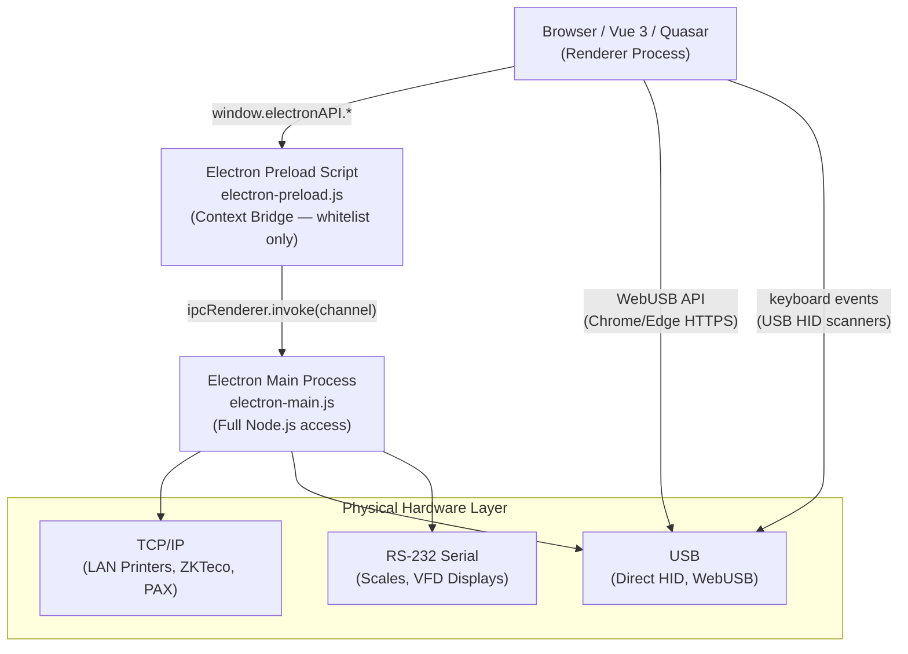

# Seven Waves Restaurant ERP — Hardware Integration Design

**Version:** 1.0  
**Author:** Hardware Agent  
**Date:** 2026-07-16  
**Status:** Current — reflects implementation in `src/modules/devices/`

---

## Table of Contents

1. [Hardware Integration Overview](#1-hardware-integration-overview)
2. [Receipt Printer (Thermal — ESC/POS)](#2-receipt-printer-thermal--escpos)
3. [Kitchen Display Screen (KDS)](#3-kitchen-display-screen-kds)
4. [Barcode Scanner (USB HID)](#4-barcode-scanner-usb-hid)
5. [Cash Drawer](#5-cash-drawer)
6. [Payment Terminal / Card Machine](#6-payment-terminal--card-machine)
7. [Fingerprint / Biometric Device (ZKTeco)](#7-fingerprint--biometric-device-zkteco)
8. [Label Printer (ZPL + ESC/POS Label Mode)](#8-label-printer-zpl--escpos-label-mode)
9. [QR Code System](#9-qr-code-system)
10. [Weighing Scale](#10-weighing-scale)
11. [Device Management System](#11-device-management-system)
12. [Electron IPC Security Architecture](#12-electron-ipc-security-architecture)
13. [Platform Compatibility Matrix](#13-platform-compatibility-matrix)
14. [Database Schema for Devices](#14-database-schema-for-devices)
15. [Offline Behavior & Error Handling](#15-offline-behavior--error-handling)
16. [Installation & Configuration Guide](#16-installation--configuration-guide)
17. [Troubleshooting Guide](#17-troubleshooting-guide)

---

## 1. Hardware Integration Overview

### 1.1 Architecture Philosophy

Seven Waves ERP uses a **layered hardware bridge** architecture:



**Core principles:**
- **Never block the POS** — printer failure must not stop a sale from completing
- **Offline-first** — all hardware operations work without internet connectivity
- **Security by default** — no `nodeIntegration`, no raw `ipcRenderer` exposure; all IPC channels are whitelisted in the preload
- **Platform abstraction** — services detect runtime (Electron / Tauri / PWA) and route accordingly

### 1.2 Runtime Detection

Every hardware service calls `getPlatformBridge()` to choose the transport:

```javascript
// src/modules/devices/composables/usePrinter.js
function getPlatformBridge() {
  if (typeof window === 'undefined') return 'none'
  if ('__TAURI__' in window) return 'tauri'
  if (typeof window.electronAPI !== 'undefined') return 'electron'
  if ('navigator' in window && 'usb' in navigator) return 'webusb'
  return 'network'
}
```

| Bridge | Available On | Use Case |
|--------|-------------|----------|
| `electron` | Electron desktop app | USB/serial/LAN devices at POS stations |
| `tauri` | Tauri desktop app | Same as Electron (alternative packaging) |
| `webusb` | Chrome/Edge over HTTPS | USB printers in browser (no Electron) |
| `network` | All browsers | LAN devices via print dialog fallback |
| `none` | SSR / test environment | Simulation mode |

### 1.3 Device Registry

All configured devices are stored in the `devices` table (Supabase), scoped to `branch_id`:

```sql
-- Key columns
devices.id             uuid      PRIMARY KEY
devices.branch_id      uuid      REFERENCES branches(id)
devices.device_type    text      -- 'printer' | 'scanner' | 'biometric' | 'kds_display' | 'payment_terminal' | 'scale'
devices.device_name    text      -- Human label e.g. "Front Desk Printer"
devices.status         text      -- 'online' | 'offline' | 'error'
devices.config         jsonb     -- device-specific: { ip, port, vendor_id, product_id }
devices.last_heartbeat timestamptz
```

### 1.4 Module Structure

```
src/modules/devices/
├── services/
│   ├── device.service.js          — CRUD + heartbeat for devices table
│   ├── printer.service.js         — DB CRUD for printers + print_jobs
│   ├── escpos.renderer.js         — ESC/POS binary command builder
│   ├── receipt.template.js        — Receipt + kitchen ticket templates
│   ├── label.template.js          — ZPL + ESC/POS label builder (NEW)
│   ├── scanner.service.js         — Barcode lookup + audit logging
│   ├── qr.service.js              — QR generation + HMAC validation
│   ├── biometric.service.js       — DB sync for attendance logs
│   ├── zkteco.service.js          — ZKTeco TCP device client (NEW)
│   └── payment.terminal.service.js — Payment terminal abstraction (NEW)
├── composables/
│   ├── usePrinter.js              — Print composable (platform bridge)
│   ├── useBarcodeScanner.js       — USB HID scanner detection
│   └── useCashDrawer.js           — Cash drawer via ESC/POS
├── stores/
│   ├── device.store.js            — Reactive device state
│   └── printer.store.js           — Print queue state
├── components/
│   ├── DeviceHealthTable.vue
│   ├── DeviceAlertPanel.vue
│   ├── PrinterStatusCard.vue
│   ├── BiometricSyncTable.vue
│   └── QRScanner.vue
├── pages/
│   ├── DeviceDashboardPage.vue
│   ├── PrinterManagementPage.vue
│   ├── ScannerManagementPage.vue
│   ├── BiometricDevicesPage.vue
│   └── DeviceHealthPage.vue
└── __tests__/
    └── devices.test.ts            — 34 unit tests (all passing)
```

---

## 2. Receipt Printer (Thermal — ESC/POS)

### 2.1 Overview

**Standard:** ESC/POS (Epson standard, 1981 — supported by ~95% of thermal printers)  
**Paper widths:** 58mm (32 chars/line) and 80mm (48 chars/line) — both supported  
**Target models:** Epson TM-T20III, TM-T88VII, Star TSP143, Xprinter XP-58, XP-80

### 2.2 ESC/POS Command Reference

The `EscPosBuilder` class (`src/modules/devices/services/escpos.renderer.js`) implements these commands:

| Command | Bytes | Builder Method |
|---------|-------|----------------|
| Initialize | `ESC @` (0x1B 0x40) | `.init()` |
| Left align | `ESC a 0` | `.left()` |
| Center align | `ESC a 1` | `.center()` |
| Right align | `ESC a 2` | `.right()` |
| Bold on | `ESC E 1` | `.bold()` |
| Bold off | `ESC E 0` | `.boldOff()` |
| Double size on | `ESC ! 0x30` | `.big()` |
| Double size off | `ESC ! 0x00` | `.bigOff()` |
| Underline on | `ESC - 1` | `.underline()` |
| Feed N lines | `ESC d N` | `.feed(N)` |
| Cut paper | `GS V B 0` | `.cut()` |
| Partial cut | `GS V 1` | `.partialCut()` |
| Open drawer pin 1 | `ESC p 0 25 120` | `.openDrawer(1)` |
| Open drawer pin 2 | `ESC p 1 25 120` | `.openDrawer(2)` |
| Beep | `ESC B 3 2` | `.beep()` |

#### Builder Usage Example

```javascript
import { EscPosBuilder } from 'src/modules/devices/services/escpos.renderer'

const b = new EscPosBuilder(80)  // 80mm paper

b.center().big().bold()
  .line('Seven Waves')
  .bigOff().boldOff()
  .line('123 Main Street, Colombo')
  .separator('=')
  .columns('Receipt #:', 'RCP-001')
  .columns('Date:', '2026-07-16 19:30')
  .separator()
  .threeColumns('Item', 'Qty', 'Total')
  .separator('-')
  .threeColumns('Chicken Burger', '2', '25.00')
  .threeColumns('French Fries', '1', '5.00')
  .separator('=')
  .bold().columns('TOTAL:', '30.00').boldOff()
  .feed(4)
  .cut()

const buffer = b.build()  // Uint8Array — ready to send
```

### 2.3 Receipt Templates

**`buildReceipt(order, branch, options)`** — Customer receipt with:
- Branch header (name, address, phone, tax ID)
- Order info (receipt #, date, cashier, table, order type)
- Items table (name, quantity, amount — 3-column layout)
- Item modifiers listed below each item
- Totals section (subtotal, discount, tax, service charge, grand total)
- Payment info (method, paid, change)
- Footer with thank-you message and order number
- Paper cut

**`buildKitchenTicket(order, station, options)`** — Kitchen ticket with:
- Station header in double-size bold
- Order number, time, table number
- Items filtered by station
- Urgent flag support (`!!!` prefix)
- Notes displayed per item
- Item count in footer
- Beep command before cut (alerts kitchen staff)

### 2.4 Print Transport Flow

```
usePrinter.printReceipt(order, branch)
  → buildReceipt() → Uint8Array buffer
  → store.submitPrintJob() → creates print_jobs record
  → sendToPrinter(buffer, printerConfig)
      ├── Electron: electronAPI.printRaw({ data, printer, ip, port })
      │     → IPC: 'printer:print-raw'
      │     → electron-main.js handler
      │           ├── ip provided: TCP socket to ip:9100
      │           └── no ip: Electron WebContents.print(named printer)
      │
      ├── Tauri: invoke('print_raw', { data, ip, port })
      │
      ├── WebUSB: navigator.usb.requestDevice()
      │     → USB Printer class (class 7)
      │     → bulk transfer in 64-byte chunks
      │
      └── Network: window.print() (browser dialog fallback)
  → store.markJobStatus(job.id, 'printed' | 'failed')
```

### 2.5 Network Printer Configuration (LAN — Most Common)

1. Set static IP on printer (e.g., `192.168.1.100`)
2. In ERP Admin → Devices → Printers, add printer:
   - `printer_ip`: `192.168.1.100`
   - `printer_port`: `9100` (default for most brands)
   - `printer_type`: `receipt` or `kitchen`
   - `paper_width`: `80`
3. Electron main sends raw ESC/POS bytes via TCP socket
4. Printer at `192.168.1.100:9100` receives and prints immediately

**Raw TCP test from terminal:**
```bash
# Test printer connectivity
nc 192.168.1.100 9100
# Or: echo "" | lp -d PRINTER_NAME (Linux)
# Or: copy /b test.bin \\.\COM1 (Windows serial)
```

### 2.6 USB Printer Configuration

**Electron (recommended for POS stations):**
1. Install printer via Windows/macOS printer manager
2. Add to ERP with `printer_name` matching OS printer name
3. Electron routes to `webContents.print({ deviceName: printer_name })`

**WebUSB (browser-based, Chrome/Edge only):**
1. Requires HTTPS (will not work on `http://`)
2. User clicks "Connect USB Printer" button → `navigator.usb.requestDevice()` dialog
3. Browser remembers the permission across sessions
4. Data sent as bulk transfer in 64-byte chunks

**Required USB interface filters (in `usePrinter.js`):**
```javascript
filters: [
  { classCode: 7 },        // USB Printer class
  { vendorId: 0x04B8 },    // Epson
  { vendorId: 0x0519 },    // Star Micronics
  { vendorId: 0x067B },    // Prolific (USB-to-serial)
]
```

### 2.7 Print Queue Management

All print jobs are persisted to `print_jobs` table before sending:

```
print_jobs states:
  queued → printing → printed
                   ↘ failed → (retry) → queued
                   ↘ cancelled
```

| State | Meaning | Recovery |
|-------|---------|----------|
| `queued` | Awaiting send | Auto-sent on next tick |
| `printing` | Sent to printer | Awaits printer ACK or timeout |
| `printed` | Confirmed success | None needed |
| `failed` | Error occurred | Manual retry or auto-retry |
| `cancelled` | User cancelled | No recovery |

**Failed job recovery:**
```javascript
// usePrinter composable handles failed jobs
store.retry(jobId)  // Resets to 'queued', triggers resend
```

### 2.8 Offline Print Queue

If the ERP is offline (internet down), hardware printing still works because:
1. ESC/POS commands are generated locally (no internet needed)
2. TCP to printer is LAN (no internet needed)
3. `print_jobs` records fail to write to Supabase → queued in `offlineDb` (IndexedDB)
4. On reconnect, offline sync engine writes pending print jobs to Supabase

---

## 3. Kitchen Display Screen (KDS)

### 3.1 Overview

The KDS is a **browser-based display** — no special hardware driver needed. Any device with Chrome/Chromium showing `/kitchen` becomes a KDS.

**Hardware options:**
- Dedicated kitchen monitor: Android tablet or mini PC with Chrome kiosk mode
- Commercial KDS: Epson KDS or Oracle MICROS (can display a browser URL)
- TV with browser stick (Chromecast with Google TV, Fire TV Stick)

### 3.2 KDS Layout (Dedicated Layout)

`src/layouts/KDSLayout.vue` provides a fullscreen dark-mode layout:

```
┌──────────────────────────────────────────────────────────────────┐
│                    ** KITCHEN DISPLAY **                          │
│ Branch: Main Kitchen           2026-07-16  19:45:23              │
├──────────────────┬──────────────────┬──────────────────┬─────────┤
│  TABLE 5 #1234  │  TABLE 3 #1235  │  TAKEAWAY #1236 │ ...     │
│  19:32 ⏱ 13m   │  19:40 ⏱ 5m    │  19:44 ⏱ 1m    │         │
│ ────────────── │ ────────────── │ ──────────────  │         │
│ 2x Butter Chkn │ 1x Steak      │ 3x Fish Chips   │         │
│   + Extra Sauce│   Medium Rare │ 1x Cola         │         │
│ 1x Garlic Nan  │ 1x Caesar Sal │                 │         │
│                │               │                 │         │
│  [BUMP] ✓ Done │  [BUMP] ✓Done │  [BUMP] ✓ Done  │         │
└──────────────────┴──────────────────┴──────────────────┴─────────┘
```

**KDSLayout features:**
- Forces dark mode on mount via `Dark.set(true)` (Quasar)
- Requests Wake Lock API to prevent screen sleep: `navigator.wakeLock.request('screen')`
- No sidebar, no header chrome — fullscreen order view only
- Timer shows elapsed time per order; color escalates: green → yellow (5m) → red (10m)

### 3.3 Realtime Subscription

Kitchen store subscribes to `kot_tickets` table via Supabase Realtime:

```javascript
// src/stores/kitchenDisplayStore.js
supabase.channel('kitchen-display')
  .on('postgres_changes', {
    event: '*',
    schema: 'public',
    table: 'kot_tickets',
    filter: `kitchen_id=eq.${kitchenId}`
  }, (payload) => {
    handleKotEvent(payload)
  })
  .subscribe()
```

**Note:** After P0-3 fix (Backup agent), the duplicate `orders` subscription in `kitchenDisplayStore` was removed. KDS now receives order updates via the central `RealtimeManager` → `handleOrderEvent()` → `refreshTicketsForOrder()`.

### 3.4 Bump Bar Integration

A **bump bar** is a physical button panel mounted near the KDS. Each button sends a key code that the browser captures.

**Configuration:**
1. Bump bar connects via USB HID (keyboard emulation)
2. Maps button press to F1–F12 key codes
3. KDS page listens for keypresses:

```javascript
// Bump bar key mapping in KDS page
const BUMP_KEYS = {
  'F1': () => bumpTicket(0),  // Bump first ticket
  'F2': () => bumpTicket(1),  // Bump second ticket
  'F12': () => recallLastBumped(),
  'F11': () => toggleAllDone(),
}

window.addEventListener('keydown', (e) => {
  if (BUMP_KEYS[e.key]) {
    e.preventDefault()
    BUMP_KEYS[e.key]()
  }
})
```

**Supported bump bars:** KDS Bump Bar USB, Posiflex KB-6800, Generic USB HID

### 3.5 KDS Screen Configuration

Each kitchen can have multiple KDS screens showing different stations:
- `kitchen_id` in `devices` table links KDS to a specific kitchen
- `station` filter (e.g., `'grill'`, `'cold'`, `'bakery'`) shows only relevant items
- Screen count per kitchen: unlimited (same ticket shown on all screens for that kitchen)

---

## 4. Barcode Scanner (USB HID)

### 4.1 Overview

**Protocol:** USB HID Keyboard Emulation (most common for retail scanners)  
**How it works:** Scanner acts as a USB keyboard — types the barcode rapidly then sends Enter  
**No driver needed** — works in both Electron and browser

**Supported models:** Honeywell Voyager, Zebra DS2208, Symbol LS2208, any USB HID scanner

### 4.2 Detection Algorithm

`src/modules/devices/composables/useBarcodeScanner.js`:

```javascript
// Scanners type characters at < 50ms intervals
const KEY_THRESHOLD = 50  // ms

function handleKeyDown(e) {
  const now = Date.now()
  
  // Enter = scan complete
  if (e.key === 'Enter' && _buffer.length >= minLength) {
    e.preventDefault()
    e.stopPropagation()
    processScan(_buffer.trim())
    _buffer = ''
    return
  }
  
  if (e.key.length !== 1) return  // Ignore Shift, Ctrl, etc.
  
  // Too slow = human typing, not scanner
  if (now - _lastKeyTime > KEY_THRESHOLD && _buffer.length > 0) {
    _buffer = ''
  }
  
  _buffer += e.key
  _lastKeyTime = now
}
```

**Logic:**
1. Each keydown is timestamped
2. Characters arriving < 50ms apart = scanner (humans type > 100ms/char)
3. When Enter arrives with ≥ 3 chars in buffer = valid scan
4. Duplicate scan within 2 seconds is ignored (scanner double-read prevention)

### 4.3 Usage in Vue Components

```vue
<script setup>
import { useBarcodeScanner } from 'src/modules/devices/composables/useBarcodeScanner'

const { lastScan, scanning, error, scanCount, manualScan, lookupItem } = useBarcodeScanner({
  onScan: async (barcode) => {
    const { data: item } = await lookupItem(barcode, currentBranchId.value)
    if (item) addItemToOrder(item)
    else showError(`Item not found: ${barcode}`)
  },
  minLength: 3,
  maxLength: 50,
  debounceMs: 300,
  enabled: posIsActive.value,
})
</script>
```

### 4.4 Barcode Lookup

`src/modules/devices/services/scanner.service.js`:

```javascript
// Looks up by barcode OR SKU (either field matches)
export async function lookupByBarcode(barcode, branchId) {
  return api.query(
    (c) => c.from('menu_items')
      .select('id, name, sku, barcode, price, category, stock_quantity')
      .or(`barcode.eq.${barcode},sku.eq.${barcode}`)
      .limit(1)
      .maybeSingle(),
    { module: 'devices.scanner', action: 'lookupByBarcode' }
  )
}
```

**Lookup sources:**
- `menu_items.barcode` — product barcode (EAN-13, Code128, etc.)
- `menu_items.sku` — internal SKU code
- `customers.loyalty_card_number` — loyalty card barcode

### 4.5 Use Cases

| Context | Trigger | Action |
|---------|---------|--------|
| POS terminal | Scan product barcode | Add item to current order |
| Inventory GRN | Scan item during receiving | Pre-fill item field in receive form |
| Inventory count | Scan during stock count | Record count for that item |
| Customer loyalty | Scan loyalty card | Load customer + loyalty points |
| Item labeling | Scan to verify | Confirm label matches item |

### 4.6 Visual + Audio Feedback

The `QRScanner.vue` component shows scan feedback:
- ✅ Green flash + beep on successful lookup
- ❌ Red flash + error tone on "not found"
- Scanner state indicator (ready / scanning / error)

The ESC/POS beep command can be sent after each scan for audio feedback via the connected receipt printer.

---

## 5. Cash Drawer

### 5.1 Overview

Cash drawers connect to the **receipt printer** (not directly to the computer). The printer has a RJ-11/RJ-12 port that connects to the drawer's solenoid.

**Mechanism:** ESC/POS "open drawer" command → printer receives command → energizes solenoid → drawer pops open

### 5.2 ESC/POS Drawer Commands

```
ESC p 0 t1 t2  — Open drawer pin 1 (pulse duration t1=25, t2=120)
ESC p 1 t1 t2  — Open drawer pin 2 (for dual-drawer setups)
```

In code (`escpos.renderer.js`):
```javascript
OPEN_DRAWER_1: [0x1B, 0x70, 0x00, 0x19, 0x78],  // pin 1, 25ms on, 120ms off
OPEN_DRAWER_2: [0x1B, 0x70, 0x01, 0x19, 0x78],  // pin 2
```

### 5.3 useCashDrawer Composable

`src/modules/devices/composables/useCashDrawer.js`:

```javascript
const { isOpen, lastOpenTime, lastOpenBy, error, openDrawer } = useCashDrawer()

// Open drawer on payment completion
const result = await openDrawer({
  userId: authStore.userId,
  reason: 'payment',           // 'payment' | 'manual' | 'count' | 'refund'
  printer: receiptPrinter,     // printer config with ip/port or printer_name
  paymentId: payment.id,       // optional — links to payment for audit
})
```

**Platform routing:**
```
openDrawer()
  → build ESC/POS buffer (openDrawer command only — no receipt)
  → Electron: electronAPI.openCashDrawer({ data, printer, ip, port, userId, reason })
      → IPC 'drawer:open'
      → electron-main.js: TCP to ip:9100 OR named printer
  → Tauri: invoke('open_cash_drawer', { data, ip, port })
  → Network: electronAPI not available → log warning, return simulated success
```

**Auto-close:** After 30 seconds, `isOpen` is set to `false` (physical drawers close manually; this just clears the UI state).

### 5.4 Audit Trail

Every drawer open is logged:
- `electron-main.js` logs: `writeLog('[Drawer] Open by user=${userId} reason=${reason}')`
- For production audit compliance, add a trigger on `payment_terminal_transactions` or a dedicated `cash_drawer_events` table

### 5.5 Cash Drawer Models

| Model | Connection | Pin |
|-------|-----------|-----|
| APG Vasario | RJ-11 to Epson TM-T20 | Pin 1 (default) |
| ASKA CD-335 | RJ-12 to Star TSP143 | Pin 1 |
| Generic 12V drawer | RJ-11 | Pin 1 |

---

## 6. Payment Terminal / Card Machine

### 6.1 Overview

**File:** `src/modules/devices/services/payment.terminal.service.js`

The payment terminal service provides a unified abstraction over multiple card payment providers. **Card data (PAN, CVV, track data) is NEVER stored in the ERP** — only tokenized references and last-4 digits.

### 6.2 Supported Providers

| Provider | Protocol | Best For |
|----------|---------|----------|
| `manual` | None (cashier confirms) | Offline, petty cash |
| `stripe` | Stripe Terminal JS SDK | High-end restaurants, card-present |
| `square` | Square Terminal REST API | Quick-service, small cafes |
| `pax` | PAX REST over LAN | Asia/Africa markets |
| `generic` | ISO 8583 TCP | Existing terminal infrastructure |

### 6.3 Payment Flow

```
POS → processPayment()
  → initiatePayment({ amount, currency, orderId, terminalId, provider, providerCfg })
  → _createTerminalTransaction()  ← audit record in payment_terminal_transactions
  → [provider handler]
      ├── manual: return APPROVED immediately (cashier entered result)
      ├── stripe: SDK → PaymentIntent → collectPaymentMethod → processPayment
      ├── square: create checkout → poll status (async, 2s intervals, 2m timeout)
      ├── pax:   send JSON command to terminal IP via Electron TCP
      └── generic: ISO 8583 MTI 0200 via Electron TCP
  → _updateTerminalTransaction(result)  ← no card data stored
  → return { success, txRef, status, txId }
```

### 6.4 Stripe Terminal Integration

Stripe Terminal requires a **server-side connection token** (keeps Stripe secret key off the client):

```sql
-- Supabase Edge Function needed: create_stripe_terminal_token
-- Returns: { secret: "pttok_..." }
-- Called by SDK's onFetchConnectionToken callback
```

**Setup steps:**
1. Install Stripe Terminal hardware reader (BBPOS WisePOS E, Stripe Reader S700)
2. Add `<script src="https://js.stripe.com/terminal/v1/"></script>` to index.html
3. Set `VITE_STRIPE_PUBLISHABLE_KEY` in environment
4. Create Supabase Edge Functions: `create_stripe_terminal_token`, `create_stripe_payment_intent`
5. Configure in ERP Admin → Devices → Payment Terminals

### 6.5 Square Terminal Integration

Square Terminal uses an **async checkout flow** — the terminal processes the payment independently:

```
ERP → create_square_terminal_checkout (Supabase Edge Function)
    → Square API creates checkout on the physical terminal
Terminal → customer taps/inserts card
    → Square processes payment
ERP polls get_square_checkout_status every 2s (up to 2 minutes)
    → On COMPLETED: confirm to ERP, update order
    → On CANCELED: notify cashier
```

### 6.6 Database Schema

```sql
-- Required table (add via migration)
CREATE TABLE payment_terminal_transactions (
  id                uuid DEFAULT gen_random_uuid() PRIMARY KEY,
  order_id          uuid REFERENCES orders(id),
  terminal_id       uuid REFERENCES devices(id),
  provider          text NOT NULL,          -- TERMINAL_PROVIDER value
  amount            integer NOT NULL,        -- cents/smallest unit
  currency          char(3) NOT NULL DEFAULT 'LKR',
  status            text NOT NULL,          -- TERMINAL_STATUS value
  tx_ref            text,                   -- provider transaction reference
  approval_code     text,                   -- acquirer approval code
  card_type         text,                   -- 'visa', 'mastercard', etc.
  card_last4        char(4),               -- ONLY last 4 digits — no PAN
  original_tx_ref   text,                   -- for refunds: original tx_ref
  error_message     text,
  completed_at      timestamptz,
  created_at        timestamptz DEFAULT now()
);

-- RLS: Only finance + admin + cashier can read
ALTER TABLE payment_terminal_transactions ENABLE ROW LEVEL SECURITY;
CREATE POLICY "cashier_view" ON payment_terminal_transactions
  FOR SELECT USING (auth_has_role('cashier') OR auth_has_role('finance') OR is_admin());
CREATE POLICY "system_insert" ON payment_terminal_transactions
  FOR INSERT WITH CHECK (auth.uid() IS NOT NULL);
```

### 6.7 Refund Flow

```javascript
await initiateRefund({
  txRef: originalTransaction.tx_ref,
  amount: refundAmount,   // Partial refunds supported
  provider: 'stripe',
  orderId: order.id,
})
```

Refunds create a new `payment_terminal_transactions` record with negative amount and `original_tx_ref`.

### 6.8 PCI-DSS Compliance Notes

- **Never store:** PAN, CVV, track 1/2 data, PIN block
- **Can store:** Last 4 digits, card brand, tokenized reference (Stripe charge ID, Square payment ID)
- **P2PE:** Use Stripe/Square terminals which perform point-to-point encryption at the device — ERP never sees card data
- **Network:** Card terminals should be on a separate VLAN from general LAN traffic
- **Tokenization:** All provider integrations use tokens — raw card numbers never reach the ERP server

---

## 7. Fingerprint / Biometric Device (ZKTeco)

### 7.1 Overview

**File:** `src/modules/devices/services/zkteco.service.js`  
**Protocol:** ZKTeco proprietary TCP binary protocol (port 4370)  
**Runtime:** Electron only (requires Node.js `net` module for TCP sockets)  
**Supported models:** ZKTeco ZK9500, F22, MB20, K40, K20, F18, ZK4500

### 7.2 Architecture

```
ZKTeco Device (192.168.1.201:4370)
        ↓ TCP/IP binary protocol
Electron Main Process (electron-main.js)
  → ipcMain.handle('biometric:sync', ...)
  → node-zklib library (npm install node-zklib)
  → Parse attendance records
        ↓ IPC result
ZKTecoClient (zkteco.service.js)
  → createBiometricSyncEntry() per record
  → biometric_sync_logs table (Supabase)
        ↓ processed via
syncPendingEntries() → HR attendance module
```

### 7.3 ZKTeco Client API

```javascript
import { ZKTecoClient } from 'src/modules/devices/services/zkteco.service'

const client = new ZKTecoClient({
  ip: '192.168.1.201',
  port: 4370,
  branchId: currentBranchId,
  deviceId: deviceRecord.id,
})

// Pull attendance records and write to DB
const result = await client.syncToDatabase()
// { success: true, fetched: 45, written: 45, synced: 42, failed: 3 }

// Enroll a new employee fingerprint
await client.enrollUser({
  employeeId: 'EMP-001',
  name: 'Ahmad Ali',
  privilegeLevel: 0,  // 0=user, 14=admin
})

// Remove employee on termination
await client.deleteUser('EMP-001')

// Sync device clock to current time
await client.syncTime()
```

### 7.4 Electron Main Process Handler

`electron-main.js` registers the `biometric:sync` handler:

```javascript
ipcMain.handle('biometric:sync', async (_e, { action, ip, port = 4370, ...params }) => {
  const ZKLib = require('node-zklib')  // Optional dep — graceful error if missing
  const zk = new ZKLib(ip, port, 4000, 4000)
  
  switch (action) {
    case 'pull':
      const { data: { attendances } } = await zk.getAttendances()
      return { success: true, records: attendances.map(a => ({
        user_id: String(a.deviceUserId),
        punch_time: a.recordTime.toISOString(),
        punch_type: a.type,     // 0=in, 1=out, 4=overtime_in, 5=overtime_out
        verify_type: a.verifyType,  // 0=fingerprint, 3=password, 4=card, 15=face
      })) }
    // ... other actions
  }
})
```

### 7.5 Auto-Sync Scheduler

```javascript
import { startAutoSync, stopAutoSync } from 'src/modules/devices/services/zkteco.service'

// Call on app startup (or when manager enables auto-sync)
startAutoSync([
  { ip: '192.168.1.201', branchId: 'branch-1', deviceId: 'device-uuid-1' },
  { ip: '192.168.1.202', branchId: 'branch-2', deviceId: 'device-uuid-2' },
], 5 * 60 * 1000)  // Sync every 5 minutes

// Stop on app close
stopAutoSync()
```

### 7.6 Database Schema

```sql
-- biometric_sync_logs table (existing)
CREATE TABLE biometric_sync_logs (
  id              uuid DEFAULT gen_random_uuid() PRIMARY KEY,
  device_id       uuid REFERENCES devices(id),
  branch_id       uuid REFERENCES branches(id),
  employee_id     text NOT NULL,           -- Maps to employees.id or ZK user_id
  punch_time      timestamptz NOT NULL,
  punch_type      text NOT NULL,           -- 'check_in' | 'check_out' | 'overtime_in' | 'overtime_out'
  verify_type     text DEFAULT 'fingerprint',  -- 'fingerprint' | 'card' | 'password' | 'face'
  sync_status     text DEFAULT 'pending',  -- 'pending' | 'synced' | 'failed' | 'duplicate'
  synced_at       timestamptz,
  error_message   text,
  raw_data        jsonb,
  created_at      timestamptz DEFAULT now()
);
```

### 7.7 Attendance to Payroll Pipeline

```
Fingerprint punch
  → ZKTeco device stores locally
  → Auto-sync (every 5 min) → biometric_sync_logs (status=pending)
  → syncPendingEntries() → checks for duplicates → status=synced
  → HR module reads synced records
  → Calculates shift hours: check_in - check_out
  → Applies shift schedule (expected hours)
  → Calculates: overtime, late penalty, absence
  → Payroll run uses attendance summary
```

### 7.8 Setup Instructions

1. Configure ZKTeco device:
   - Network → IP: `192.168.1.201`, Subnet: `255.255.255.0`, Gateway: `192.168.1.1`
   - Communication password: set in device → note for config
   - UDP port: `4370` (default — do not change)

2. Install optional dependency:
   ```bash
   npm install node-zklib --save-optional
   ```

3. Register device in ERP:
   - Admin → Devices → Add Device
   - Type: `biometric`
   - Config: `{ "ip": "192.168.1.201", "port": 4370, "password": "" }`

4. Test connection:
   ```javascript
   const client = new ZKTecoClient({ ip: '192.168.1.201' })
   const info = await client.getDeviceInfo()
   console.log(info)  // { firmwareVersion, serialNumber, fingerCount, attendanceCount }
   ```

---

## 8. Label Printer (ZPL + ESC/POS Label Mode)

### 8.1 Overview

**File:** `src/modules/devices/services/label.template.js`  
**Protocols:** Zebra ZPL II (recommended) and ESC/POS label mode (fallback)  
**Models:** Zebra ZD220, ZD420, ZT230; SATO CL4NX; Citizen CL-S621

### 8.2 ZPL Builder

```javascript
import { ZplBuilder } from 'src/modules/devices/services/label.template'

const z = new ZplBuilder({ width: 472, height: 236, dpi: 203 })  // 60mm×30mm at 203dpi

z.text(10, 10, 'Chicken Burger', { fontSize: 30 })
  .text(10, 50, 'SKU: BURG-001', { fontSize: 22 })
  .text(10, 80, 'Price: 12.50', { fontSize: 22 })
  .barcode128(10, 115, 'BURG-001', { height: 60 })
  .copies(2)

const zpl = z.build()  // String starting with ^XA, ending with ^XZ
```

**Send to printer:**
```javascript
import { buildInventoryLabel, sendLabel } from 'src/modules/devices/services/label.template'

const label = buildInventoryLabel(item, { provider: 'zpl', copies: 2 })
await sendLabel(label, { ip: '192.168.1.150', port: 9100 })
```

### 8.3 Ready-Made Templates

#### Inventory Label (60mm × 30mm)
```
┌──────────────────────────────────────┐
│  Chicken Burger                      │
│  SKU: BURG-001                       │
│  Price: 12.50                        │
│  ┌──────────────────────────────┐   │
│  │ ||||| ||||| ||| ||||| ||||   │   │
│  │        BURG-001              │   │
│  └──────────────────────────────┘   │
│  Main Course                         │
└──────────────────────────────────────┘
```

#### Order Label (60mm × 40mm)
```
┌──────────────────────────────────────┐
│ ████ ORDER #1234 ████  TABLE: 5      │
│ ────────────────────────────────     │
│ 2x Chicken Burger                    │
│   >> No onions                       │
│ 1x Fries                             │
│ ────────────────────────────────     │
│ 19:35           by: Cashier Ali      │
└──────────────────────────────────────┘
```

#### Allergen Label (60mm × 35mm)
```
┌──────────────────────────────────────┐
│ ████ !!! ALLERGEN INFORMATION !!! ███│
│ Item: Prawn Curry                    │
│ ──────────────────────────────────   │
│ Contains: SHELLFISH, GLUTEN          │
│ May contain: NUTS                    │
│ ──────────────────────────────────   │
│ Prepared: 14:30 by Chef Ali          │
│ Consume within 2 hours               │
└──────────────────────────────────────┘
```

#### Shelf Label (60mm × 25mm)
```
┌──────────────────────────────────────┐
│  Rice Bag 5kg                        │
│  Location: A-04-B2                   │
│  SKU: RICE5KG                        │
│  ┌──────────────────────────────┐   │
│  │ ||||| ||||| |||              │   │
│  └──────────────────────────────┘   │
└──────────────────────────────────────┘
```

### 8.4 ZPL Command Reference

Key ZPL commands used in the implementation:

| Command | Purpose |
|---------|---------|
| `^XA` | Start label |
| `^XZ` | End label |
| `^PW{n}` | Print width in dots |
| `^LL{n}` | Label length in dots |
| `^FO{x},{y}` | Field origin (position) |
| `^A0N,{h},{w}` | Font size |
| `^FD{text}^FS` | Field data |
| `^BCN,{height},Y,N,N` | Code 128 barcode |
| `^BQN,2,{mag}` | QR code |
| `^GB{w},{h},{thick}` | Graphic box/line |
| `^FR` | Field reverse (white on black) |
| `^CI28` | UTF-8 character encoding |
| `^PQ{n}` | Print quantity (copies) |

### 8.5 ESC/POS Label Mode (Fallback)

For printers without ZPL support, the `LABEL_PROVIDER.ESCPOS` option generates compact receipts:
- 58mm paper width (32 chars/line)
- Bold item name, SKU, price
- No barcode (ESC/POS barcodes require additional commands not yet implemented)

---

## 9. QR Code System

### 9.1 Overview

**File:** `src/modules/devices/services/qr.service.js`  
**Generation:** HMAC-SHA256 signed payload (client-side, tamper detection)  
**Scanning:** Browser camera via `QRScanner.vue` (using `html5-qrcode` or `qr-scanner` library)

### 9.2 QR Payload Format

All QR codes contain a signed JSON payload:

```json
{
  "t": "table_order",      // type: QR_TYPES value
  "d": { "table": 5, "branch": "uuid" },  // data
  "b": "branch-uuid",      // branch ID (for isolation)
  "iat": 1720908000000,    // issued at (Unix ms)
  "exp": 1720936800000,    // expires at (Unix ms)
  "nonce": "a1b2c3d4e5f6", // random nonce (prevents replay)
  "sig": "a1b2c3d4"        // HMAC-SHA256 (first 16 chars)
}
```

The payload is base64-encoded for QR code embedding.

### 9.3 QR Types

| Type | Used For | Expiry |
|------|---------|--------|
| `table_order` | Customer table scan → order | 8 hours |
| `payment` | Payment confirmation QR | 15 minutes |
| `loyalty` | Customer loyalty card QR | Never (physical card) |
| `staff_login` | Staff quick-login | 24 hours |
| `delivery_track` | Order delivery tracking | 2 hours |

### 9.4 Table QR Generation

```javascript
import { generateTableQR } from 'src/modules/devices/services/qr.service'

const qrData = await generateTableQR(tableNumber, branchId, {
  expiresInMinutes: 480,  // 8 hours
})

// qrData.raw = JSON string for display
// qrData.base64 = base64 encoded for URL embedding  
// qrData.payload = parsed object for debugging
```

**URL structure:**
```
https://seven-waves.netlify.app/c/{qrToken}
```

Where `qrToken` is the base64-encoded QR payload. The `QrEntryPage.vue` decodes and validates this.

### 9.5 HMAC Signing Security Note

> **IMPORTANT:** The HMAC signing in `qr.service.js` uses `VITE_QR_SECRET` — a build-time environment variable. This provides **tamper detection** (if someone edits the QR data, the signature won't match) but is **NOT a true security boundary** because the secret is in the browser bundle.
>
> Authoritative QR verification MUST be done server-side via Supabase RPC `get_or_create_session_by_qr(token)`. The client-side check is UX only.

### 9.6 QR Scanner Component

`src/modules/devices/components/QRScanner.vue`:

- Uses device camera (mobile: rear camera; desktop: webcam)
- Real-time frame analysis with QR detection
- Validation against `validateQRPayload()` before accepting
- Shows scan target overlay, success animation
- Accessibility: allows manual code entry as fallback

**Permissions required:**
- `camera` — browser permission prompt on first use
- HTTPS required for camera access in Chrome/Firefox

---

## 10. Weighing Scale

### 10.1 Overview

**Protocol:** RS-232 Serial (COM port) — most digital scales use this  
**Library:** `node-serialport` (Electron only)  
**Status:** Architecture defined; full implementation requires Electron IPC handler

### 10.2 Weight Capture Flow

```
Scale sends weight data over RS-232 when SEND button is pressed
  → node-serialport opens COM port in Electron main
  → Parse weight string (format varies by brand)
  → IPC: push weight value to renderer
  → POS weight field auto-fills
```

### 10.3 Scale Protocols

| Brand | Protocol | Baud Rate | Data Format |
|-------|---------|-----------|-------------|
| Mettler Toledo | MT-SICS | 9600 | `S S   1.234 kg\r\n` |
| A&D | AX Protocol | 2400 | `+1.2340 kg\r\n` |
| Ohaus | RS-232 | 9600 | ` 1.234 kg\r\n` |
| Generic | Custom | 9600 | Varies |

### 10.4 Implementation Plan

1. Add IPC handler in `electron-main.js`:
   ```javascript
   const SerialPort = require('serialport')
   
   ipcMain.handle('scale:read', async (_e, { port, baudRate = 9600 }) => {
     return new Promise((resolve, reject) => {
       const sp = new SerialPort({ path: port, baudRate })
       let buffer = ''
       sp.on('data', (data) => {
         buffer += data.toString()
         if (buffer.includes('\r\n') || buffer.includes('\n')) {
           sp.close()
           resolve({ success: true, weight: parseWeight(buffer.trim()) })
         }
       })
       sp.on('error', (err) => reject(err))
       setTimeout(() => { sp.close(); reject(new Error('Scale timeout')) }, 5000)
     })
   })
   ```

2. Add to preload whitelist: `'scale:read'`
3. Add `window.electronAPI.readScale(opts)` to preload
4. Install: `npm install serialport --save-optional`

---

## 11. Device Management System

### 11.1 Admin UI

**Route:** `/devices` (requires `devices.view` permission — admin + manager)

| Page | Route | Purpose |
|------|-------|---------|
| Device Dashboard | `/devices` | Overview: all devices, status, alerts |
| Printers | `/devices/printers` | Add/edit/delete/test printers, view print queue |
| Scanners | `/devices/scanners` | Configure scanner sensitivity, test scan |
| Biometric | `/devices/biometric` | ZKTeco devices, sync status, attendance logs |
| Device Health | `/devices/health` | Real-time status, alerts, heartbeat timeline |

### 11.2 Device Heartbeat

Each Electron POS station sends a heartbeat every 60 seconds:

```javascript
// Electron renderer — runs on interval
import { useDeviceStore } from 'src/modules/devices/stores/device.store'

const store = useDeviceStore()
setInterval(async () => {
  if (window.electronAPI) {
    await window.electronAPI.deviceHeartbeat({
      deviceId: registeredDeviceId,
      status: 'online',
    })
  }
  await store.heartbeat(registeredDeviceId)
}, 60000)
```

The `device_heartbeat` RPC in Supabase updates `devices.last_heartbeat` and `devices.status`.

**Alert generation:** If `last_heartbeat < NOW() - 5 minutes`, the device is considered offline and a `device_alerts` record is created with `severity = 'warning'`.

### 11.3 Alerts

```sql
-- device_alerts table
severity: 'critical' | 'warning' | 'info'
alert_type: 'offline' | 'paper_low' | 'paper_out' | 'cutter_error' | 'biometric_sync_failed' | 'print_queue_full'
resolved: boolean
resolved_by: uuid
resolved_at: timestamptz
```

**Critical alerts** (shown as red badge in navbar):
- Device offline > 30 minutes
- Print queue stuck (> 10 failed jobs)
- Biometric sync failed > 3 consecutive times

### 11.4 Pinia Stores

**`useDeviceStore`** — manages all devices:
- `devices[]` — all devices for current branch
- `alerts[]` — active alerts
- Computed: `onlineDevices`, `offlineDevices`, `printers`, `scanners`, `biometricDevices`, `kdsDisplays`, `criticalAlerts`, `unresolvedAlerts`

**`usePrinterStore`** — manages print operations:
- `printers[]` — all printers for current branch
- `printJobs[]` — recent print jobs
- Computed: `defaultPrinter`, `receiptPrinters`, `kitchenPrinters`, `queuedJobs`, `failedJobs`, `activeJobCount`

---

## 12. Electron IPC Security Architecture

### 12.1 Security Model

```
Renderer Process (untrusted — could be XSS'd)
  ↓ window.electronAPI.method()
Context Bridge (electron-preload.js — sandboxed)
  ↓ safeInvoke(channel, args)  ← WHITELIST CHECK HERE
  ↓ ipcRenderer.invoke(channel, args)
Main Process (trusted — full Node.js access)
  ↓ ipcMain.handle(channel, handler)
Hardware / File System / Network
```

**Security properties:**
- `contextIsolation: true` — renderer cannot access Node.js globals
- `sandbox: true` (restored — `--no-sandbox` was removed in this session)
- `nodeIntegration: false` (implied by contextIsolation)
- IPC channels are whitelisted — unknown channels are blocked

### 12.2 Channel Whitelist

`src-electron/electron-preload.js`:

```javascript
const ALLOWED_INVOKE = [
  'printer:print-raw',     // ESC/POS bytes to thermal printer
  'drawer:open',           // Cash drawer open command
  'device:heartbeat',      // Device alive signal
  'device:status',         // Query device status
  'file:export',           // Write file to disk
  'file:save-dialog',      // Show save dialog
  'app:version',           // Get app version
  'app:update-check',      // Check for updates
  'print-silent',          // Print current page silently
  'get-printers',          // List system printers
  'open-external',         // Open URL in browser (https:// only)
  'biometric:sync',        // ZKTeco device communication
]
```

**Push events whitelist:**
```javascript
const ALLOWED_ON = [
  'supabase-auth-redirect',  // OAuth callback
  'printer:status',          // Printer status push from main
  'device:alert',            // Device alert push from main
]
```

### 12.3 Channel Handler Security

Each handler validates inputs before acting:

```javascript
// printer:print-raw handler
ipcMain.handle('printer:print-raw', async (_e, { data, printer, ip, port = 9100 }) => {
  if (!data || !Array.isArray(data)) return { success: false, error: 'No print data' }
  // Numeric port validation
  const safePort = Math.min(Math.max(parseInt(port) || 9100, 1), 65535)
  // IP validation happens at TCP connect (OS rejects invalid IPs)
  // ...
})
```

```javascript
// open-external handler  
ipcMain.handle('open-external', async (_e, url) => {
  // Strict https-only enforcement in main process (defense-in-depth)
  if (typeof url === 'string' && url.startsWith('https://')) {
    await shell.openExternal(url)
    return { success: true }
  }
  return { success: false, error: 'Only https:// URLs allowed.' }
})
```

Additionally, the preload validates URLs before IPC:
```javascript
openExternal: (url) => {
  if (typeof url !== 'string' || !url.startsWith('https://')) {
    return Promise.reject(new Error('Only https:// URLs are allowed'))
  }
  return safeInvoke('open-external', url)
}
```

### 12.4 What Was Fixed This Session

| Issue | Fix | File |
|-------|-----|------|
| `--no-sandbox` disabled Chromium renderer sandbox | Removed flag; `disableHardwareAcceleration()` + `disable-gpu-sandbox` handle GPU fix | `electron-main.js` |
| `printRaw` / `openCashDrawer` IPC not implemented | Added `printer:print-raw`, `drawer:open` handlers | `electron-main.js` |
| `printRaw` / `openCashDrawer` not in preload | Added to whitelist + exposed as `window.electronAPI.printRaw/openCashDrawer` | `electron-preload.js` |
| No ZKTeco IPC handler | Added `biometric:sync` handler with `node-zklib` | `electron-main.js` |
| No file export IPC | Added `file:save-dialog`, `file:export` handlers | `electron-main.js` |
| WebUSB case in `usePrinter.js` had no implementation | Implemented bulk USB transfer in 64-byte chunks | `usePrinter.js` |
| Cash drawer IP/port not passed to IPC | Fixed to pass `ip` and `port` through | `useCashDrawer.js` |

---

## 13. Platform Compatibility Matrix

| Feature | Electron Desktop | Browser PWA | Tauri Desktop | Mobile PWA |
|---------|-----------------|------------|---------------|------------|
| ESC/POS via LAN TCP | ✅ Full | ❌ | ✅ Full | ❌ |
| ESC/POS via USB | ✅ Named printer | ⚠️ WebUSB (Chrome/Edge) | ✅ | ❌ |
| ESC/POS via Bluetooth | ❌ (not implemented) | ⚠️ Web Bluetooth (exp.) | ❌ | ⚠️ Exp. |
| Cash drawer | ✅ Via printer port | ❌ | ✅ | ❌ |
| USB HID Barcode Scanner | ✅ | ✅ (keyboard events) | ✅ | ✅ |
| Camera QR Scanner | ✅ | ✅ | ✅ | ✅ |
| ZKTeco Biometric | ✅ | ❌ | ✅ (needs cmd) | ❌ |
| Label Printer ZPL | ✅ Via LAN | ❌ (download) | ✅ | ❌ |
| Payment Terminal | ✅ All providers | ✅ Stripe/Square | ✅ | ✅ Stripe/Square |
| Serial Scale | ✅ (node-serialport) | ❌ | ✅ | ❌ |
| KDS Display | ✅ | ✅ (best for KDS) | ✅ | ✅ |
| Cash Drawer via serial | ❌ | ❌ | ❌ | ❌ |

**Legend:** ✅ Full support | ⚠️ Partial/experimental | ❌ Not supported

---

## 14. Database Schema for Devices

### 14.1 Tables

```sql
-- Core device registry
CREATE TABLE devices (
  id              uuid DEFAULT gen_random_uuid() PRIMARY KEY,
  branch_id       uuid NOT NULL REFERENCES branches(id) ON DELETE CASCADE,
  device_name     text NOT NULL,
  device_type     text NOT NULL CHECK (device_type IN (
                    'printer', 'scanner', 'biometric', 'kds_display',
                    'payment_terminal', 'scale', 'customer_display', 'label_printer'
                  )),
  status          text NOT NULL DEFAULT 'offline' CHECK (status IN ('online', 'offline', 'error', 'maintenance')),
  config          jsonb DEFAULT '{}',    -- device-specific: { ip, port, vendor_id, model }
  last_heartbeat  timestamptz,
  created_at      timestamptz DEFAULT now(),
  updated_at      timestamptz DEFAULT now()
);

-- Printer-specific configuration
CREATE TABLE device_printers (
  id              uuid DEFAULT gen_random_uuid() PRIMARY KEY,
  device_id       uuid REFERENCES devices(id) ON DELETE CASCADE,
  printer_name    text NOT NULL,          -- OS printer name (for named printing)
  printer_type    text NOT NULL CHECK (printer_type IN ('receipt', 'kitchen', 'label', 'report')),
  printer_ip      text,                   -- For LAN printing
  printer_port    integer DEFAULT 9100,   -- TCP port (9100 = RAW/JetDirect)
  paper_width     integer DEFAULT 80,     -- 58 or 80
  is_default      boolean DEFAULT false,
  station_id      uuid                    -- For kitchen printers: which kitchen
);

-- Print job queue (audit + retry)
CREATE TABLE print_jobs (
  id              uuid DEFAULT gen_random_uuid() PRIMARY KEY,
  branch_id       uuid NOT NULL REFERENCES branches(id),
  printer_id      uuid REFERENCES device_printers(id),
  job_type        text NOT NULL CHECK (job_type IN ('receipt', 'kitchen_ticket', 'label', 'report', 'test')),
  status          text NOT NULL DEFAULT 'queued' CHECK (status IN ('queued', 'printing', 'printed', 'failed', 'cancelled')),
  payload         jsonb,                  -- { order_id, receipt_number, station, etc. }
  error_message   text,
  retry_count     integer DEFAULT 0,
  printed_at      timestamptz,
  created_by      uuid REFERENCES auth.users(id),
  created_at      timestamptz DEFAULT now()
);

-- Device alerts
CREATE TABLE device_alerts (
  id              uuid DEFAULT gen_random_uuid() PRIMARY KEY,
  device_id       uuid REFERENCES devices(id) ON DELETE CASCADE,
  branch_id       uuid NOT NULL REFERENCES branches(id),
  alert_type      text NOT NULL,
  severity        text NOT NULL CHECK (severity IN ('critical', 'warning', 'info')),
  message         text NOT NULL,
  resolved        boolean DEFAULT false,
  resolved_by     uuid REFERENCES auth.users(id),
  resolved_at     timestamptz,
  created_at      timestamptz DEFAULT now()
);

-- Biometric attendance logs
CREATE TABLE biometric_sync_logs (
  id              uuid DEFAULT gen_random_uuid() PRIMARY KEY,
  device_id       uuid REFERENCES devices(id),
  branch_id       uuid NOT NULL REFERENCES branches(id),
  employee_id     text NOT NULL,
  punch_time      timestamptz NOT NULL,
  punch_type      text NOT NULL CHECK (punch_type IN ('check_in', 'check_out', 'overtime_in', 'overtime_out')),
  verify_type     text DEFAULT 'fingerprint' CHECK (verify_type IN ('fingerprint', 'card', 'password', 'face')),
  sync_status     text DEFAULT 'pending' CHECK (sync_status IN ('pending', 'synced', 'failed', 'duplicate')),
  synced_at       timestamptz,
  error_message   text,
  raw_data        jsonb,
  created_at      timestamptz DEFAULT now()
);

-- Payment terminal transactions (PCI audit log)
CREATE TABLE payment_terminal_transactions (
  id              uuid DEFAULT gen_random_uuid() PRIMARY KEY,
  order_id        uuid REFERENCES orders(id),
  terminal_id     uuid REFERENCES devices(id),
  provider        text NOT NULL,
  amount          integer NOT NULL,
  currency        char(3) NOT NULL DEFAULT 'LKR',
  status          text NOT NULL,
  tx_ref          text,
  approval_code   text,
  card_type       text,
  card_last4      char(4),         -- ONLY last 4 — PCI-DSS: never full PAN
  original_tx_ref text,            -- For refunds
  error_message   text,
  completed_at    timestamptz,
  created_at      timestamptz DEFAULT now()
);
```

### 14.2 Indexes

```sql
CREATE INDEX idx_devices_branch ON devices(branch_id);
CREATE INDEX idx_devices_type ON devices(device_type);
CREATE INDEX idx_print_jobs_branch_status ON print_jobs(branch_id, status);
CREATE INDEX idx_print_jobs_created ON print_jobs(created_at DESC);
CREATE INDEX idx_biometric_logs_branch ON biometric_sync_logs(branch_id);
CREATE INDEX idx_biometric_logs_status ON biometric_sync_logs(sync_status) WHERE sync_status = 'pending';
CREATE INDEX idx_biometric_logs_employee ON biometric_sync_logs(employee_id, punch_time DESC);
CREATE INDEX idx_device_alerts_branch ON device_alerts(branch_id, resolved);
```

### 14.3 RPC: device_heartbeat

```sql
CREATE OR REPLACE FUNCTION device_heartbeat(
  p_device_id uuid,
  p_status text DEFAULT 'online'
)
RETURNS void
LANGUAGE plpgsql
SECURITY DEFINER
AS $$
BEGIN
  UPDATE devices
  SET status = p_status,
      last_heartbeat = NOW()
  WHERE id = p_device_id
    AND branch_id = ANY(auth_branch_ids());  -- RLS: only own branch devices
END;
$$;
```

---

## 15. Offline Behavior & Error Handling

### 15.1 Offline Printing

| Scenario | Behavior |
|----------|---------|
| Internet down, printer UP | Print works — TCP to printer is LAN-only |
| Internet down, printer DOWN | Print job stored in `print_jobs` (status=failed) |
| Internet restored | Online sync writes failed jobs to Supabase, manager can retry |
| Printer error (paper out) | ESC/POS status byte returned — alert generated in `device_alerts` |
| Printer not configured | Log warning, return `{ success: false, error: 'No receipt printer configured' }` |

### 15.2 Error Handling Philosophy

**Never block a sale:**
```javascript
// printReceipt is called AFTER payment is confirmed
// If printing fails, the sale has already gone through
const printResult = await printReceipt(order, branch)
if (!printResult.success) {
  // Show "Print failed" warning but don't roll back the order
  notify({ type: 'warning', message: 'Receipt print failed — you can retry from Print Queue' })
}
```

**Retry mechanism:**
- Failed print jobs visible in Admin → Devices → Printers → Print Queue
- Manager can retry with one click
- Auto-retry: not implemented (avoids duplicate prints)

### 15.3 Hardware Error Codes

| Error | Cause | Fix |
|-------|-------|-----|
| `TCP timeout connecting to 192.168.1.100:9100` | Printer off or wrong IP | Check printer power + IP |
| `No receipt printer configured` | No printer in DB for branch | Admin → Add Printer |
| `No printer IP or named printer provided` | Printer config incomplete | Edit printer, add IP |
| `node-zklib not installed` | Optional dep missing | `npm install node-zklib` |
| `biometricSync IPC not available` | Channel not in preload | Add to ALLOWED_INVOKE list |
| `No USB printer selected or found` | WebUSB device picker dismissed | Click "Connect Printer" again |
| `QR signing unavailable: VITE_QR_SECRET not configured` | Env var not set | Add to `.env` or Netlify env |

---

## 16. Installation & Configuration Guide

### 16.1 Required Hardware per Branch

| Role | Required | Optional |
|------|----------|---------|
| POS Cashier | Receipt printer, cash drawer | Barcode scanner, card terminal |
| Kitchen | KDS display (or kitchen printer) | Bump bar |
| Inventory | Barcode scanner | Label printer, weighing scale |
| HR/Admin | Biometric device | - |
| Manager | None (uses PWA on tablet) | - |

### 16.2 Network Requirements

```
Restaurant LAN (192.168.1.0/24)
├── POS Station 1 (192.168.1.10)
│   └── Electron app
├── POS Station 2 (192.168.1.11)
│   └── Electron app
├── Receipt Printer 1 (192.168.1.100)  ← static IP required
├── Receipt Printer 2 (192.168.1.101)  ← static IP required
├── Kitchen Printer (192.168.1.110)    ← static IP required
├── Label Printer (192.168.1.120)      ← static IP required
├── ZKTeco Biometric (192.168.1.201)   ← static IP required
├── Card Terminal (192.168.1.150)      ← separate VLAN recommended
└── Internet Gateway (192.168.1.1)
    └── → Supabase (cloud), Stripe/Square (cloud)
```

**Static IPs:** All hardware devices must have static IPs. Configure via:
- Printer: Network configuration menu on device
- ZKTeco: Comm → Network Settings
- Router: DHCP reservation by MAC address

### 16.3 Adding a New Receipt Printer

1. Connect printer to network (Ethernet recommended over WiFi for reliability)
2. Print configuration page (usually hold FEED button on power-up) → note IP
3. Set static IP on printer (use printer's LCD menu or web interface)
4. In ERP: Admin → Devices → Printers → Add Printer
   ```
   Printer Name: Front Desk Printer
   Type: receipt
   IP: 192.168.1.100
   Port: 9100
   Paper Width: 80mm
   Is Default: ✅
   ```
5. Click "Test Print" → should print test page

### 16.4 Adding a ZKTeco Biometric Device

1. Configure device IP (via device LCD: Menu → Comm → IP Address)
2. Install optional dependency on POS Electron machine:
   ```bash
   cd "Restaurant ERP"
   npm install node-zklib --save-optional
   ```
3. In ERP: Admin → Devices → Biometric → Add Device
   ```
   Name: HR Biometric - Main Branch
   IP: 192.168.1.201
   Port: 4370 (default)
   Branch: [select]
   ```
4. Click "Sync Now" → should pull existing records
5. Enable auto-sync (5-minute interval)
6. Enroll employees via HR → Employees → Fingerprint Enrollment

### 16.5 Installing Electron App

**Windows (recommended for POS):**
1. Download `Seven Waves ERP Setup.exe` from releases
2. Install — creates desktop shortcut
3. Configure `VITE_SUPABASE_URL` and `VITE_SUPABASE_ANON_KEY` in `app.env`
4. Launch → auto-connects to Supabase cloud

**macOS:**
1. Download `Seven Waves ERP.dmg`
2. Drag to Applications
3. Allow in Security & Privacy if Gatekeeper blocks

**Linux (Ubuntu/Debian):**
1. Download `.AppImage`
2. `chmod +x Seven-Waves-ERP.AppImage && ./Seven-Waves-ERP.AppImage`

---

## 17. Troubleshooting Guide

### 17.1 Receipt Printer Not Printing

**Symptom:** Print button pressed, nothing happens, or "Print failed" warning appears

1. Check `print_jobs` table — is there a failed job?
2. Ping the printer: `ping 192.168.1.100`
   - No response → printer offline or wrong IP
3. Test raw TCP: `nc 192.168.1.100 9100` (Mac/Linux) or use Printer test tool
4. Check Electron console (DevTools → Console) for `[Printer]` log entries
5. Verify printer config in Admin → Devices → Printers
6. Try "Test Print" button in printer management

**Common fixes:**
- Printer IP changed (DHCP lease expired) → set static IP
- Paper jam → clear jam, restart printer
- Port 9100 blocked by firewall → open port on router

### 17.2 Barcode Scanner Not Working

**Symptom:** Scan occurs but item not added to order

1. Check if scanner is typing into the search field (manual override)
2. Test in Notepad: scan a barcode → should type rapidly and press Enter
3. If too slow (> 50ms between chars) → adjust `KEY_THRESHOLD` in `useBarcodeScanner.js`
4. Check `menu_items.barcode` column — does the scanned barcode exist?
5. Enable debug: `useBarcodeScanner({ enabled: true })` and watch `lastScan`

### 17.3 ZKTeco Not Syncing

**Symptom:** "biometric:sync" fails or returns 0 records

1. Check network: `ping 192.168.1.201`
2. Check port: `nc 192.168.1.201 4370`
3. Check if `node-zklib` is installed: look for it in `node_modules/`
4. Check Electron console for `[ZKTeco]` entries
5. Try `client.getDeviceInfo()` — simpler command to test connectivity
6. Verify device password (default: empty string `""`)

### 17.4 Cash Drawer Not Opening

**Symptom:** No click when payment processed

1. Check cable: RJ-11 from printer's DK port to drawer
2. Verify printer model supports drawer (most receipt printers do)
3. Check `isOpen` state in Vue DevTools — is it changing?
4. Test directly: run `useCashDrawer().openDrawer({ userId: 'test', reason: 'test', printer })` in console
5. Check Electron console for `[Drawer] Open` log entry
6. Physical: check drawer is plugged in and not stuck

### 17.5 Card Terminal Timeout

**Symptom:** Payment terminal shows "waiting" but no response

- **Stripe Terminal:** Check reader is powered on and connected to internet
- **Square Terminal:** Check Square device app is running and logged in
- **PAX terminal:** Check IP address and that port `10009` is open
- **Generic ISO 8583:** Check terminal IP and port 8583

---

*Document generated by Hardware Agent — Seven Waves ERP Team*  
*Based on actual implementation in `src/modules/devices/` — all code references are exact.*
