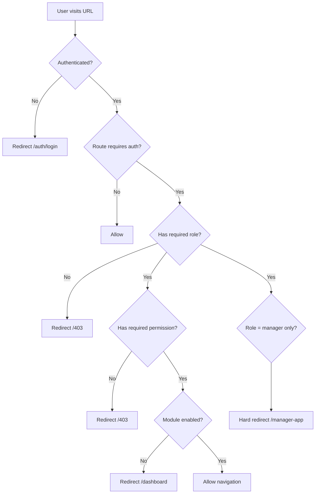
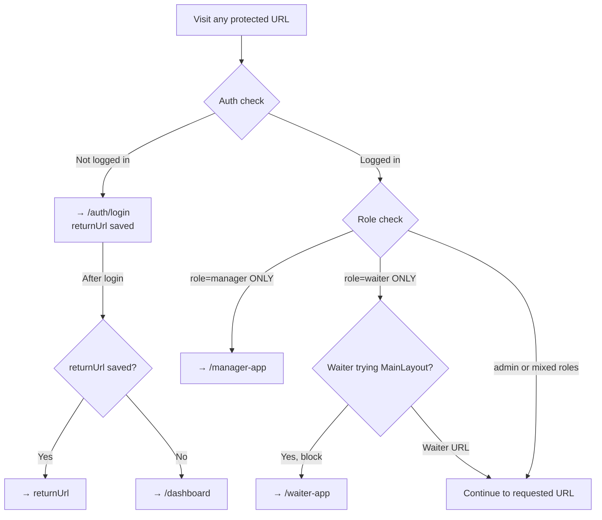

# Navigation Flow — Seven Waves Restaurant ERP

---

## 1. Auth Guard Logic



---

## 2. Admin Navigation Tree

```mermaid
flowchart LR
    Auth[/auth/login] --> Dashboard[/dashboard]
    Dashboard --> MAIN[MAIN section]
    Dashboard --> OPS[OPERATIONS section]
    Dashboard --> INV[INVENTORY section]
    Dashboard --> FIN[FINANCE section]
    Dashboard --> HR[HR section]
    Dashboard --> REP[REPORTS section]
    Dashboard --> SYS[SYSTEM section]

    MAIN --> dashboard[/dashboard]
    MAIN --> reports[/reports]
    MAIN --> loyalty[/loyalty]

    OPS --> pos[/pos]
    OPS --> kitchen[/kitchen]
    OPS --> cashier[/cashier]
    OPS --> orders[/orders]
    OPS --> tables[/admin/tables]
    OPS --> waiter[/waiter]
    OPS --> reservations[/website-orders/reservations]
    OPS --> delivery[/delivery-app admin view]

    INV --> inventory[/inventory?tab=dashboard]
    INV --> items[/inventory?tab=items]
    INV --> stock[/inventory?tab=stock-levels]
    INV --> documents[/inventory?tab=documents]
    INV --> recipes[/inventory?tab=recipes]
    INV --> suppliers[/inventory?tab=suppliers]

    FIN --> finance[/finance]
    FIN --> expenses[/finance/expenses]
    FIN --> payroll_fin[/finance/payroll]
    FIN --> tax[/finance/tax]
    FIN --> receivables[/finance/receivables]

    HR --> employees[/hr/employees]
    HR --> attendance[/hr/attendance]
    HR --> shifts[/hr/shifts]
    HR --> payroll_hr[/hr/payroll]
    HR --> performance[/hr/performance]
    HR --> leaves[/hr/leaves]

    REP --> sales_rep[/reports/sales]
    REP --> inventory_rep[/reports/stock-on-hand]
    REP --> kitchen_rep[/reports/kitchen-orders]
    REP --> hr_rep[/reports/staff-sales]

    SYS --> system[/system]
    SYS --> roles[/admin/roles]
    SYS --> printers[/admin/printers]
    SYS --> profile[/profile]
```

---

## 3. Manager Navigation Tree

```mermaid
flowchart TD
    Login[/auth/login] -->|role=manager only| ManagerApp[/manager-app]
    Login -->|role=manager + other roles| MainERP[MainLayout dashboard]

    ManagerApp --> floor[/manager-app/floor - Floor Overview]
    ManagerApp --> alerts[/manager-app/alerts - Alerts]
    ManagerApp --> orders[/manager-app/orders - Order List]
    ManagerApp --> reports[/reports via MainLayout link]
    ManagerApp --> settings[via MainLayout if has admin role]
```

---

## 4. Waiter PWA Navigation

```mermaid
flowchart TD
    Login[/auth/login] -->|waiter role| WaiterApp[/waiter-app - Home]
    
    WaiterApp --> WHome[WaiterHomePage - Leaderboard + Stats]
    WaiterApp --> WPOS[/waiter-app/pos - POS for new order]
    WaiterApp --> WTables[/waiter-app/tables - Table Status]
    WaiterApp --> WInbox[/waiter-app/inbox - Shift Inbox]
    WaiterApp --> WOrders[/waiter-app/orders - My Orders]
    
    WInbox -->|Accept order| AcceptFlow[accept_order_as_waiter RPC]
    AcceptFlow --> WOrders

    WTables -->|Tap table| TableDetail[Table Detail + Orders]
    
    WaiterApp --> WNotifs[/waiter-app/notifs - Notifications]
    WaiterApp --> WReady[/waiter-app/ready-alerts - Kitchen Ready Alerts]
    WaiterApp --> WProfile[/waiter-app/profile - My Profile]

    Guard{Off shift?} -->|Yes, block| WHome
    Guard -->|No| AllRoutes[All routes accessible]
```

---

## 5. Cashier Navigation

```mermaid
flowchart TD
    Login[/auth/login] -->|cashier role| Cashier[/cashier - Cashier Station]
    
    Cashier --> BillingQueue[BillingQueue sidebar - Ready orders]
    Cashier --> BillDialog[BillDialog - Invoice view]
    BillDialog --> PaymentFlow[Payment processing]
    PaymentFlow -->|Paid| PrintReceipt[Print receipt / WhatsApp]
    
    Cashier --> POS[/pos - also accessible]
    POS -->|Quick Pay| QuickPayFlow[process_cashier_invoice RPC]
```

---

## 6. Kitchen Staff Navigation

```mermaid
flowchart TD
    Login[/auth/login] -->|kitchen role| KDS[/kitchen - Kitchen Display]
    
    KDS --> NewTickets[New KOT tickets column]
    KDS --> InProgress[In Progress column]
    KDS --> Ready[Ready column]
    
    NewTickets -->|Start| InProgress
    InProgress -->|Mark Ready| Ready
    Ready -->|Notifies waiter| WaiterReadyAlert[Waiter gets alert]
```

---

## 7. Delivery Rider Navigation

```mermaid
flowchart TD
    Login[/auth/login] -->|delivery role| DeliveryHome[/delivery-app - Home]
    
    DeliveryHome --> AssignedDeliveries[List of assigned deliveries]
    AssignedDeliveries -->|Accept| ActiveDelivery[/delivery-app/active]
    ActiveDelivery --> MapView[GoogleMapTracker live navigation]
    MapView -->|Delivered| DeliveryHistory[/delivery-app/history]
    
    DeliveryHome --> History[/delivery-app/history]
```

---

## 8. Customer (QR / Online) Navigation

```mermaid
flowchart TD
    QR[Customer scans QR code] --> QrEntry[/c/:qrToken - QrEntryPage]
    QrEntry -->|RPC get_or_create_session| CustomerAuth[/customer/auth - Register/Login]
    CustomerAuth -->|Skip or logged in| TouchMenu[/touch - MenuBookTablet]
    
    Online[Customer visits online URL] --> CustomerMenu[/menu - CustomerMenuPage]
    
    TouchMenu --> BrowseMenu[Browse categories and items]
    BrowseMenu -->|Add to cart| Cart[MenuCartDrawer]
    Cart -->|Place Order| OrderConfirm[Order submitted toast]
    OrderConfirm --> TrackOrder[/touch - OrderProgressDrawer]
    
    CustomerMenu -->|Track| OrderTracking[/order-tracking - OrderTrackingPage]
```

---

## 9. Deep Link Map (URL → Screen → Required Role)

| URL | Screen | Required Roles | Auth Required |
|-----|--------|---------------|---------------|
| `/auth/login` | Login | — | No |
| `/dashboard` | Admin Dashboard | All | Yes |
| `/pos` | Point of Sale | cashier, waiter, admin | Yes |
| `/kitchen` | Kitchen Display | kitchen, admin | Yes |
| `/cashier` | Cashier Station | cashier, admin | Yes |
| `/orders` | Orders List | All staff | Yes |
| `/waiter` | Waiter Dashboard | waiter, admin | Yes |
| `/inventory` | Inventory | inventory, admin, manager | Yes |
| `/procurement` | Procurement | procurement, admin | Yes |
| `/finance` | Finance | finance, admin | Yes |
| `/hr` | HR | hr, admin | Yes |
| `/reports/*` | Reports | admin, manager, finance | Yes |
| `/admin/roles` | Role Management | admin | Yes |
| `/admin/printers` | Printer Config | admin | Yes |
| `/system` | System Dashboard | admin | Yes |
| `/profile` | User Profile | All | Yes |
| `/waiter-app` | Waiter PWA | waiter, admin, manager | Yes |
| `/waiter-app/inbox` | Shift Inbox | waiter, admin, manager | Yes |
| `/manager-app` | Manager PWA | manager, admin | Yes |
| `/delivery-app` | Delivery PWA | delivery, admin | Yes |
| `/touch` | Customer Kiosk | — (session token) | No (session) |
| `/menu` | Online Menu | — | No |
| `/c/:token` | QR Entry | — | No |
| `/customer/auth` | Customer Auth | — | No |
| `/403` | Forbidden | — | No |
| `/404` | Not Found | — | No |

---

## 10. Auth Redirect Rules



---

## 11. Error Page Navigation

| Error | Route | Trigger |
|-------|-------|---------|
| 404 Not Found | `/404` | Unmatched route — `ErrorNotFound.vue` |
| 403 Forbidden | (inline message or redirect) | Failed role/permission check |
| Session Expired | `/auth/login` | 30-min inactivity timer or Supabase 401 |
| Offline | (banner overlay) | `navigator.onLine = false` |

---

## 12. Section-to-Route Mapping (MainLayout tab nav)

The `sectionForPath()` function in `src/layouts/MainLayout.vue:408-427` controls which top-nav tab is active for each URL:

| Section Tab | Route Prefixes |
|------------|----------------|
| MAIN | `/dashboard`, `/loyalty` |
| OPERATIONS | `/pos`, `/kitchen`, `/cashier`, `/orders`, `/waiter`, `/operations` |
| INVENTORY | `/inventory`, `/procurement` (via sidebar, not top-nav) |
| PROCUREMENT | `/procurement` |
| FINANCE | `/finance` |
| REPORTS | `/reports` |
| HR | `/hr` |
| SYSTEM | `/admin`, `/system`, `/profile` |
| WEBSITE | `/website-orders`, `/website` |
